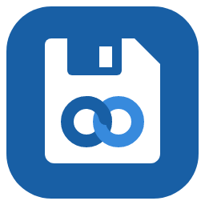
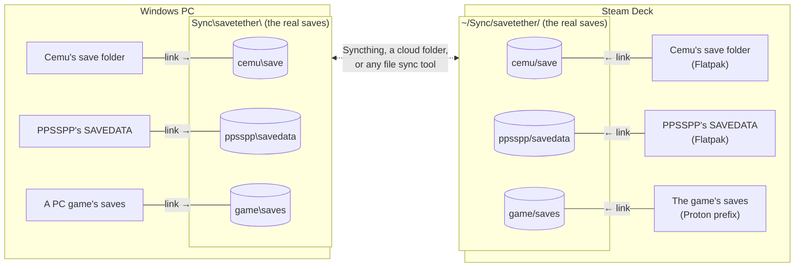

<div align="center">



# SaveTether

**Keep game save folders in one place, and let your sync tool share them between machines.**

[](https://github.com/carlocgc/SaveTether/actions/workflows/ci.yml)
[](https://github.com/carlocgc/SaveTether/releases/latest)
[](LICENSE)

[](https://github.com/carlocgc/SaveTether/actions/workflows/update-definitions.yml)


**[Install](#install)** · **[Getting started](#getting-started)** · **[Documentation](#documentation)** · **[Ways to share](docs/sharing.md)** · **[Command line](docs/cli.md)** · **[Contributing](CONTRIBUTING.md)**


</div>

## What it is

SaveTether moves an app's save folder into one folder you choose and leaves a link in its place, so the app reads and writes where it always did. Put that folder under a sync tool you already use, such as [Syncthing](https://syncthing.net/), and a PC and a Steam Deck play from the same saves. SaveTether does no syncing itself; it sets up and looks after the links at each end. Cloud folders and network shares can work too: see [ways to share the folder](docs/sharing.md).



## What it does

- **Links, not copies:** a junction on Windows, a symbolic link on Linux. No administrator or root rights, except to link a network share on Windows without Developer Mode.
- **Backs up first.** Every change is preceded by a verified copy outside the synced folder, which can be restored.
- **Never picks a winner silently.** When a device and the synced folder both hold saves, it compares them game by game and asks which to keep.
- **Survives interruption.** Operations are journalled; a crash part way is finished or undone with Recover.
- **Keeps watch.** The app sits in the tray and turns amber when a link is replaced or broken, for example by an emulator update.
- **Finds save folders for you:** popular emulators and frontends built in, and thousands of PC games from the [Ludusavi manifest](https://github.com/mtkennerly/ludusavi-manifest), refreshed monthly. It looks inside Flatpak sandboxes, Wine and Proton prefixes, EmuDeck and SD cards. Any other folder can be added by path.

## Limits

- **One device in use at a time.** Let the sync tool finish before switching devices; two devices writing the same saves at once is left to the sync tool's conflict handling.
- **Early days.** Tested on Windows, Linux and the Steam Deck. Keep your own backup of saves you care about too.
- **Imported game definitions are unverified:** they are converted from the manifest, not tried by hand, so check the save folders the plan shows before applying.

## Install

Download your platform's package from the [latest release](https://github.com/carlocgc/SaveTether/releases/latest):

| Platform | Package |
|---|---|
| Windows 10 or 11, x64 | `savetether-<version>-win-x64-setup.exe`, or the `.zip` |
| Linux x64, including the Steam Deck | `savetether-<version>-linux-x64.tar.gz` |
| Linux ARM64 | `savetether-<version>-linux-arm64.tar.gz` |

Each holds the desktop app (`savetether-gui`) and the command line (`savetether`). Neither needs administrator rights (except to link a network share without Developer Mode).

- **Windows:** the installer puts SaveTether in `%LOCALAPPDATA%\Programs\SaveTether` with a Start menu entry; uninstall it from Settings > Apps. From the `.zip`, keep the files together.
- **Linux:** unpack it anywhere and start `savetether-gui`. The first run offers to install it for your user (into `~/.local` and the app menu); Settings > Uninstall removes it.
- **Steam Deck, Game Mode:** the [SaveTether Decky plugin](https://github.com/carlocgc/SaveTether-Decky) shows each link's state in the Quick Access menu, with Check now. It reads the installed command line, so install SaveTether in Desktop Mode first; fixes are made in the desktop app. It needs [Decky Loader](https://decky.xyz/), and installing it is described in its README.

## Getting started

Start the desktop app. The first run asks for your synced folder, a name for this device, and where to keep backups. Then **Add app** finds the apps on this device and their save folders, and **Apply** links them. On the first device its saves become the shared copy; on the others, SaveTether shows how their saves differ and asks what to keep.

Everything the app does is also in the command line, with a stable `--json` output for scripts: see the [command line reference](docs/cli.md).

## Documentation

| | |
|---|---|
| [Ways to share the folder](docs/sharing.md) | Sync tools, cloud folders, network shares, and what each needs |
| [Command line reference](docs/cli.md) and [JSON output](docs/cli-json.md) | Every command, with examples; the `--json` contract |
| [Design](docs/design/save-redirection-design.md) and [desktop app specification](docs/design/desktop-app-spec.md) | What SaveTether guarantees and why; every screen and refusal |
| [Implementation plan](docs/plans/implementation-plan.md) and [hardware testing](docs/testing/hardware-testing.md) | What is built and next; how it is tested on real devices |
| [Releasing](docs/releasing.md) | Branches, versions and packages |

## Building

Requires the .NET 10 SDK: `dotnet build` and `dotnet test`. Release builds are Native AOT and need the platform's native toolchain (the Visual Studio C++ build tools on Windows, `clang` and `zlib1g-dev` on Linux):

```bash
dotnet publish src/SaveTether.Gui -c Release -r linux-x64   # or win-x64, linux-arm64; src/SaveTether.Cli likewise
```

Run the app from its publish folder, not from `bin/`. Platform quirks are in [hardware testing](docs/testing/hardware-testing.md#building-for-linux); packaging is in [Releasing](docs/releasing.md).

## Licence

MIT. See [LICENSE](LICENSE).
