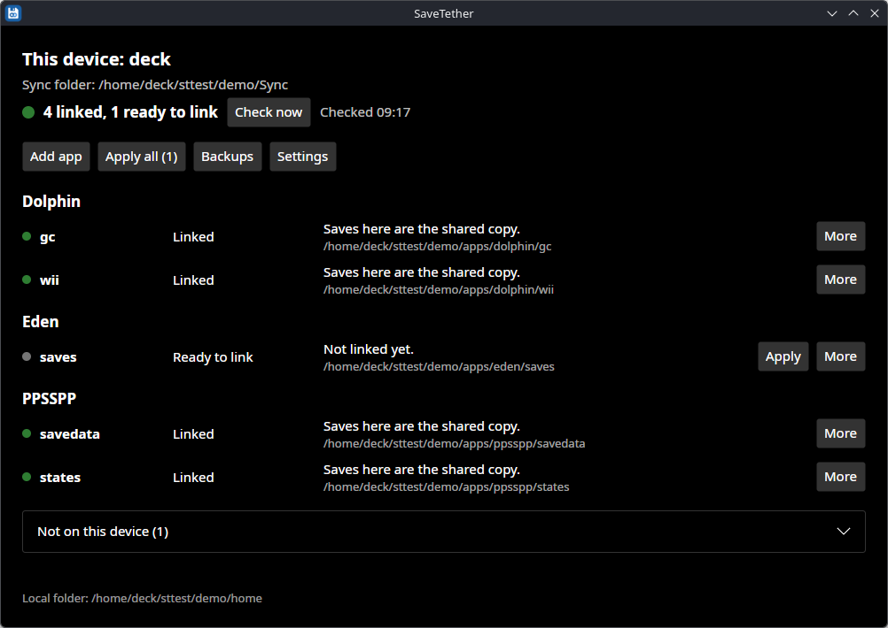
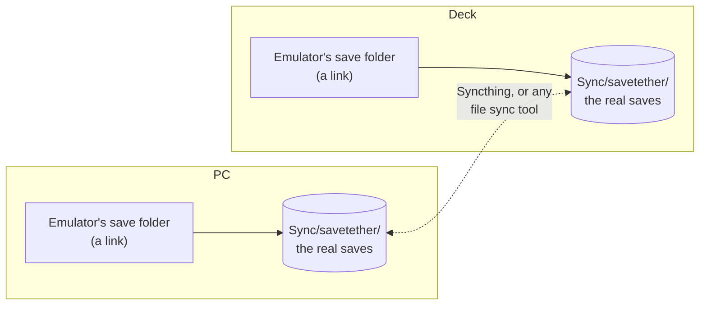

<div align="center">

# SaveTether

**Keep game save folders in one place, and let your sync tool share them between machines.**

[](https://github.com/carlocgc/SaveTether/actions/workflows/ci.yml)
[](https://github.com/carlocgc/SaveTether/releases/latest)
[](LICENSE)




</div>

## What it is

SaveTether is a folder redirection tool. It moves an app's save folder into a single folder you choose and leaves a link in its place, so the app reads and writes exactly where it always did.

The point is to share that folder between machines. Put it under a sync tool you already use, such as [Syncthing](https://syncthing.net/), and a PC and a Steam Deck play from the same saves. SaveTether does no syncing itself; it sets up and looks after the links at each end. A cloud storage folder, or a network share on Linux, can work too: see [ways to share the folder](docs/sharing.md).



## What it does

- **Links, not copies.** The app's folder becomes a junction (Windows) or symbolic link (Linux) into the synced folder. No administrator or root rights needed.
- **Backs up before it changes anything.** Every change is preceded by a verified copy kept outside the synced folder, and any of them can be restored.
- **Never picks a winner silently.** When a machine and the synced folder both hold saves, it compares them game by game and asks which to keep, offering only the choices that are safe.
- **Survives interruption.** Each operation is journalled, so a crash or power cut part way is finished or undone with `recover`.
- **Keeps watch.** The desktop app sits in the tray and turns amber when a link has been replaced, broken or re-pointed, for example by an emulator update.
- **Finds save folders for you** where an app has a definition, including inside Flatpak sandboxes, Wine and Proton prefixes (Steam, Lutris) and on SD cards.
- **Two front ends, one core:** a desktop app for Windows and Linux (on the Steam Deck, Desktop Mode), and a command line with a stable JSON output for scripts.

## Limits

- **One machine in use at a time.** Playing offline is fine; let the sync tool finish before switching machines. Two machines writing the same saves at once is left to the sync tool's conflict handling.
- **Early days.** It is tested on Windows, Linux and the Steam Deck with Cemu, Eden, PPSSPP and a Lutris game, and has a large automated test suite. SaveTether backs up before every change, but keep your own backup of saves you care about too.
- **Few built-in app definitions.** Only Cemu ships with one. Any other folder can be added by path, or described in a definition of your own.

## Install

Download the package for your platform from the [latest release](https://github.com/carlocgc/SaveTether/releases/latest) and unpack it anywhere:

| Platform | Package |
|---|---|
| Windows 10 or 11, x64 | `savetether-<version>-win-x64.zip` |
| Linux x64, including the Steam Deck | `savetether-<version>-linux-x64.tar.gz` |
| Linux ARM64 | `savetether-<version>-linux-arm64.tar.gz` |

Each holds the desktop app (`savetether-gui`), the command line (`savetether`), and the libraries the app needs beside it. Keep the files together. `SHA256SUMS.txt` on the release page lets you check the download.

**Windows:** run `savetether-<version>-win-x64-setup.exe` instead to install SaveTether for your user, without administrator rights: it goes to `%LOCALAPPDATA%\Programs\SaveTether`, with a Start menu entry, an option to make the `savetether` command available in terminals, and an entry in Settings > Apps to uninstall it. A newer installer updates it. **Linux:** the first time the desktop app starts from where you unpacked it, it offers to install itself for your user: the app goes to `~/.local/lib/savetether`, the `savetether` command and a `savetether-gui` link to `~/.local/bin`, and SaveTether is added to the app menu; you can delete the unpacked files afterwards. Starting a newer unpacked version offers to update it, and Settings > Uninstall (or `savetether uninstall`) removes it.

## Quick start

**Desktop app.** Start `savetether-gui`. The first run asks for your synced folder, a name for this machine, and where to keep backups. Then **Add app** finds an app's save folders, or **Apply** links a folder you have added. On the first machine, its saves become the shared copy; on the others, SaveTether shows how their saves differ and asks what to keep.

**Command line.** The same, on the first machine:

```bash
savetether init --sync-root ~/Sync --device desktop --create-root
savetether map add ppsspp.savedata --target ppsspp/SAVEDATA --source /path/to/PSP/SAVEDATA
savetether apply ppsspp.savedata --copy
```

And on each other machine, once the sync tool has delivered `~/Sync/savetether`:

```bash
savetether init --sync-root ~/Sync --device deck
savetether map add ppsspp.savedata --source /path/to/PSP/SAVEDATA
savetether apply ppsspp.savedata
```

`savetether status` shows each folder's state. Every command is described, with examples, in the [command line reference](docs/cli.md).

## Documentation

| | |
|---|---|
| [Ways to share the folder](docs/sharing.md) | Sync tools, cloud folders, network shares, and what each needs |
| [Command line reference](docs/cli.md) | Every command and option, with examples and workflows |
| [JSON output](docs/cli-json.md) | The `--json` contract for scripts |
| [Design](docs/design/save-redirection-design.md) | What SaveTether guarantees, and why it works the way it does |
| [Desktop app specification](docs/design/desktop-app-spec.md) | Every screen, state and refusal |
| [Implementation plan](docs/plans/implementation-plan.md) | What is built, what is next, and how it was tested |
| [Testing on real hardware](docs/testing/hardware-testing.md) | How the app is checked on Windows, Linux and the Steam Deck |
| [Releasing](docs/releasing.md) | Branches, versions and release packages |

## Building

Requires the .NET 10 SDK.

```bash
dotnet build
dotnet test
```

The release builds are Native AOT. Publishing needs the platform's native toolchain: the Visual Studio C++ build tools on Windows, or `clang` and `zlib1g-dev` on Linux.

```bash
dotnet publish src/SaveTether.Cli -c Release -r linux-x64
dotnet publish src/SaveTether.Gui -c Release -r linux-x64
```

Use `win-x64` or `linux-arm64` for the other targets. Run the desktop app from its publish folder, which holds the native libraries it loads (Skia, HarfBuzz, and ANGLE on Windows), not from `bin/`. `build/package.sh` makes the package a release ships; see [Releasing](docs/releasing.md).

On Windows, if publishing fails with `'vswhere.exe' is not recognized`, put Visual Studio's installer folder on `PATH` for that shell first:

```powershell
$env:PATH = "${env:ProgramFiles(x86)}\Microsoft Visual Studio\Installer;$env:PATH"
```

## Licence

MIT. See [LICENSE](LICENSE).
