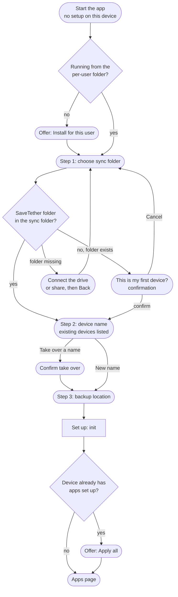
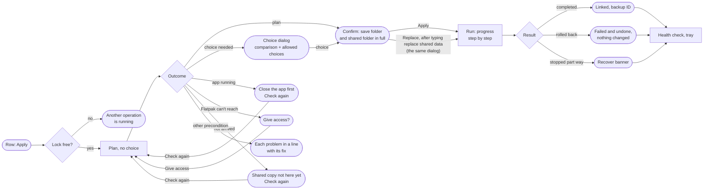
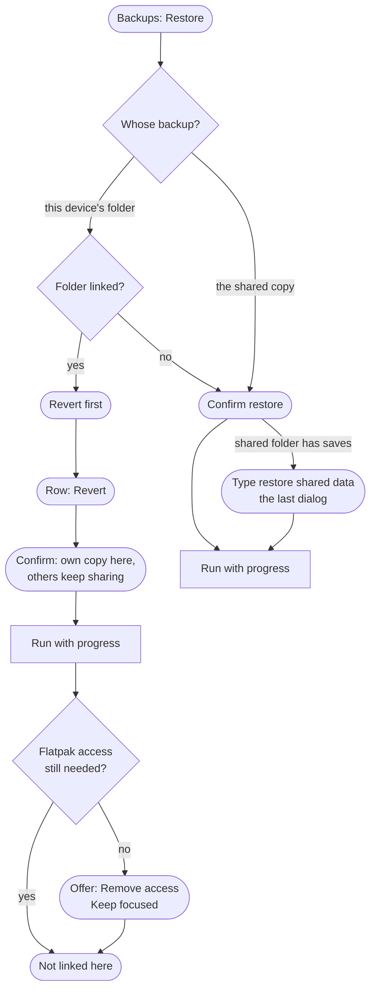

# Desktop app specification (phase 3)

Status: written 2026-11-17; the owner accepted every proposed answer to the open questions the same day (section 15). It specifies the desktop app of design 5.14 to the level of design 5.12. Built so far (2026-11-18): the core changes of section 13 except item 5, and the app shell, meaning sections 2, 3 and 3.1, with a window that shows the header, the banners of rows 1 to 5 and each mapping's state word. The pages, dialogs and actions of sections 4 to 12 are not built yet.

The design (`save-redirection-design.md`) says *what* SaveTether does and *why*. This document says what the window and tray icon show in every state, what each button does, and how every refusal the core can give reaches the person. Section numbers like "5.3" refer to the design.

## 1. Principles

1. **The app holds no logic of its own.** Every check, plan and change goes through the core (`Workspace`), exactly as the CLI does. The app decides only what to show and which choices to offer. If the app and the CLI disagree about what is allowed, the app is wrong.
2. **Only allowed choices are offered.** Where the CLI lists the allowed flags and refuses the others, the window offers only the allowed choices. A choice the core would refuse is never a button.
3. **The app speaks in its own words.** The core's messages are written for the CLI and name its flags (about 70 strings name a command or a flag today). The app writes its own sentence for each refusal *kind* and fills in the facts (paths, names, sizes) from the core's structured fields. The core's message is still shown, under "Details", so nothing the core knows is hidden. Section 13 lists the core change this needs.
4. **One operation at a time.** Within the app, and across processes, through the operation lock (section 9.1).
5. **Safe by default, with the keyboard alone.** Every dialog opens with focus on the choice that changes nothing. Escape always cancels or goes back. Nothing needs a mouse, a hover or a drag (section 12).
6. **Everything in one window.** Dialogs are overlays inside the main window, not separate OS windows. A dialog then cannot open behind the window or on another screen, and keyboard focus never has to move between windows.
7. **Desktop only.** The app runs on the Windows and Linux desktops, which on the Deck means Desktop Mode. It is not built or supported for Game Mode (decided by the owner on 2026-11-17). A Decky plugin with limited functions may cover Game Mode later (5.11, phase 4).
8. **Short, and true for one device.** *Added 2026-11-23 by the owner.* A dialog says each thing once: the backup in the last dialog before a run, never in every dialog of a flow. The sync folder may be a plain folder on one device, so it is not assumed to sync. Other devices are named only when another device is registered in the sync folder (`OperationSession.HasOtherDevices`), and a sync tool only in a dialog that cannot happen without one (not arrived, shared folder missing), as "if you use a sync tool". The words: **sync folder** (the folder chosen at setup), **shared folder** (one mapping's folder in it), **shared copy** (what a shared folder holds), **this device's data** (what the save folder holds).

## 2. The process

- **One process, one copy.** `savetether-gui` holds a single-instance lock in the local folder (5.12, "Local files"). A second start sends "show the window" to the first copy and exits. Windows: a named mutex plus a named pipe. Linux: a lock file plus a Unix socket in the same folder. The operation lock (9.1) is separate: the app holds it only while an operation runs.

  *As built:* one mechanism on both systems, `gui.lock` held with no sharing (as the operation lock is) plus a Unix domain socket, which .NET supports on Windows 10 and later, so the code and its tests are the same everywhere. The socket is `gui.sock` in the local folder, or, when that path is too long for a socket, a name made from the local folder's path in `$XDG_RUNTIME_DIR` (Linux) or the temporary folder. A socket left by a killed copy is removed by the next copy through `SafeFs.DeleteSocket`, which refuses anything that is not a socket. If the claim cannot be made at all, the app runs without it and logs why.
- **Start.** With `--minimized` (used by the autostart entry, section 11) the app starts with the tray icon only. Without it the window opens. Either way it runs a health check at once.
- **Closing the window** hides it and leaves the tray icon running. The first time this happens, a notification says: "SaveTether is still running in the tray. Quit it from the tray icon's menu." Where there is no tray host (stock GNOME), closing the window quits. Detecting "no tray host" is not reliable on Linux (plan section 5, trial notes), so the rule is: on Linux, the app checks for an `org.kde.StatusNotifierWatcher` owner on the session bus at start; if there is none, closing the window quits (decision 1).
- **Quit** (tray menu, or Ctrl+Q in the window) is refused while an operation runs: "Wait for the current operation to finish." Operations are journalled transactions; stopping one half way is what `recover` exists for, not something to offer.

  *As built (2026-11-18), the end of the session:* a log off, restart or shut down is never vetoed. Found on the owner's PC: Windows named SaveTether as preventing a restart. When Windows asks, Avalonia closes the windows with the reason `OSShutdown` and refuses the session's end if any stays open, and the app cancelled that close to hide to the tray. Now a close for that reason, or for the app's own shutdown, goes ahead (`WindowClose` in the presentation project): the tray icon is removed and the app quits, logging "session ending". An operation running at that moment is not waited for: the session ends regardless, and its journal leaves it to Recover at the next start.
- **Log.** The app appends one line per operation, refusal and unexpected error to `gui.log` in the local folder, and keeps the last 1 MB. No paths beyond those already in the local files, no content of save files.

## 3. Overall state and the tray icon

The overall state is computed from one `Status()` report plus the journal, the lock and the setup state. The first row that matches wins.

| # | Condition | Icon | Tray menu first line | Window header |
|---|---|---|---|---|
| 1 | No `bootstrap.json` (device not set up) | amber | Not set up | the setup page (section 6) |
| 2 | A file has a newer schema than this version knows (`StoreProblem.SchemaTooNew`) | amber | Update SaveTether | banner B1 |
| 3 | Journal open (unfinished operation) | amber | An operation did not finish | banner B2 |
| 4 | Sync root unavailable (`SyncRootProblem` set) | amber | Sync folder not available | banner B3 |
| 5 | Device file mismatch | amber | Device name used by another install | banner B4 |
| 6 | Any mapping not OK and not Not applied | amber | *n* apps need attention | rows sorted to the top |
| 7 | Otherwise | green | All linked; or *n* ready to link, or *n* linked, *m* ready to link | the same |

- **Two conditions added while building** (2026-11-18), both amber: *Cannot check this device*, after row 2, when the core refuses to report for another reason (this device's file missing from the sync folder, say; the window shows the core's message); and *Health check failed*, when checks fail unexpectedly three times in a row (section 10). Until the third, the icon keeps its last state.
- **Not applied stays green** (5.14): a mapping set up on another device and not wanted here is normal.
  *As built (2026-11-20):* green does not always say "All linked". Folders this device has and has not linked ("Ready to link") are counted, as Apply all counts them: "6 ready to link" with none linked, "4 linked, 2 ready to link" with some. "Sync folders ignored by this device" is not counted. The first build said "All linked" with every link reverted (found by the owner).
- **The lock does not change the state.** While another process holds the operation lock (a CLI `apply`, the Decky plugin), the folder it is working on may briefly look Replaced (renamed aside, 5.3). So while the lock is held by another process, a check's result is shown in the window but does not change the icon or raise a notification; the next check after the lock is released does.
- **Tray menu**: the first line above (disabled, as a label), then "Open SaveTether", "Check now", a separator, "Quit". Clicking the icon opens the window; the trial found the icon's position cannot be known reliably on Linux, so there is no panel beside the icon (plan section 5).
- **Icons**: two images, green and amber, each with a distinct shape as well as colour (a tick and an exclamation mark), so the state does not depend on telling colours apart.
  *As built (2026-11-19), the app's icon:* SaveTether has an icon of its own, a "linked floppy" (a save disk with two linked rings, in blue), chosen by the owner from three concepts. `build/render-icon.cs` holds its shapes and writes `src/SaveTether.Gui/Assets`: a multi-size `savetether.ico` (16 to 256 pixels, with a simpler drawing at 24 and under), `savetether.png` (256), the tray base `savetether-tray.png`, and `savetether.svg`. The windows, title bars and taskbar show the app's icon, which says which app it is, instead of the state; the window's header and the tray show the state. The tray icon is the app's icon with a badge, a green tick or an amber exclamation mark. `savetether-gui.exe` carries the `.ico` (Explorer, the Start menu, Settings > Apps), and so does the Windows installer, whose wizard also shows the icon in its side and corner pictures (`build/windows/wizard.png`, from the same tool, and `savetether.png`; PNG wizard pictures need Inno Setup 6.5.2 or newer, which the script checks); on Linux the package carries `savetether.png` and the install names it in the menu entry.

### 3.1 Checks and notifications

- **When**: at start, every 5 minutes, when the window is shown or the tray menu opens, and after every operation. "Check now" in the window header and the tray menu. A check takes milliseconds (5.5); it runs off the UI thread, and a check already running is not started twice.
- **Notification** when a check finds a mapping in an amber state that it was not in at the previous check, or a new amber condition from rows 1 to 5. One notification per check at most, saying the header's headline: "2 apps need attention.", or a condition's own ("Sync folder not available."). At start, an amber state is notified once: this is the login check that 5.5 replaced with the tray icon. Nothing is notified when the state turns green; the icon changes.
- **How**: Windows, a toast through PowerShell's `Windows.UI.Notifications` (no new dependency); Linux, `notify-send` when it is on `PATH`, otherwise none. A notification that cannot be shown is logged and otherwise ignored. Clicking a notification is not required to do anything (decision 2): opening the window from a PowerShell toast needs an app ID registration, which the release archive does not do. The tray icon and its menu are the way in.
- *As built (2026-11-25, owner), the text is a count:* the notification names no mapping. It was a list ("Ryujinx saves: not linked. Eden saves: shared folder missing."), which grows long and says less than the window, where the fix happens. When it is raised is unchanged: a mapping newly amber still raises one, even when the count stays the same. The Decky plugin's toasts say the same.
- *As built (2026-11-23), who a Windows toast is from:* sent as PowerShell's app ID, toasts said "Windows PowerShell" and had PowerShell's icon. Now the installed copy (in the folder the installer recorded in its uninstall entry, which `/DIR=` can change, else the default folder) sends as the installer's Start menu entry (a shortcut's app ID is its target's path), so the toast shows SaveTether's name and icon; any other copy registers the app ID `SaveTether` with its name under `HKCU\Software\Classes\AppUserModelId` (Windows 11 shows no icon for it). The uninstaller removes that key. The toast carries the message only: Windows already shows the app's name above it. Settings can turn notifications off (section 11).

## 4. Window layout

Minimum 800 × 560, designed for 1280 × 800 (the Deck's screen) at 100 % scaling, base text 15 px.

- **Header**: device name, sync folder path, the overall state word with its icon, "Check now", and the time of the last check. *As built (2026-11-22), asked for by the owner:* while the device is not set up, "Check now" and the time are hidden: there is nothing to check yet, and showing the window checks anyway. Setup's step 1 says what the sync folder is for (each app's folder is kept there, with a link left in its place) before asking for one a sync tool keeps the same on every device; a network share is suggested on both systems. *As built (2026-11-23, phase 3.7 T4):* on Windows a share is accepted, stored as UNC (a mapped letter shows "Using \server\share (the drive Z: points to)"), and step 1 shows the not-recommended warning (`Workspace.NetworkShareWarning`, shared with the CLI) in amber under its usual sentence (`SyncFolderCheck.Warning`); there is no separate finding, the share continues as `NotSetUp` or `AlreadySetUp`. A share that does not answer is `Missing`; one this device cannot link to (Developer Mode off, or policy) is `NetworkDrive`, with the Developer Mode text, and Next becomes **Check again**. A mount on Linux is not detected, so it gets no warning. Not built: the warning once more on the first Apply to a share.
- **Banners**: zero or more, below the header, in the order of section 3's table. Each says what is wrong in one sentence and has its actions as buttons.
- **Pages**, as a tab strip under the banners: **Apps** (default), **Backups**, **Settings**. Ctrl+1, Ctrl+2, Ctrl+3 switch pages; the tab strip is also reachable with Tab.
- **Dialogs** are overlays over the page, with the page dimmed and not focusable underneath.
- **Busy**: while an operation runs, every action button in the window is disabled, and the operation's dialog shows its progress (section 9.3).

### 4.1 Banners

| # | When | Sentence | Actions |
|---|---|---|---|
| B1 | A shared or local file has a newer schema | "A newer version of SaveTether has written <file>. Update SaveTether on this device before going on." | Open the releases page (decision 3: a link, so the only network access is the person's own browser), Details |
| B2 | Journal open | "<Operation> of <mapping> did not finish. Nothing else can be done until it is recovered." | **Recover** (section 9.5), Details |
| B3 | Sync root unavailable | "The sync folder <path> is not available: <reason>. If it is on a drive or a network share, connect it." The reason is "it does not exist" or "the SaveTether folder is not in it", from the core's two cases (5.12, "Sync root unavailable") | Check again, Open the folder's parent |
| B4 | Device file mismatch | "Another SaveTether install uses the device name '<name>'. Two machines with one name would apply each other's folders." | **This is that device** (take over, section 6.3), **Use another name** (section 6.2), Details |
| B5 | The autostart entry points to a missing file | "SaveTether is set to start with the session, but the entry points to <path>, which is missing." | **Fix it** (rewrite the entry, section 11), **Turn it off** |
| B6 | The lock is held by another process | "Another SaveTether operation is running (<command>, started <time>). Actions are paused until it finishes." | none; the app re-checks the lock every 3 seconds while the window is visible |

*As built (2026-11-20), B3:* one sentence, as in the table; the first build showed a general sentence with the core's longer message below it, which said the same thing twice (found in phase 3's exit test). The reason has a third case, "it cannot be read (<the system's reason>)": a network share or FUSE mount that stopped answering ("Transport endpoint is not connected") can still look present from what the system has cached, so the core opens the marker folder, not only looks at it. Setup's step 1 says the same of such a folder, where the first build showed "Something went wrong".

While B1, B2 or B3 is shown, every action on the Apps and Backups pages is disabled, except "Open folder". The core refuses these operations anyway; disabling them avoids a click that can only fail.

### 4.2 Background status

*Changed 2026-11-20 (owner):* the first design was a strip above the footer with a progress bar. It appeared and went within a second, moving the page each time, and looked like a bug. The status is now one line in the footer's right corner, always there, opposite "Local folder". It says **Idle** when nothing runs in the background. While a task runs it says what, for example "Scanning: 412 of 8,943, 3 found" (just the found count when the total is not known), with a small **Cancel** beside it. There is no progress bar and nothing else on the page moves. Anything else that runs in the background and should be told (the health check, later) reports through the same line.

- One task at a time. Any action that starts a scan is disabled while one runs (the footer already says what is running, so the button says nothing more); it is enabled again when the scan finishes, is cancelled, or fails.
- A scan only reads: it does not take the operation lock, does not disable operation buttons, and an operation does not stop it.
- The status is separate from the banners (4.1) and the operation dialog's progress (9.3). Leaving Add app does not stop the scan; its result is there on return.
- A failed scan shows "Scanning failed: <message>" with **Dismiss**, once; starting the next scan also clears it.

*As built (2026-11-20):* `BackgroundTasks` (presentation) is the registry, `MainWindow.Tasks` holds it and `MainWindow` draws the footer line (`Idle` is `MainWindow.Idle`). The health check does not report through it yet.

## 5. Apps page

Mappings are grouped by app: the part of the mapping ID before the dot, named from the app's definition when there is one ("Ryujinx"), otherwise the ID itself. Inside an app, one row per role (mapping), named from the definition's role name ("Saves") or the part after the dot.

Each row shows: the state word and icon, one sentence, and the folder on this device. Rows needing attention, and the apps holding them, sort to the top; the rest are in name order.

Page actions: **Add app** (section 8), **Apply all** (section 9.4, shown when at least one row is Ready to link).

### 5.1 States

The core's `HealthState` has seven values. Not applied, Replaced and Broken each cover situations that need different words and actions, so the core says which with a `HealthReason` (section 13, item 2), shown below in the Situation column.

*Restored 2026-11-26:* sections 5 to 7 were dropped by mistake in #77 (2026-11-20), together with the old 4.2 it meant to replace, and are back as they were then. The table below was brought up to the build of 2026-11-26 (`StateWords`, `AppsPage.Row`) when it was restored; the dated notes after it say what changed and why. The notes the Apps page gathered while this section was missing (they had landed after Apply all, 9.4) are moved here unchanged.

| Core state | Situation (reason) | Word | Colour | Sentence | Main action | Other actions |
|---|---|---|---|---|---|---|
| OK | | Linked | green | The link's kind: "Symlink" or "Junction" ("Link" when it cannot be told) | none | Open folder, Open shared folder, Back up now, Backups, Revert |
| Not applied | no folder set on this device (`no-save-folder`) | Not set up here | grey | "<n> devices have a link." ("1 device has a link."; their names when hovered), or "No device links this role." | Add (Add app's page 2 for this app, or the form for a folder by hand) | Choose the folder myself (a definition's app); a red **Delete** when no device links the role |
| Not applied | folder set, not linked (`not-linked-yet`) | Ready to link | grey | "Original" | **Apply** | Open folder, Remove |
| Not applied | the folder in the device file is not an absolute path (`save-folder-not-absolute`) | Device file error | amber | "This device's file has '<value>' as the folder." | none (Add again is not built) | Details |
| Replaced | the folder holds files (`folder-holds-files`) | Not linked | amber | "The link was replaced by a real folder. Saves made here are not shared." | **Apply** (stops at the choice, section 9.2) | Open folder, Backups |
| Replaced | the folder is empty (`folder-empty`) | Link missing | amber | "The link is gone and the folder is empty." | **Apply** | Open folder |
| Replaced | nothing at the folder (`folder-missing`) | Folder gone | amber | "Nothing is at <path>. If the app has moved, find it again." | **Find the app again** (Add app, section 8); **Choose the folder again** for a folder added by hand | Apply; Choose the folder myself (a definition's app) |
| Replaced | a file or something else is where the folder was (`not-a-folder`) | Not a folder | amber | "Something other than a folder is at <path>. Move it away by hand, then apply." | Open folder's parent | Details |
| Broken | the shared folder is missing (`shared-folder-missing`) | Shared folder missing | amber | "The link is in place, but its shared folder is missing. If you use a sync tool, it may not have arrived yet." | Check again | Open folder, Open shared folder's parent |
| Broken | the sync root cannot be used (`sync-root-unavailable`) | Shared folder missing | amber | Covered by banner B3; the row repeats only "The sync folder is not available." | Check again | Open folder |
| Retargeted | | Linked elsewhere | amber | "The folder now links to <path> instead of the shared folder. Remove that link by hand, then apply." | Open folder | Details |
| Double seed | | Two shared copies | amber | "More than one device made its saves the shared copy." | **Use this device's copy** (section 9.2, Double seed) | Backups, Details |
| Foreign link | | Not SaveTether's link | amber | "The folder is a link SaveTether did not make, to <path>. Remove it by hand, then apply." | Open folder | Details |

"Not applied, no folder set" counts as grey but is listed after everything else, under a collapsed heading, so a device that uses three of ten shared apps is not cluttered. The heading was "Not on this device (*n*)"; it is **Sync folders ignored by this device (*n*)** since 2026-11-21 (see the notes below).

*As built (2026-11-18):* `AppsPage` (presentation project) holds this table, the grouping and the order; the window shows each row's main action as a button and the others under **More**.

Changes from the table above:
- **Linked rows** have no main button, as the table says. Revert is under More. The previous build had made Revert the main action, which the table does not.
- **Opening folders.** Open folder uses `explorer` on Windows and `xdg-open` on Linux.
- **No device has a folder.** When no device has a folder set for the mapping, the row says "No device has a folder set for it." instead of "Set up on <devices>".
- **The collapsed section** stays open across checks, and its rows name their app, since there is no app heading above them.
- **The page's buttons stay in view** (2026-11-19, asked for by the owner). Add app, Apply all, Backups and Settings sit in a bar above the scrolling area. A page shown in place of the Apps page (Add app with its hand form, Backups, Settings) puts its way back, "Back" or "Back to apps", in that same bar, so it is in the same place on every page and stays in view however long the page is. A page's own action, such as Add or Look again, stays below what it acts on. Setup keeps Back beside Next, as in any step-by-step form.

*As built (2026-11-18), with Add app:* **Find the app again** (Folder gone) and **Add** (Not on this device) open Add app's page 2 for the row's app. Both are offered only when the catalog has a usable definition for the app (`MappingState.HasDefinition`); a mapping made by hand with `map add` has none, so its row keeps no main action there, as Add app could only refuse it.

*As built (2026-11-19), with "Add a folder by hand":* a mapping with no definition now has a main action too, which opens the hand form for that mapping (section 8): **Add** on a Not on this device row, and **Choose the folder again** on a Folder gone row.

*As built (2026-11-18), with the Backups page:* **Backups** is under More on Linked, Not linked and Two shared copies, as the table lists it.

Not built yet:
- **Add again** on "Folder setting is wrong".
- **Opening the other actions by keyboard:** they are a Tab stop (the More button), not the Menu key or Shift+F10 (section 12).

**Stop using here** is `map remove`: refused by the core while applied, so it is only offered when Ready to link. It asks for confirmation: "Forget this device's folder for <role>? Nothing is deleted; the shared copy and other devices are not affected."

The "Device file error" row (first called "Folder setting is wrong") turns the overall state amber, unlike the core's Not applied (decision 4). Keeping it green, as the CLI does, would leave a misconfiguration unnoticed.

*Apps page rows, as built (2026-11-21, owner):* a row's sentence names what its folder is, since the state word beside it already says Linked or Ready to link: **Symlink** or **Junction** for a linked folder, **Original** for one not yet linked (it said "Saves here are the shared copy." and "Not linked yet."). In "Sync folders ignored by this device" the name column takes the room of the dropped state column and keeps a gap before the sentence. The "Sync folders ignored by this device" section drops the state column, since its name already says it, and a row's folder line is left out when it has none, so the sentence is centred on the row. **Stop using here** is renamed **Remove** in More (a ready row only), with the same confirmation and effect: the folder is forgotten, nothing is deleted, and the row moves to "Sync folders ignored by this device". The page has a title, "Manage links", above its buttons, as the other pages have. On Add app the scan is one button, **Scan for saves** (it was Scan for saves, with System files and Save states boxes in a frame). The boxes are removed: no shipped definition has a system or state folder (every imported role and Cemu's is a save folder), so they changed no result, and the scan looks for save folders only.

A row of an app from the imported set, in "Sync folders ignored by this device" or with its folder missing, now opens Add app's page 2 for that app (its folders as checkboxes) like a built-in one; before, only built-in and shared definitions did, and an imported app got the form for a folder by hand. A mapping made by hand under an imported app's name, with a role the definition lacks, still gets the form.

*Not-here list, as built (2026-11-21, owner):* the section that was "Not on this device (n)" is headed **Sync folders ignored by this device (n)**. The button columns of every row share one width (a shared size scope), so a row with an extra button, such as Delete, does not move the sentence of the rows without one.

*State word, as built (2026-11-25, owner):* a mapping this device has no save folder for (Not applied, no save folder) reads **Not set up here**, not "Not on this device": its shared copy may well be on this device, in the sync folder. It stays grey and apart from the amber **Not linked**. The Decky plugin uses the same word.

*Choose the folder myself, as built (2026-11-23, owner):* a row of a definition's app, in "Sync folders ignored by this device" or Folder gone, has **Choose the folder myself** under More. It opens the form for a folder by hand for that mapping, so the folder is given directly. Before, Add and Find the app again were the only ways in, and both ended at "No install of <app> was found" when the app was not where the definition looks: on Linux every time for a portable copy, since no built-in definition has a Linux install that asks for an install folder (found on Mint with PPSSPP). In the not-here list Add is the right-most button, with Delete and More to its left. *As built (2026-11-24, owner):* Delete and More sit at the right of their shared column, so on a row without Delete, More is next to Add.

*Back up now, as built (2026-11-26, owner):* a Linked row, and only a Linked row (owner), has **Back up now** under More, before Backups. It takes a verified backup (reason `snapshot`, shown as "snapshot" in Backups) of the shared copy the folder links to (`Workspace.BackUpNow`). It copies only, so it asks nothing first; it runs under the operation lock and says how many files were backed up and the backup's folder ("Test linked: 1 file backed up to <backup folder>"), or why none was ("No backup was made"). There is no CLI command for it yet.

*Sizes, as built (2026-11-24, owner):* each Apps row has a Size column between State and Details, in Add app's words ("12 files, 3.4 MiB", "not there yet"): this device's folder, read through its link so a linked one shows the shared copy, or the shared copy when the device has no folder for it. The header's sync folder line ends with the whole sync folder's size the same way. Each is read off the UI thread at every check; until the first read ends it says "measuring…" (at least the busy minimum, as Add app), and after that the last size stays shown while it is read again. One folder is never read twice at once. Nothing is read while the sync folder is unavailable, or for a row whose shared folder is out of reach (Broken): on a network share each read could wait out the network timeout. Add app reads its unticked folders the same way (`FolderSizes`). The sync folder line wraps, so a long path does not push the size out of view.

*Column widths, as built (2026-11-24, owner):* on the Apps page and Backups each column but the last fits its content, measured in the window's font (`Navigation.FitWidth`): the widest text it shows, or its name if wider, plus a 24 px gap. On Apps, Folder fits the role names on the page (at most 220 px), State the state words on the page, and Size the sizes last read, or "measuring…" for one not read yet (at most 180 px); a size read after the page is drawn that is wider widens the column, in the header and every row; on Backups, Taken, Why and Copy of fit their rows. Text past a cap ends in "…"; a folder name cut that way shows in full when hovered. The last column (Details, or Size on Backups) takes what is left, and the buttons are sized first, so they stay in view down to the window's 800 px minimum. Checked on Windows at 1000 and 800 px. The widest state word was renamed from "Folder setting is wrong" to "Device file error" to narrow the State column.

*Column names, as built (2026-11-24, owner):* the Apps rows (Folder, State, Size, Details), Backups (Taken, Why, Copy of, Size) and Add app's page 1 (App, Last played, Notes; while searching App, Notes, On this device) have their column names in a row at the top of the list's frame, outside what scrolls, so they stay in view. The row is shown only while the list has rows. "Sync folders ignored by this device" has none: its columns differ and it sits in its own expander.

*Row other devices have, as built (2026-11-21, owner):* the sentence only says how many devices have a link ("1 device has a link.", "12 devices have a link."), for any number, so a row stays one short line. The names are the sentence's hover text, one per line, with no styling to suggest it (the owner's choice; hover does not exist on a touch screen). In the not-here list Add is the right-most button and Delete sits to its left, so the buttons end at the same edge as the rows above. (Twelve devices as a wrapped paragraph, and then as "a, b, c and 9 more" with a Devices button, were tried first.)

*Delete, review fixes (2026-11-21):* the delete never recurses into the shared folder on its own. It deletes each file the verified backup holds that is still what the backup has, and removes folders only when empty; a save that arrived or changed after the backup stays, and so does the record, and the dialog says "Deleted only in part" with what was removed, the backup, and to run Delete again. A shared folder reached through a link (such as an app folder, or the shared data folder itself) is refused. Setting files aside (in a folder beside the sync folder) was tried and removed: it refused sync folders at the root of a drive; instead the confirmation asks the owner to make sure every write to the role's shared folder is complete and the sync folder is up to date on every device that uses it, the condition no code here can check. Files an earlier build set aside are still settled.

*Delete on a mapping no device uses, as built (2026-11-21, owner):* a row in "Sync folders ignored by this device" that says "No device links this role." has a red **Delete** button beside Add. It calls the core's `map delete` (design 5.3, invariant 2's third exception): the confirmation is short, as the owner asked: the title "Delete <app role>, orphaned in the shared folder?" and two sentences, "Any other devices that use the sync folder will see this deletion. Before confirming, make sure all writes to this role's shared folder are complete and the sync folder is up to date on every device that uses it." (A longer text said what stays; the CLI's prompt and the docs say more.) then the shared saves are backed up on this device and the backup verified (Backups lists it as "before deleting"), and only then are the shared folder, the seed markers and the mapping record deleted. It is not offered for a row another device has a folder for, and the core refuses it too (naming the device) if a device file shows one. The red button style is `Danger.Style`, also used for the confirmation's Delete.

*App names, as built (2026-11-20):* an app added from the imported set is shown by its definition's name ("Atelier Umia"), not its id, on Apps and Backups. The imported set is read for this only when an app has no shared or built-in definition.

## 6. First-run setup

Shown instead of the pages when there is no `bootstrap.json`, and reachable later from banner B4. Three steps, each a page with Back and Next; the result is one `Workspace.Init` call at the end, so nothing is written until the last step.

### 6.1 Sync folder

A path field and a "Choose folder" button. The folder picker is the OS dialog. The field accepts a typed path too, for a folder the picker does not show, such as a network share that is not mounted in the file manager.

On Next the app checks the folder and shows one of:

| Found | Shown | Offered |
|---|---|---|
| `savetether/.savetether/` exists | "This sync folder is already set up for SaveTether, on: <device names>." | Next |
| the folder exists but has no SaveTether folder | "This sync folder is not set up for SaveTether yet." and the two cases below | **This is my first device** (create-root), or Back |
| the folder does not exist | "<path> does not exist. If it is on a drive or a network share, connect it." | Back |
| on Windows, the folder is on a network drive *(added 2026-11-19)* | "<path> is on a network drive. On Windows, SaveTether links save folders with junctions, which can only point to a local drive, so no save folder could be linked there. Use a folder on a local drive, and keep it in step with the share or the other devices with a sync tool." | Back |

*As built (2026-11-19), the network-drive row:* checked first, from the path and the drive's type alone (`PathRules.IsOnNetworkDrive`), since probing a share that is not reachable can stall for seconds. The core's `Init` refuses the same, so the CLI's `init` does too; before this, a network sync folder was accepted at setup and refused only at the first apply. On Linux a symbolic link into a mounted share works, so nothing is refused there. `docs/sharing.md` describes the ways to share the folder.

*Changed 2026-11-23 (phase 3.7 T4, design 5.16):* a Windows network share is accepted, linked with symlinks. Step 1 stores a mapped drive as its UNC path ("Using \\server\share (the drive Z: points to)."), checks that this device can make a symlink there (`Workspace.RequireLinkableShare`), and shows the not-recommended warning (`Workspace.NetworkShareWarning`) without blocking. The network-drive row above now applies only to a share this device cannot link to (Developer Mode off, or policy): its refusal says how to enable it, with Check again. The step's opening sentence (`SetupFlow.SyncFolderIntro`, 2026-11-22) says what the sync folder is for before asking for one.

"This is my first device" asks for confirmation: "Only do this on the first device. If SaveTether is set up on another device, wait until the sync tool has delivered the SaveTether folder here instead; setting it up twice creates two separate setups." This is the GUI form of 5.3 invariant 5's protection against an empty mount point.

### 6.2 This device's name

- Existing device files are listed first, each with "Take over" (used after a wipe, 5.4). Below them, a field for a new name, filled with a suggestion from the machine's host name, lowercased, with characters outside `a-z 0-9 - _` dropped.
- The name is checked as typed against `Identifiers.IsValidDeviceName`, with the rule under the field.
- **Take over** needs confirmation (5.6): "Only take over '<name>' if this is that device, set up again. Two machines with one name would apply each other's folders." Buttons: Cancel (focused), Take over.

### 6.3 Backups, and finish

- The backup location: the default, or the one in the device file being taken over, with "Change". A location from the device file that does not exist is shown with the core's note (5.12, `init`): its drive may not be connected.
- **Set up** runs `Init`. A `StoreException` is shown in place with the step it belongs to, and nothing moves on.
- After setup the window shows the Apps page. When the device was taken over and has folders set (a restore after a wipe), it also shows: "This device has <n> apps set up. Apply them all now?" with **Apply all** (section 9.4) and Not now.
- First run only, before step 6.1: the install step of section 11, when the app is not running from the per-user location.

*As built (2026-11-18):* `SetupFlow` in the presentation project, shown by `SetupView`. Three choices were made while building it:
- **The lock.** Set up takes the operation lock. The app's own files mean the local folder exists before setup, so a CLI could run at the same moment.
- **The backup location.** It is passed to `Init` only when the owner changed it. Unchanged, the core decides, as the CLI does without `--backup-root`. So a taken-over device's location that is not there is not created, since its drive may only be disconnected; the page shows the core's note beforehand.
- **Typed paths.** A typed path may start with `~` on Linux.

Not built yet: the install step, the Apply all offer after a take-over (it needs operations, section 9.4), and reaching setup again from banner B4.

Built since: the install step (section 11, "Installing"). The other two were not checked when this section was restored (2026-11-26).

## 7. Operation flow, common to every action

Apply, Revert, Restore, Recover, Add app, Stop using here, the Flatpak grant and its revoke, Take over and changing the backup location are operations. Each:

1. Takes the operation lock (9.1). If another process holds it: "Another SaveTether operation is running (<command>). Try again when it has finished." Nothing else happens.
2. Plans (where the core plans): `PlanApply`, `PlanRevert`, `PlanRestore`, `PlanAppAdd`.
3. On a refusal, shows it (section 9) and releases the lock.
4. On a plan, shows the confirmation for that action, with the plan's steps in plain words under "Show steps". The lock is held while the dialog is open, so the plan cannot go stale behind it; a dialog left open for 10 minutes is cancelled and the lock released (decision 5).
5. Runs the plan with progress (9.3), then shows the result (9.3), releases the lock, and runs a health check.

*As built (2026-11-18), for Apply, Revert and Recover.* `OperationSession` (presentation project) holds the lock from the first plan to the result; `ActionFlow` (the app) shows the dialogs. While an operation runs, the app runs no health check, since its own lock is held and a folder may be renamed aside for a moment, and Quit is refused with section 2's sentence.

Choices made while building:
- **Arriving saves.** The choice dialog cannot know beforehand that the shared copy may still be arriving: the core says so only once add-missing or replace-shared is chosen (`RefusalKind.NotArrived` with `AssumeSyncedWouldHelp`). So that choice is followed by a dialog with section 9.2's sentence and "The shared saves really were deleted". Disabling the two choices in advance is not done.
- **Which button has the focus.** In refusal dialogs Cancel has the focus, not Check again: it is the choice that changes nothing.
- **Recovery's result** is worded as recovery succeeding: "Recovered: the unfinished apply was undone." The plain run's "failed and was undone" read as a new failure (found on the Deck).

Built since: the other row actions except Backups, and Apply all (section 5's notes); Add app (section 8's notes), which takes the lock only for Add.

Built since: Backups and Restore (section 9.7's notes).

Built since: "Stop using here" is **Remove**, Delete on a mapping no device uses, and Back up now (section 5's notes); every step run off the UI thread goes through `Overlay.WorkAsync` (9.4's notes).

## 8. Add app

A guided `app add` (5.2, "Adding an app"; plan P2.5). Two pages and a confirmation.

**Page 1, choose an app.** The catalog's apps (shared definitions, then built-in, as `app list` shows them), in name order, with a search field that filters as typed. Next to each, filled in the background: "Found", "Not found" or "Added" (already has a folder on this device). Opening the page does not wait for detection.

*Decided (2026-11-20):* page 1's automatic scan finds installed apps only. *Changed 2026-11-20 (owner):* an imported definition detects a game by its own save folder, which stays after the game is gone, so the scan listed uninstalled games (70 apps on the owner's PC, 18 after the fix below). A definition from the Ludusavi manifest with a Steam ID is now found only when Steam has the game installed (an `appmanifest` in a Steam library: on Linux the libraries under the home folder, on Windows the registry's `SteamPath` and Program Files (x86)); where the device has no Steam at all the save folder alone still counts, and a deep scan lists such a game as "Not installed". A search row's Found / Not found label asks the same question (`InstallScan.IsInstalled`), so the label and the list agree. A game bought elsewhere that also has a Steam ID is therefore left to the deep scan or the search. **Scan for saves** is an opt-in deeper scan that also lists saves left by uninstalled apps, with a choice of role classes (plan T4b). Scans show their progress and Cancel in a strip along the bottom of every page (T5a); a second scan cannot start while one runs. The strip is separate from the operation lock and does not block operations.

*As built (T4b, core and presentation; the button came with T5):* `InstallScan.Run` and `AddAppFlow.FoundApps` take `ScanOptions` (`RoleClasses`, default `save`; `RequireInstall`, default true; `ScanOptions.Deep(...)` turns the gate off). `ScanHit` and `FoundApp` carry `Installed`; page 1 marks `Installed == false` rows "Not installed". One row per app: a detected install wins over a newer write in an undetected one.

*As built (T5, 2026-11-20):* page 1 is the found list. Opening it starts the automatic scan once per window session (`ScanSession`, which the window owns, so leaving Add app keeps the rows and the scan); rows appear as they are found, newest save first, each "Last played <date>" (or "No save files yet"), then "Already added" (`AddAppFlow.AddedApps`: apps with a folder set on this device). Search lists at most 50 matches over every definition (imported ones too; `AddAppFlow.Search`), says how many there are in all, and builds rows only for those shown; each shown row is checked in the background for Found / Not found / Added. Imported rows say "Unverified"; a deep-scan row with no install says "Not installed". **Scan for saves** runs the deep scan, with System files and Save states as the optional extra classes (Save is always on); it is disabled while one runs. *Changed 2026-11-20 (owner):* Only the list scrolls. Pinned above it, top to bottom: the title and what the page is for, "Back to apps", the actions (**Add folder**, then **Scan for saves** with its two choices in one frame to show they belong together), the search field and the count ("18 found on this device"). The window's scrollable area sits in a box that is always drawn, outside what scrolls (the Apps page, Add app and every other page); page 1 uses the whole window width, its columns sharing it (the form pages keep a readable width). The status line's count is the found count: the core reports no total. The list is refreshed at most about four times a second while a scan runs, by adding rows at their sorted places and updating the others in place, so the row that has the focus is never replaced. A search that fails to read the definitions says so under the search field. Page 1 lets go of the scan session when another page replaces it. The scan loop moved to `Workspace.ScanFound`, shared with the CLI's `app list --found`. Not built: the full per-class choice (cache, mods, media are never offered).

**Page 2, the plan.** `PlanAppAdd` with what is known so far; then, by outcome:

| Outcome | Shown | Offered |
|---|---|---|
| Plan | For an imported definition an unverified note, and for one with `cloud_saves` a note naming those stores' cloud saves; the install used and what showed it is there; each role with its class, folder, size and file count, "already a link" or "not there yet" where so; the definition's quirks; each role's note | Role checkboxes (the definition's defaults ticked; `cache` and `media` classes unticked and labelled why), **Add** |
| `install-choice-needed` | "Choose an install of <app>." and the candidates, each with what was found or, for one that needs a folder, what the owner would enter | Pick one, then the plan |
| `not-installed` | "No install of <App> was found." with each install looked for and why it was not found | The fields below, for installs whose `ResolveProblem` is `needs-value`; Back |
| `unresolved` | "<Role>'s folder could not be worked out: <reason>." | The field that would resolve it, if any; Back |
| `unknown-install`, `unknown-role` | Cannot happen from the window, which only offers what the definition lists. Shown as an unexpected error (section 10) | |
| `invalid-definition` | "The definition for <app> has mistakes, so it cannot be used." with the core's message | Back |
| `conflict` | "<Role> is already set up differently: <facts>." Covers another target recorded, a role applied at another folder (revert it first), and a folder another mapping uses | Back |
| `not-local` | "A folder is on a network drive": on Windows SaveTether can only link a folder on a local drive. Added 2026-11-19 | Back |

**Fields** only for what cannot be found by looking (5.14): install folder, SD card, Wine prefix. Each is a path field with "Choose folder". After a field changes, the plan is made again.

**Add** runs `AddApp`. It changes no save data, so the confirmation is the plan page itself. Afterwards: "<App> added. Apply it now?" with **Apply** (section 9.2, for each role added) and Not now.

**Re-running for a moved app.** "Find the app again" on a Folder gone row opens page 2 for that app directly. The core's rule for a folder that is applied at the old place (revert first, unless the link moved with the folder) arrives as `conflict`.

**Add a folder by hand** (decision 6): an **Add folder** button, the first of the actions pinned above page 1's list (a link at the bottom until 2026-11-20), for apps with no definition. A form for `map add`: mapping ID, target, save folder, process names, entry depth. It is the only way to add an unlisted app without the CLI. It comes late in phase 3, after the guided flow.

*As built (2026-11-18).* `AddAppFlow` (presentation project) holds the pages' logic and words; `AddAppScreen` (the app) shows them in place of the Apps page, which a check in the background does not replace.

Choices made while building:
- **The lock is taken for Add only.** Planning reads, and page 2 is made again at every field, install or role change, so holding the lock across the page (section 7, step 4) would pause health checks and every CLI command while the owner reads. Instead Add takes the lock, plans once more with the same request, and writes only if that plan matches the one shown (install, values, and each role's mapping, target, folder, new or not, depth). If it differs, page 2 shows the new outcome with "Something changed since this page was made. Check it again, then add." The point of section 7, a plan that cannot go stale behind the confirmation, is kept.
- **Roles.** Every role the chosen install has is listed; the definition's defaults are ticked. Ticking or unticking makes the plan again with exactly the ticked roles, so sizes are shown only for planned roles. A role that is off by default says why, as "Off by default: ...", ticked or not. Ticking a role whose folder cannot be worked out keeps the previous plan and says why. With none ticked, Add is off.
- **Fields** are found from the definition: an install that uses `{install_dir}` or `{sd_card}` in its detect rule, base or role paths gets that field, and a winpath on Linux gets the Wine prefix field. For `not-installed` they are offered for the installs that need a value, or for every install when the core says the app has moved (`GiveNewLocation`), prefilled with the remembered value. For `unresolved`, when the core says a location would help. A changed field takes effect with **Use folder**, not at each keystroke. An install that needs a value is worded "can only be looked for once you give its location below", not with the core's token (found on the Deck).
- **Apply it now?** runs the ordinary Apply flow (section 9.2) for each role added, one after another, each its own operation.
  *As built (2026-11-20):* the app checks once the add is written and before it asks, so the Apps page behind the question shows the app just added; the first build still said "No apps are set up yet" there (found in phase 3's exit test). No check runs while an operation holds the lock, so the page behind an Apply's own result shows the row as it was before that Apply until the result is closed.
- **Roles already linked.** A role whose folder is already a link (the app was added and applied before) is not offered to Apply, as the CLI's `app add` does: the dialog says "Already linked here: ..." beside the roles Apply still links. When every role is linked there is nothing to ask: "<App> added" says so, and that the Apps page shows whether each link is healthy. Before, it said "Nothing is linked yet" for an app already linked (found by the owner with Cemu, 2026-11-19).
- **Add app begins with the installs, then the folder (2026-11-21, owner).** Adding an app opens a page, "Choose an install of <app>.", when the definition lists more than one install for this system, counting the ones found and, for a definition written by hand, the one that needs an install folder from the owner. Each is a button, "Use <id>", with where it was found, or for the install folder one what the owner would enter: `<install folder>/mlc01/usr/save`. A found install goes to the plan, with no folder to give. The install folder one goes to "Where is <app> installed?": the folder field, filled with the one stored or given before, and under it "Select the folder containing \"mlc01/usr/save\"." (the install's base plus each default folder's path, from the definition for this system); Use folder then plans. Back returns to the install page from the plan and from the folder page. The install used last time does not skip the page, and its folder can be changed: before, the folder was asked for first and the choice came after (found on the owner's Cemu, stored as `win-portable`, which hid the Documents install). A definition with one install that needs a folder goes straight to the folder page; imported definitions keep the older flow whatever they find, so no imported game gets an extra page or a folder page. The page is built before any one install's refusal is shown: when the install found is refused (a conflict, say), the owner can still choose another install, and Back from the refusal returns to the list. The plan warns, in amber, when the folder that should contain a ticked save folder does not exist ("The folder E:\...\mlc01\usr does not exist, so Apply will refuse to link save."), following links as Apply does: Apply refuses such a folder whatever the shared copy holds, so the owner learns it before Add, not at Apply. A save folder that is missing but whose parent exists is not warned about: Apply creates it from the shared copy. Add is still allowed. (The first version warned when no device had shared the mapping; it stayed silent for Cemu, whose mapping the Deck had already added, found by the owner.) Nothing is searched for: the owner decides.
- **Errors.** A refusal from the core while planning (`StoreException`, an unreadable file) is shown on the page with Back to apps; anything else is section 10's unexpected error, logged and shown on the page.

Not built yet:
- **Another install when one is found.** When exactly one install is detected, the core plans it, and the window offers no way to use another install of the same app instead (the CLI has `--install`).

*As built (2026-11-19): Add a folder by hand.* `ManualAddFlow` (presentation project) holds the form's logic and words; `AddAppScreen` shows it in place of page 1. Choices made while building:
- **Any folder, not only saves.** The form says "Folder to share", since a hand-added folder may hold saves, mods, textures or anything else (asked for by the owner).
- **Names in words, not an ID and a target.** A new folder asks for the folder to share, the app's name and a name for the shared folder. The mapping ID and the shared folder follow from the two names: "Dolphin" and "GC" give `dolphin.gc`, shared as `dolphin/GC`, shown under the fields as they are typed. The owner never types an ID, and the target's first part always matches the ID's, which `map add` requires. Common accented Latin letters are folded by a table ("é" to "e"), since SaveTether runs with invariant globalization, where Unicode normalization cannot be relied on; a name with no letter from a to z or digit is refused with that reason.
- **The shared folder's name follows the folder** as it is typed or chosen, until the owner types their own (found on the Deck: suggesting only into an empty field left it at "h").
- **Join mode.** The same form serves a mapping another device made by hand: opened from that mapping's row (section 5.1), it asks only for this device's folder and process names, says which devices have it, and keeps the mapping's entry depth. A new folder whose names give a mapping that already exists with the same shared folder asks "Already shared by another device" before sharing it from here too, and also keeps that mapping's depth; a different shared folder for the same ID, or a mapping this device already has, is refused at the field.
- **A network folder** is refused at the folder field on Windows (added 2026-11-19, found by the owner): Apply had copied such a folder into the shared copy before failing to make the junction.
- **Process names** (first built as "Program names"; renamed by the owner to match the CLI's `--process` and the running-app refusal) are one field, separated by commas, with a hint naming Task Manager and System Monitor as where to find them; a name with a folder in it is refused. The field stays outside Advanced: without it Apply, Revert and Restore cannot refuse while the app runs.
- **Choose running app** beside the field opens a list of what is running, with a search, asked for by the owner. The names come from the running-app check's own code (`SystemProcessLister`), so a name picked is one the check finds. On Linux that code gives each process twice (its short name, cut to 15 characters, and its program file's name), and a Windows program under Wine or Proton gives a Windows path: the list shows each once, and leaves out kernel threads (names with a `/`). Add or a double click adds the name to the field, after any already there. The app has to be running to be listed; the dialog says to start it first. No attempt is made to tell apps from system processes, which no rule does reliably across Windows, KDE and Cinnamon; the search is how to find one.
- **Entry depth is under "Advanced", closed,** at 1, with the reason in words, tied to Apply's "add games only this device has": when a folder that already holds files is linked and the shared folder has files too, Apply can add the folders the shared copy lacks, and the depth says how deep to look for them (Cemu's save folder as the example of 2; wording from the owner). The section opens by itself when the depth has a problem or is not 1. It stays rather than a plain "copy whatever is missing", because copying file by file would mix two devices' files inside one game (design 5.13). Join mode shows the mapping's depth only when it is not 1.
- **Checking and Add.** Checking reads only. Add takes the operation lock, checks again, and runs the core's `map add`; problems are shown beside their fields, and a refusal from the core (a folder inside another mapping's, the lock held) as a dialog with nothing written. Afterwards "Apply it now?" as for an app.
- **Focus.** The folder field is focused once the page is laid out: focused at once, it did not take the focus when the form was opened from a row, and Return then pressed Add with the old folder (found on the Deck).
- **The app's name is kept** (changed 2026-11-26, found by the owner: an app named "Lantern Harbor" was shown as `lantern-harbor`). The name typed is stored on the new mapping (`name`, mapping format 3), and the Apps, Backups and Remove device pages show it when the app has no definition; the ID still names the shared folder and the mapping. A name longer than 100 characters, or with a tab or line break, is refused under the App name field. A name that is only the ID's app part ("dolphin") is not stored. A mapping made from a definition, or one that joins an existing mapping, stores no name, so it stays in the format older versions read. Before, a mapping had no field for a name and the app was shown under its ID.

*As built (2026-11-24): Choose folder on every Add app page.* Asked for by the owner, after xemu on Windows and ScummVM outside its default folders showed "No install of <app> was found." with nothing to give: the location field appears only for an install whose paths use `{install_dir}`, and those definitions have none (a definition's folder must be a named subfolder of its base, so a folder of any name, like xemu's hard disk image folder, cannot be written as one). Every page of Add app for a definition, built-in, shared or imported (choose install, location, plan and refusals), now ends with "Another folder" and a **Choose folder** button. It opens the hand form with the app fixed (`ManualAddFlow.StartForApp`): no app name field, the mapping takes the definition's ID, and the owner names the folder, so a folder named "Hard disk" for xemu is shared as `xemu/Hard disk`, mapping `xemu.hard-disk`. Back returns to the Add app page it came from. On the plan page it sits under the folders to share, above "Worth knowing" (moved there by the owner). A name that gives a role the definition has ("hdd") makes the same mapping the definition would, so another device adding the app by its definition shares the same copy.

*As built (2026-11-24): fewer words in Add app.* Asked for by the owner ("way too noisy"). Removed: page 1's intro under the title; "Pick the one whose saves this device should share." on the install pages; on the location page, the line per install that only waits for the field below ("<install>: can only be looked for once you give its location below."; Details keep the core's reasons); on the plan, "Adding records these folders; it changes no saves. Apply links them afterwards." (the "Apply it now?" dialog says it), "Remove it from the Apps page to take it away." after "Added already.", and a role's class where its ID says it ("saves", not "saves (saves)"); the amber line is "Tick a folder to add." and is not shown when every folder is added. (Later the same day, owner: the amber line is gone, as Add greyed out says it; and a folder that is not ticked shows its place and size too, like a ticked one: the flow works it out as the "moved" check does; its size is read in the background, the line saying "<folder>: measuring…" for at least half a second so a quick read does not flash, and kept until the app is opened again, so ticking boxes does not read a large folder again. A folder that is already a link shows its size too, the shared copy's, read through the link like any other (no longer "already a link": "Added already." says it, owner).) Every Add app page now keeps its title and its row of buttons above the scrolling area, and nothing else, so the bar is the same height across the flow: the plan's "Install: …, found at …" line and the location page's amber lines open the scrolling area, and the hand form's Add sits beside Back. Screen headings are in title case ("Manage Links", "Add App", "Backups", "Maintenance", "Settings", "Set Up This Device", "Remove This Device"), as are Add app's short headings ("Add Folder" for the hand form, was "Add a folder by hand"; "Already Set Up Differently", "A Folder Is on a Network Drive", "Something Went Wrong"); a heading that is a sentence ("The definition for <app> has mistakes, so it cannot be used.") is left as it is. Every "Back to apps" button is now "Back" (owner). The headings follow one pattern: "<app> Select Install" (choosing an install, giving its folder), "<app> Add Folders" (the plan), "<app> Add Custom Folder" (the hand form from Custom folder); refusals keep their own titles (owner). This follows the plan page and the other screens; before, the title scrolled on all but the plan (owner). Back returns to the page shown before, kept as a history since the app was opened, with a folder given still in its field: Back from a lone portable install's folder page went to a plan made from last time's folder and never shown, and from the plan skipped the folder page (owner, PPSSPP on Windows). Opened from a row on the Apps page, Back from the first page returns to the Apps page, not to the catalog. The location page's title is the app's name ("No install of <app> was found.", "Where is <app> installed?" and "A folder could not be worked out" before), with "No installations found on this device." as its first amber line when nothing was found. The hand form keeps its labels with fewer hints: none under "Folder to share" or the shared folder's name, "For example Dolphin." under the app name, one sentence under process names, and no closing line. The unverified and cloud notes are one sentence each. The Choose folder button of the note above is **Add another folder**, a button on its own (no heading or hint; its tooltip says what it is for), since the folder fields' browse button is also called Choose folder; its form is "Add another folder of <app>", with no sentence under the title. Then, as the location page still had three buttons about folders (found by the owner on PPSSPP): every path field's picker button is **Browse…** (Add app, the hand form and first-run setup), and the location page's button is **Continue**, not Use folder. Then, asked for by the owner: a thin grey rule across the whole box sits above a **Custom folder** heading and its **Browse…** button on every page (and on a plan, another above "Worth knowing"), so the definition's folders and the owner's own read as two paths. Browse… opens the folder picker first, then the hand form ("Add another folder of <app>") with that folder and its name filled in; cancelling the picker does nothing. To run the rule across, Add app's pages now use the whole width, as page 1 does; sentences keep their 820-pixel limit. The location page shows why nothing was found (each install's reason, or "was not where it was last time") in amber above the field, and has no Details box: the core's text only repeated the title. Details stay where the page's words differ from the core's (a conflict, a network folder); an invalid definition's errors and the unexpected-error text are the sentence itself, so they have no Details box either.

## 9. Apply, revert, restore, recover

### 9.1 Operation lock

Plan section 5 lists the lock as its own item; this is the behaviour both front ends rely on.

- File `operation.lock` in the local folder, opened with no sharing (`FileShare.None`) for the length of the operation. The OS releases it when the process ends, however it ends, so a killed process never leaves a lock that blocks. On Linux .NET takes an exclusive advisory `flock` for `FileShare.None`, which is enough because every party is SaveTether. Any other share mode takes a *shared* `flock`, which would let two processes in, so the mode must stay `None`. Proved by the lock's tests against a second process: PowerShell on Windows, `flock(1)` on Linux.
- The lock file is never deleted: deleting it while it is held would let another process lock a new file, and two operations would run.
- Who holds the lock goes in a separate file, `operation-holder.json` (schema, process ID, front end `cli` or `gui`, command, start time), because a file opened with no sharing cannot be read by another process. It is written just after the lock is taken and deleted when the lock is released; while a reader has it open (Windows refuses the delete then), the release finishes on a thread of its own within about half a second, so the app's UI thread does not wait. Taking the lock also stamps the lock file's modified time, which `status` compares before and after it reads, to catch an operation that started and ended meanwhile. A killed process leaves it behind, so a refusal names the holder only while that process is still running; otherwise the refusal does not name one. *Changed 2026-11-25 (phase 4.1):* it used to stay after release, so a running desktop app that had finished an operation still read as holding the lock to another process, which `status --json`'s `operation_running` would have reported.
- The CLI takes it for every command that writes: `init`, `map add`, `map remove`, `app add`, `apply` (including the Flatpak grant and revoke), `revert`, `backup restore`, `recover`. Not for `status`, `backup list`, `app list` or a dry run. It is taken before the journal is checked, since another process's running operation has its journal open. `init` on a device never set up takes no lock: there is no local folder yet, and taking the lock would create one, which a refused `init` must not leave behind. Two first-time `init`s at the same instant are not guarded against.
- CLI refusal: exit 1, "Another SaveTether operation is running (<front end> <command>, process <id>, started <time>). Nothing was changed. Try again when it has finished." `--json`: `"problem": "operation-running"`. Every store refusal now carries its kind in `problem`, so scripts can tell them apart.

### 9.2 Apply

**Apply** on a row runs `PlanApply` with no choice. By outcome:

**A plan.** A confirmation: "Link <role> on this device to the shared folder?" with the save folder and the shared folder in full (5.3 requires the plan to print both), "A backup is taken first" when the folder has data, and the steps under "Show steps". Buttons: Cancel (focused), Apply.

When the plan has `NeedsFirstSeedConfirmation`, the confirmation adds: "If <role> was already set up on another device, cancel and make sure no other device is still writing to the sync folder. Otherwise both devices will make their own saves the shared copy." (5.3, the one race.)

**A refusal**, by `RefusalKind`:

| Kind | Shown | Offered |
|---|---|---|
| `choice-needed` | The choice dialog, below | |
| `choice-not-allowed` | Cannot happen: the dialog offers only `AllowedChoices`. Shown as an unexpected error | |
| `confirmation-needed` | The replace confirmation, below | |
| `not-arrived` | "Another device shared this, but the shared folder here is empty. If you use a sync tool, it may not have arrived yet." and "Go ahead only if those files were deleted on purpose. ..." | **Check again** (focused), and under "More": "They were deleted on purpose", which re-plans with `AssumeSynced`. *As built (2026-11-23):* the warning is part of the refusal; its separate confirmation is gone, since the plan's confirmation still follows. |
| `foreign-link` | The Foreign link sentence from 5.1 | Open folder |
| `broken-link` | The Broken sentence from 5.1 | Check again |
| `precondition` | Every failure, one line each, from the table below | The actions in the table |

**Precondition failures**, by `PrecheckKind`. Several can come together (5.3, "Order of checks"); each is listed.

| Kind | Sentence | Offered |
|---|---|---|
| `sync-root-not-initialized` | Banner B3 covers it | |
| `unfinished-operation` | Banner B2 covers it | |
| `app-running` | "Close <app> first. SaveTether looked for: <process names>. Changing the folder while <app> runs can lose what it writes on exit. Say it is closed only if it is." | **Check again** (focused), and under "More": "<App> is closed", which re-plans with `AssumeClosed`. *As built (2026-11-23):* the warning is part of the refusal, not a confirmation of its own. |
| `sandbox-cannot-reach` | "<App> is a Flatpak and cannot write to the shared folder. SaveTether can give it access to the SaveTether folder in the sync root, and nothing else." | **Give access** (the grant, then re-plan), Cancel. Offered only when the core says the grant is the only thing in the way, as the CLI does (5.3, Flatpak precondition); otherwise the sentence alone, with Details |
| `source-parent-missing` | "The folder that should hold the save folder does not exist: <path>. The app may have moved, or not been started yet." | Find the app again |
| `backup-location-unusable` | "Backups cannot be written to <path>: <fact>." | Open Settings |
| `not-enough-space` | "Not enough free space on <volume>: <need> needed, <free> free." | none |
| `target-not-local` | "The sync folder is on a network share, and Windows on this device is set not to follow links to a share." Changed 2026-11-23 (phase 3.7 T3): a share is linked with a symlink, so only the policy refuses it here | none |
| `symlink-not-allowed` | "The sync folder is on a network share. To link to it, Windows needs Developer Mode (Settings, System, For developers), or SaveTether run once from a terminal opened as administrator." Added 2026-11-23 (phase 3.7 T3); T4 added **Check again** | none |
| `source-not-local` | "<Role>'s folder is on a network drive. On Windows SaveTether can only link a folder on a local drive." Added 2026-11-19; the folder is refused when added too, so this is the last line of defence | none |
| `source-inside-sync-root`, `paths-overlap`, `target-outside-data-root`, `source-unusable`, `target-unusable` | "<role> cannot be linked as it is set up: <fact>." | Details |
| `not-applied`, `backup-unusable`, `restore-destination-unusable` | Revert and restore only; see 9.6 and 9.7 | |

*As built (2026-11-22), `source-unusable`:* it is also the refusal for a save folder that is the user's home folder, a folder holding it, or a drive root (a typo such as `--source ~` would otherwise back up and link a whole profile). The planner reads the home folder from the operating system (`UserProfile`), not from the resolver's environment.

**The choice dialog** (`choice-needed`). Title: "<Role> on this device already has data." Then the comparison and the allowed choices.

- **Comparison** (5.4), grouped by entry (5.13's entry depth): "Only on this device (*n*)", "Only in the shared copy (*n*)", "On both, different (*n*)" and "On both, the same (*n*)", each collapsed (changed 2026-11-22, asked for by the owner: a long list of memory cards filled the dialog). Each entry expands to its files with size and time. Above the groups: "Newest here: <time>. Newest in the shared copy: <time>."
- **Choices**, one per `AllowedChoices` value, as a list where nothing is selected at first. Continue is disabled until one is.

| Choice | Label | Sentence |
|---|---|---|
| `copy` | Share this device's data | "This data becomes the shared copy in the sync folder." |
| `no-copy` | Use the shared data (when the shared folder has data); Start empty (when it is empty) | "This device's data is kept in a backup only. <App> will see the shared data." / "This device's data is kept in a backup only. <App> will see no data until another device shares some." |
| `add-missing` | Use the shared data, and add games only this device has | "Copies entries the shared copy does not have. Nothing in the shared copy is changed or deleted." |
| `replace-shared` | Replace the shared data with this device's | "The shared data in the sync folder is replaced, so any other devices that use it will see this device's data. It is backed up on this device first." |

- Every option ends with: "This device's data is backed up first, whichever you choose."
- When `AssumeSyncedWouldHelp`, `add-missing` and `replace-shared` are shown disabled with: "The shared copy may still be arriving: it lacks files a device shared. Wait for the sync tool, or confirm it has finished." and a checkbox "It has finished syncing", which re-plans with `AssumeSynced`.
- `replace-shared` leads to the replace confirmation.

**The replace confirmation.** *As built (2026-11-23), asked for by the owner:* it is the last dialog before the run, after the choice and the plan's confirmation ("Link <role> on this device to the shared folder?", with its steps), so every text-guarded action ends the same way. It asks for the typed phrase "replace shared data", like every other deletion of saves, because the shared saves are deleted from the sync folder. Title: "Replace the shared data for <role> in the sync folder?" then: "The shared copy is backed up on this device first. Then it is deleted and replaced with this device's saves. Any other devices that use the sync folder will see the replacement." Buttons: Cancel, **Replace in the sync folder**, disabled until the phrase matches. *As built (2026-11-23, principle 8):* the plan's confirmation and the typed phrase are one dialog: "Replace the shared copy of <role>?", "The shared copy is backed up on this device, then replaced with this device's data.", the two folders, the steps, and the phrase box; button **Replace**. "Other devices that use the sync folder get this change too." is added only when another device is registered. The core's notes that this text restates (`Planner.ReplaceSharedNote` and the like) are left out; any other note is still shown. The choice's sentences no longer repeat the backup, which the line under the choices says once. The dialog is asked for any plan with a step that clears the shared folder (`ClearTarget`), so "Use this device's copy", which deletes nothing, has none. After the owner overrides "the shared copy may still be arriving", the replace dialog adds a paragraph saying files another device shared are not in this device's backup, and the same phrase is typed. Restoring a backup of the shared copy asks for "restore shared data" the same way, after its "Restore the backup into ...?" confirmation, and only when the shared folder holds saves to be emptied.

**Double seed.** "Use this device's copy" runs `PlanApply` with `replace-shared`. On a device where the folder is already the link (classification row 1) the confirmation instead says: "Make this device's copy the shared copy? No files change; the other devices' claims are marked as replaced." *As built (2026-11-23):* the dialog that asked the same question before the lock is gone; the plan's confirmation ("No files change: the shared folder as it is becomes the shared copy, and other devices' claims are set aside. Do this only if it holds the data to keep.", button **Use this copy**) is the only one. Where the other device's files were kept and this device's should win, the route is revert, restore and replace (5.3); the dialog says so and links to Backups.

### 9.3 Progress and results

- **Progress**: the plan's steps as a list, each ticked as the executor finishes it. Needs a progress callback from the executor (section 13, item 3).
- **Result**, by `ExecutionStatus`:

| Status | Shown |
|---|---|
| `Completed` | "<Role> is linked." (or reverted, restored), with the backup taken, and the executor's messages |
| `Refused` | As a refusal (9.2) |
| `RolledBack` | "<Operation> failed and was undone. Nothing has changed: <error>." with the executor's messages |
| `RecoveryNeeded` | Banner B2 appears; the dialog says "<Operation> stopped part way. Recover it before doing anything else." with **Recover** |

*As built (2026-11-18), pacing, asked for by the owner.* An operation takes a few milliseconds, so the step list flashed past, and a quick double click went through a dialog before it could be read. Two minimums now apply, set in `Pacing` (presentation project):
- **The step list** ticks each step at least 300 ms after the one before, and the finished list stays 800 ms before the result. Only the display waits: the executor runs at its own speed and its journal is closed when it is done; `PacedProgress` replays its reports. A step that really takes longer is ticked as soon as it is done.
- **Every dialog** ignores its buttons, Escape and Enter for its first 600 ms, then puts focus on the safe button (principle 5). The 10-minute timeout is unchanged.

*As built (2026-11-22), asked for by the owner.* Progress and result are one dialog: when the operation ends, the finished step list stays on screen, the title changes to the result's, the result's sentences (with the backup taken) are added under the list, and an OK button appears. This holds for apply, revert, restore and recover (which has no step list, so shows only the result; a refused operation shows none either, since nothing ran); Apply all shows the same dialog, but only for a mapping that did not complete. The dialogs call the contents "data", not "saves", since a role may hold screenshots, BIOS files or textures. Checked on the Deck (2026-11-22, throwaway device, shared definition): the choice dialog, the confirmation, an apply and a revert each end in the one dialog with the list, the backup line and OK.

### 9.4 Apply all

For every row in the Ready to link, Not linked or Link missing state, one `PlanApply` with no choice, in name order, each its own operation. A mapping that needs a choice or is refused is skipped, and stays on the page with its reason. Rows that needed no choice are applied after one confirmation listing them all. Afterwards: "<n> linked. <m> need you:" and the list, each opening its own Apply.

This differs from the CLI's `apply --all`, which stops at the first mapping needing a choice. The window can show all of them at once, so it carries on.

*As built (2026-11-18):* all rows are planned in one operation session; the confirmation names those it will link and those that need you first; a run that stops part way ends Apply all, since nothing else may run until it is recovered. The summary names the rows still needing you; each is opened from its own Apply button.

*As built (2026-11-20):* the wording says "<m> not linked, each needs a choice or a fix first" and tells the owner to press Apply on each to see what it needs. Every step an operation does off the UI thread (starting the session, planning, deleting, granting) runs through `Overlay.WorkAsync`: the page is locked from the first moment, so nothing can be opened while the operation is pending, and a busy dialog with a spinner shows if the work lasts more than 250 ms (a quicker step shows none, so there is no flash) and stays at least 500 ms once shown. Apply, Apply all, Revert, Restore, Stop using here and Delete backup all use it, so their dialogs can no longer appear over a different page.

*Background strip, as built (2026-11-20):* the footer line only reports (and offers Dismiss for a failed task). A scan is cancelled with the Scan button on Add app, which reads "Cancel scan" while one runs. The scan runs at its own speed; the footer line lags behind it, each line staying at least 1.2 s so it can be read. The scan button stays "Cancel scan" until the footer has caught up with the scan (a scan that ended quickly still shows its lines first), so the button and the footer agree and repeated clicks cannot queue a drip of lines. Pressing it cancels the scan while one runs; once the scan has ended it ends the footer's wait instead, showing the latest line at once. The footer shows no count while a scan runs ("Scanning for saves…"): a count began at 0 and jumped, and counted every find where the page lists only those not yet added, so the two disagreed. The first scan shows its finds as they come, counted as the page lists them; a later scan keeps the earlier list on show and replaces it only when it finishes, so a cancelled scan changes nothing. The count under the search field is only a number ("N found on this device"); it changes once, when the scan and the footer have both finished, and holds its last value until then. On Add app, Back to apps, Add folder and the scan (button and its two choices) share one row.

*Apply all, first-device answer (2026-11-21, owner):* a mapping whose folder on this device has saves while the shared location is empty used to be left for its own Apply, so a first setup was never done by Apply all. Those mappings now share one question before the confirmation: "Share this data", "Start empty" (one answer for all of them) or "Leave them" (they stay on the page, in the summary). The confirmation then lists each with its answer, and the first-seed warning is in the question. Mappings where both this device and the shared location have saves are still never batched: each needs its own choice.

*Add app, page 2 (the plan), as built (2026-11-21, owner):* the title, the line saying where the app was found, and the controls (Back and Add, side by side) sit above the scrolling area; the role notes, the unverified and cloud notes and the folders to share scroll under them, so Add stays in reach however many roles an app has.

*Add app and apps already added, as built (2026-11-21, owner):* Add only ever adds: it writes the folders ticked and never removes one (Remove on the Apps page does). An app in "Already added" is clickable only while it has a folder for this OS that this device has not added (its row says "Added, more folders to add"); with none left it is listed but not clickable. (Changed 2026-11-24, owner: every added app is clickable, since Add another folder can still add a folder of the owner's own; with every listed folder added, the plan shows no amber "Tick a folder to add.") On its plan page the folders already added show ticked and locked, with "Added already. Remove it from the Apps page to take it away.", and Add is off until a folder that is not added yet is ticked. A folder that has moved (the plan finds it somewhere else than the device has) is not "already added": adding it again records the new place, as "Find the app again" does.

*Screen headers, as built (2026-11-20):* on Backups and Settings the title (and on Backups its description) sits above the way back, outside the scrolling area; Backups' app filter shares a row with Back to apps. An app's name above its rows, on Apps and Backups, is a tinted band with a line under it.

### 9.5 Recover

Banner B2's **Recover** runs `Workspace.Recover()` after a confirmation that shows what is unfinished (the journal's operation and mapping) and that recovery either undoes or completes it (5.3, journal table). The result is shown as in 9.3. A shared-folder restore that recovery will not carry through reports the backup ID; the result shows it with "Open Backups".

### 9.6 Revert

**Revert** on a Linked row, after a confirmation: "Give this device its own copy of <role>? The shared saves are copied here and the link is removed. Other devices keep sharing." A refusal of kind `not-applied` (the folder is no longer this mapping's link) is shown with the row's current state.

After a revert, when the core says a Flatpak grant is no longer needed (`SandboxGrantNoLongerNeeded`), the result offers **Remove access** and Keep. Keep is focused, since removing it is only tidying up.

### 9.7 Backups page and restore

- A list grouped by mapping: time, reason (`pre-apply` "before linking", `pre-revert` "before reverting", `pre-restore` "before restoring", `baseline` "first backup", `snapshot` "snapshot"), whether it is of this device's folder or of the shared copy, size and file count. A filter by app. "Open folder" opens the backup's data folder: a backup is a plain tree (5.12) and can always be copied back by hand.
- **Restore**: `PlanRestore`. A refusal of kind `restore-destination-unusable` because the folder is a link: "<Role> is linked, so restoring would write into the shared copy. Revert first." with **Revert**. `backup-unusable`: "This backup is incomplete or damaged, so it cannot be restored." The first backup of a mapping is marked "Kept" (retention never removes it, 5.12).
- A backup of the shared copy needs the typed confirmation of the replace confirmation, last before the run: "Restore the shared data for <role> into the sync folder?"

*As built (2026-11-18).* `BackupsPage` (presentation project) groups and words the list; `BackupsScreen` (the app) shows it in place of the Apps page, opened by the page's **Backups** button or a row's More → **Backups**, which starts filtered to that row's app. The app filter is shown only when more than one app has backups. Restore runs through `ActionFlow.RestoreAsync`, an operation like Apply; the list is read again after it, since a restore takes a backup of what it replaces.

Choices made while building:
- **Shared copy or this device** is worked out from where the backup was taken: inside the sync folder is the shared copy. The core's list has no field for it.
- **Kept** marks each mapping's oldest backup, the one retention keeps, with an asterisk and a footnote.
- **The shared-copy confirmation** is the restore's one dialog (as built 2026-11-23): "Restore the shared copy of <role>?", "The shared copy is backed up on this device, then replaced with this backup.", the shared folder, the steps, and the box for `restore shared data`. Other devices are named only when another is registered.
- **Revert from a restore refusal** ends the restore's operation and starts Revert as its own, with its own confirmation. It is offered only when the core's reason for `restore-destination-unusable` is that the folder is a link; the other reasons (not a folder, its parent gone, a shared folder that is no longer a save folder) are worded as "cannot be restored into as it is now", with copying by hand from Open folder as the way out.
- **A local restore's confirmation** leads with "The save folder is put back as it was on <time> (<reason>)."

*Delete, added 2026-11-18 at the owner's request* (not in the spec above). Each backup row has **Delete**. It is the core's `DeleteBackup`, which removes the backup's folder through `SafeFs` and refuses while an operation is unfinished, since recovering it may need its backups. The CLI has the same as `backup delete` (`docs/cli-json.md`). The confirmation names the backup and says it cannot be undone. For the kept first backup it adds that this is usually the only copy of the folder from before SaveTether changed it, and its button reads "Delete the first backup". Deleting the first backup is allowed: the owner may need the space. Retention then keeps the next oldest as the first. The list is read again after a delete.

## 9.8 Maintenance

The screen behind the **Maintenance** button (after Settings), and the dialogs it opens: the overview of the sync folder, Rename, Remove this device, Remove another device, orphaned mappings, and Clean up on the Backups screen. The full design, with its decisions (D1 to D9), is in `docs/plans/phase-3.6-device-maintenance.md`, "The app: screens and dialogs". The logic and texts are `MaintenancePage` and `RemoveDeviceFlow` (presentation project, tested); the views are `MaintenanceScreen`, `RemoveDeviceScreen` and `BackupsScreen`.

*As built (2026-11-22).*
- **Maintenance** opens from the bar. It reads the core's `Maintenance.Overview` off the UI thread and shows the plan's four blocks. Actions are disabled, with the reason at the top of the page, while a journal is open, the lock is held, or the sync folder cannot be read (`MaintenancePage.Blocker`). A device row says why Remove is disabled in the page's blocker, not under each row.
- **Open Backups** opens the Backups screen. Its **Back to apps** goes to the Apps page, not back to Maintenance.
- *As built (2026-11-24, owner):* buttons sit at the right of their row, as in the device and orphan rows: **Open Backups** level with the overview's last line (the backups count), **Rename** and **Remove this device** beside the name and install ID.
- **`Overlay.AskTextAsync`** is `ShowAsync` with a `TextBox`; `ShowAsync` gained a `focus` parameter so focus starts in the box. Enter does not confirm, Escape cancels, and the problem text shows under the box. *As built (2026-11-23, owner):* in a danger dialog that text ("Type <phrase> to confirm.") is red like the button: `Danger.Text`, a lighter red on the dark theme so it stays readable.
- **Rename** asks for the name, then runs `device rename` under the lock. The window title is now "SaveTether: <device>" and the tray tooltip "SaveTether (<device>): <state>", so the next check shows the new name in both.
- **Orphaned mappings:** **Delete mapping** is a confirmation, then the new `Workspace.DeleteMappingRecord` (the record only; the saves stay). **Delete mapping and data** (named "and saves" until 2026-11-24; the owner asked for "data", since a mapping can hold screenshots or videos) asks for the typed phrase `delete everything` (D8), then runs `map delete` as the Apps page's Delete does, without its second confirmation.
- **Remove another device:** one warning with the box for the device's typed name (two dialogs until 2026-11-23), then `RemoveOtherDevice`.
- **Remove this device** is a screen of two pages (choices, then the plan). **Remove** then plans again under the lock, asks for each typed phrase in turn, and runs the removal behind the busy dialog (not the paced step list the plan sketched). The result lists the folders given back under "Details". Once the device is not set up, the next check shows setup, with no restart.
- **Banners:** "Removal not finished" keeps the Apps page and adds **Finish removal**, which opens page 1 with the defaults. "Removed by <name>" takes the Apps page's place, with **Finish removal here** (page 1) and **Set up again**, which runs the removal with its defaults (links become folders, nothing shared is deleted) after the typed name, and then setup shows. Both conditions pause the Apps page's actions.
- **Clean up** on Backups is a menu of three modes, over the app the list is filtered to or all apps. Keep first and Keep newest ask once; Delete all asks once, with the box for `delete all backups` in the same dialog (two dialogs until 2026-11-23). It runs behind the busy dialog.

## 10. Errors outside the tables

- **`StoreException`**: shown in the dialog or page that caused it. Its `StoreProblem` picks the title (`NotFound` "Not found", `Invalid` "Not valid", `Conflict` "Already set up differently", `MappingsApplied` "Revert these first", `NotInitialized` banner B3, `SchemaTooNew` banner B1), and the message is the core's, which must therefore be free of CLI wording (section 13, item 1).
- **Anything else** (an `IOException` the core did not expect, a bug): "Something went wrong: <exception message>." with "Copy details" (type, message, stack trace) and a pointer to `gui.log`. The app keeps running and runs a health check, since the journal decides whether anything is unfinished. An exception from a background check is logged and the icon keeps its last state; three in a row turn it amber with "Health check failed".

## 11. Settings, installing, starting with the session

**Settings page.**

- **Start with the session**: a switch. On writes the entry, off removes it. Linux: `~/.config/autostart/savetether.desktop` (`$XDG_CONFIG_HOME` honoured), `Exec=<path> --minimized`. Windows: `HKCU\Software\Microsoft\Windows\CurrentVersion\Run`, value `SaveTether`, `"<path>" --minimized`. With the switch on, the app rewrites the entry with its current path at every start (5.14, "Distribution").
- **Desktop notifications**: a switch, on by default. Off, SaveTether shows no notifications (3.1); the tray icon still shows the state. Kept in the local folder (`notifications.txt`; `settings.json` since 2026-11-26, see below). The switch also governs the Decky plugin's toasts on the same device (phase 4.1, planned), and `savetether notifications [on|off]` reads and sets it.
- **Backups**: the location, with **Change**, which runs `Init` again with the new backup root after a confirmation that existing backups stay where they are and are no longer listed. Moving them is not offered, since the core has no operation for it (decision 8).
- **Backups before actions and how many to keep** (2026-11-26, owner): see "Backup settings, as built" below.
- **This device**: name and sync folder, read only. Changing either is "Set up again", which shows the setup pages with the current values filled in. A new sync folder is refused while any mapping is applied here, as `map remove` is (decision 9): those links point into the old sync folder. The core's `Init` checks this (section 13, item 7); the refusal's next steps are one Revert per mapping, shown as a Revert button for each.
- **About**: version, the local folder (with Open), the licence.

*Backup settings, as built (2026-11-26, owner):* a **Backups** section after Desktop notifications. **Back up before actions** is a switch, labelled so under the heading, on by default. Off is unsafe mode: no action takes a backup (the core passes the setting to the planners, which leave the backup steps out, need no free space for them, and mark the plan `NoBackups`, which lets the executor clear shared data that was not backed up; and `map delete` deletes every file instead of only the backed-up ones); "Back up now" still works. Turning it off asks for the typed phrase UNSAFE in a red dialog; turning it on asks nothing. While it is off, a red line under the switch says what it risks, and every dialog that asks for a choice (two buttons or more) starts with "Unsafe mode enabled" in red (`Overlay.UnsafeMode`); no text promises a backup then: the core's notes and refusals, the app's replace, restore, delete and choice texts, the step list ("Remove the folder moved aside", without "it is in the backup") and the CLI's map delete prompt each say "No backup is taken" or that this device's data is deleted, and "This device's data is backed up first, whichever you choose." is left out of the choice dialog. **Max backups per folder** is a number box, 0 to 20, default 5 (the old fixed count): older backups beyond it are deleted after an action and after Back up now, always keeping the first; 0 keeps all. All of the device's settings, notifications included, are now in one `settings.json` in the local folder (`DeviceSettings`); an older `notifications.txt` is read until the next change moves it in. A missing or unreadable file gives the defaults, which are the safe ones. The CLI's `backup auto` and `backup keep` read and set the same values.

**Installing.** The release archive is unpacked anywhere. On first run, when the app is not in the per-user location (`~/.local/bin` on Linux, `%LOCALAPPDATA%\Programs\SaveTether` on Windows), the setup starts with: "Install SaveTether for this user?" It copies both binaries (and the app's native libraries) there, starts the copy and quits; the unpacked files are left for the person to delete. Not now carries on from where it is. On Windows, an option "Make the `savetether` command available in terminals" adds the folder to the user's `PATH` (decision 10): a persistent change to the user's environment, so it is opt-in and unticked.

**Autostart pointing to a missing binary.** The CLI's `status` reads the entry and warns when its path is missing (`autostart_missing: <path>` in `--json`); the app shows banner B5. Neither changes the entry without being asked.

*As built (2026-11-18): Start with the session, banner B5, and About.* The core's `Startup.Autostart` writes, reads and removes the entry; `SessionStart` (presentation project) holds the switch, the rewrite at start and B5's sentence; `SettingsScreen` (the app) is the Settings page, opened by a **Settings** button beside Add app and Backups.

*As built (2026-11-23): a copy with its own local folder leaves the entry alone.* The rewrite at start is skipped when `SAVETETHER_HOME` is set, and the log says "autostart entry left at <path>": the entry starts the program with the default local folder, so a copy with another one has no claim to it. Found on Windows: a test copy, installed into a scratch folder and run with a throwaway local folder, took the owner's entry, and its uninstaller then deleted it as pointing into its folder.

Choices made while building:
- **The Linux entry** is `savetether.desktop` in `$XDG_CONFIG_HOME/autostart` (`~/.config/autostart` when unset or not absolute), with `Exec="<path>" --minimized`. The path is always quoted and escaped as the Desktop Entry Specification says, so a path with spaces, quotes or `$` survives. It is written atomically and removed through `SafeFs.RemoveFile`, which removes a regular file and refuses a link, so something SaveTether did not write is never deleted through.
- **The Windows entry** is the value `SaveTether` under `HKCU\Software\Microsoft\Windows\CurrentVersion\Run`, `"<path>" --minimized`. Tests use a key of their own, never the real Run key.
- **The switch's position** is whether an entry is there, whatever program it names. **The rewrite at start** happens only while an entry is there and names another program; with the switch off nothing is created.
- **Banner B5** is read at every check. Fix it writes the entry with this app's path; Turn it off removes it. It shows beside a green state: a stale entry does not make the saves unhealthy. Since the app rewrites the entry at start, B5 in the app is seen mostly when the entry is changed while it runs; `status` is where a moved or removed app shows.
- **About** shows the version as "<version> (<short commit>)", the local folder with Open, and the licence.

Not built yet: the backup location's Change, and This device's Set up again.

*As built (2026-11-19): Installing.* Changed by the owner while building: an app that installs itself is unusual on Windows, and the first build had no way to be removed. So Windows has a conventional installer, and Linux keeps the self-install with an uninstall added.

**Windows: an installer.** `build/windows/savetether.iss`, built with Inno Setup (build time only; approved by the owner) by `build/build-installer.ps1` from the checked release package, and published beside the zip as `savetether-<tag>-win-x64-setup.exe`. The zip stays, for a portable copy.
- Per user, no administrator (the app and CLI need one only to link a network share without Developer Mode, design 5.16): `%LOCALAPPDATA%\Programs\SaveTether`, a Start menu entry, an unticked task for a desktop shortcut, and an entry in Settings > Apps that uninstalls it. A newer installer upgrades in place (one fixed `AppId`), closing a running SaveTether through the Restart Manager; the app quits when asked, as it never vetoes the end of a session.
- **`PATH`** (decision 10): an unticked task, "Make the savetether command available in terminals". The installer notes in `HKCU\Software\SaveTether` that it added the entry, and uninstalling removes only an entry it added: a folder put on `Path` by hand stays (found on the owner's PC, which had the folder on `Path` from a hand-copied CLI). The value is written as an expandable string only when an entry uses `%VAR%`, so a plain `Path` keeps its type.
- Uninstalling also removes the app's "Start with the session" entry when it starts the copy being removed.
- **RedirectionGuard is off** for Setup and Uninstall (`RedirectionGuard=no`). Inno Setup 6.5 enables it by default and a child process inherits it, so the app started from the last page failed every apply with "The path cannot be traversed because it contains an untrusted mount point" until it was restarted (found by the owner on 2026-11-21 after the first installer release candidate). The installer runs without administrator rights, so the protection, aimed at elevated installers, gained nothing.
- The uninstall confirmation says what stays: setup, backups and linked folders, which keep syncing, and that a folder is unlinked in the app first to get it back as a plain folder (`ConfirmUninstall` in `[Messages]`; silent uninstalls show nothing).
- The app makes no install offer on Windows, and has no Uninstall in Settings there.

**Linux: the self-install, with uninstall.** The core's `Startup.Installer` and `InstallLayout` know where the programs go and copy them; `InstallOffer` (presentation project) decides what to offer and words it; `InstallWindow` (the app) asks, before the main window opens.
- **Layout.** The app and its two native libraries go in `~/.local/lib/savetether`, so `~/.local/bin` holds only programs: the CLI `savetether` and a `savetether-gui` link to the app. A desktop entry in `$XDG_DATA_HOME/applications` (`~/.local/share/applications` when unset) puts SaveTether in the app menu, starting it with its window.
- **When.** At any start from somewhere other than the installed location, not only on first run, until **Not now** for that folder, which is remembered in `install-declined.txt` in the local folder. Not when started with `--minimized` (at login), and not from a folder that lacks any of the package's programs and libraries, such as a development build.
  *As built (2026-11-21), taking Not now back:* Settings, in a copy that is not installed (or is newer than the installed one), shows "Install" (or "Update") with the offer's text and a button, whatever was chosen at start; accepting installs, starts the installed copy and quits, as the offer does. The remembered choice is not cleared, so the start-up offer stays off for that folder. Found on the Deck: Not now had no way back.
- **Updating.** When an older version is installed (the version is recorded in `version.txt` beside the app), a newer copy offers "Update the installed SaveTether to <version>?". If the installed copy is running, the newer copy cannot become the one copy, so it shows the offer in place of handing over; on **Update** it asks the running copy to quit over the single-instance socket (as Quit from the tray menu, so it is refused during an operation), waits up to 20 seconds to take the claim, then replaces the files. The same or an older version is not offered.
- **The copy.** Each file is copied beside its destination, then put in place by `SafeFs.ReplaceFile`, which renames the old file aside first and removes it. The version is recorded last, the installed copy is started, and this one quits. A failure leaves the old programs whole and is said; the app then carries on from where it is.
- **Uninstall.** In Settings, in the installed copy only, "Uninstall SaveTether" with a confirmation saying what goes and what stays; and `savetether uninstall [--confirm-uninstall]`. Both remove the app folder's own files and then the folder once empty, the CLI, the link (only while it points at the installed app), the menu entry, and the autostart entry when it starts the installed app. A file that is not SaveTether's is left and named. Setup, links, backups and the sync folder are not touched: linked folders stay linked and keep syncing. The app quits afterwards. The CLI first asks a running installed copy to quit, as its tray menu would (through the app's single-instance socket, which only the copy for the same local folder hears), waits up to ten seconds, and names any installed copy still running; found on the Deck, where the first build left it running from removed files. Settings appears only once the device is set up, so before that the CLI is the way.

## 12. Keyboard and focus

The app works with the keyboard alone, for accessibility and for the Deck in Desktop Mode, where a controller's Steam Input desktop layout usually stands in for a mouse.

- Everything is reachable with Tab, Shift+Tab, the arrow keys, Enter and Escape, and focus is always visible (a 2 px outline in the accent colour).
- Lists move with the arrow keys; Enter opens a row's main action, and the Menu key or Shift+F10 opens its other actions as a list, never a hover menu.
- Every dialog opens with focus on its safe button. Escape is Cancel or Back everywhere. Enter never confirms a destructive choice from a text field.
- No tooltip carries information that is not also on screen.
- Text fields only where a value cannot be picked (device name, a path the picker cannot reach, search). Every path field has "Choose folder".
- Screen readers: every control has an accessible name (Avalonia's `AutomationProperties.Name`). Not tested beyond that in phase 3.

## 13. Changes needed in the core and the CLI

These come before or with the app, each its own small PR.

1. **Messages without CLI wording.** Core messages state what is wrong and the facts; the flag or command to use is added by the CLI's formatter, as the app adds its button. About 70 strings across 10 core files today. This removes the string replace in `CliApp` that strips " Add --confirm-replace to go ahead." from a core message.

   *Built 2026-11-17.* A refusal kind alone was not enough to choose the hint (a store error's `Conflict` covers several situations), so each message is a `Note`: its text, and the `NextStep`s that can follow it (an action such as Recover, or Revert with the mapping's ID). The CLI words each step in `Hints`; the app will word the same steps as buttons. `--json` keeps its shape: notes are written as one string, text then hint. The journal keeps plan notes as plain strings, so its format is unchanged. Every command and flag the CLI named is still named, but some sentences read differently, because the hint now follows the facts instead of sitting inside them. A test fails if a core source file names a CLI command or flag.
2. **Health reason.** `MappingHealth` gains a reason for the cases one state covers: Replaced (has files, empty, missing) and Not applied (no folder set, folder set, folder not absolute). Additive in `status --json`.

   *Built 2026-11-17* as `HealthReason`, `reason` in `status --json`, present only for Not applied, Replaced and Broken. Two situations were added while building it: Replaced by something that is not a folder (`not-a-folder`), and Broken because the whole sync root cannot be used (`sync-root-unavailable`) rather than one shared folder missing (`shared-folder-missing`). The Replaced details now give Apply as a next step, instead of naming apply in their text.
3. **Progress.** `Workspace.Run` and `Recover` take an optional `IProgress<PlanStep>`, reported after each step is journalled done. The CLI passes none.

   *Built 2026-11-17* as `IProgress<StepProgress>`, where `StepProgress` carries the step, its index, the step count, and Started or Done, so the window can show the current step as well as ticking finished ones. Each report follows the journal's record of the same thing. A recovery that carries an operation through first reports the steps already done, then the rest as they run; a recovery that undoes reports nothing, since undoing does not run the plan's steps. The callback runs on the executor's thread and must not throw: a throw is treated like a crash, leaving the operation to `recover`. The app passes a `Progress<T>`, which posts to the UI thread and does not throw.
4. **Operation lock** (9.1), in the core, used by the CLI and the app.

   *Built 2026-11-17* as `OperationLock` in the core's storage layer, used by the CLI. Section 9.1 describes what was built, including the holder file, the `init` exception and the new `problem` field in `--json`. The app will take the same lock.
5. **Autostart check** in `status` (section 11), once the app writes entries.

   *Built 2026-11-18* with the app's switch. `StatusReport.AutostartMissing`, set by the CLI from the system's entry (`autostart_missing` in `--json`, present only when set; additive, recorded in `docs/cli-json.md`), and a warning on standard error. `status` only reads the entry.
6. **Facts as fields.** Where an app sentence above needs a fact the core only has inside a message (not-enough-space's sizes, app-running's process names, a conflict's other folder), the refusal carries it as a field. Found while writing the app's texts; additive.

   *Built 2026-11-18.* A `PrecheckFailure` of kind `app-running` has `Processes` (`running`, `looked_for`), and one of kind `not-enough-space` has `Space` (`path`, `needed_bytes`, `free_bytes`). `path` is the folder the message names, not the volume, so the app finds the volume from it; sizes are in bytes, for the app to format. A conflict carries `ConflictFacts`: on `StoreException.Conflict` from `map add`, `map remove` and writing a mapping, and on `AppAddOutcome.Conflict` from `app add`. Its `kind` says which of four it is: `target-differs` (this mapping has another shared folder, given as `target`), `applied-elsewhere` (this mapping is linked at `folder`), `folder-in-use` (another mapping, `mapping_id`, has a save folder at, inside or around this one, given as `folder`) and `target-in-use` (another mapping uses this shared folder, or one that differs only by letter case). In `--json` they are `processes` and `space` on each failure, `conflict` beside `problem` for a store refusal, and `conflict` inside `app` for `app add`. Each appears only when set, so the output is otherwise unchanged. The messages are unchanged.
7. **Sync folder change guarded.** `init` with a sync root other than the one in `bootstrap.json` is refused while any mapping is applied on this device: its link points into the old sync folder, and the device would lose track of it. The refusal names the mappings to revert first. Applies to the CLI and the app alike (decision 9).

   *Built 2026-11-18* in `Workspace.Init`, before anything is written, so a refused `init` leaves the device as it was. The mappings come from this device's `state.json`, which is local and so readable with the old sync folder unmounted, and from its device file in the old sync folder when that is readable, in case the local record was lost. A mapping blocks when its save folder is a link into the old sync folder and the shared folder it points to exists. The refusal is a new `StoreProblem`, `MappingsApplied` (`"problem": "mappings-applied"` in `--json`), with one Revert step per mapping. A link whose shared folder cannot be reached does not block, by the owner's decision on 2026-11-18. It holds no saves, and `revert` would refuse it because it copies the saves back from that folder, so blocking would leave no way out but deleting links by hand. `init` goes ahead instead and returns a note for each such link, which it leaves in place. The same sync folder, given again, is not a change.

The JSON contract freeze (plan section 5) should come after items 1, 2 and 6, since they add fields to the output. *Done 2026-11-18, after all three: `docs/cli-json.md`.*

## 14. Code layout and testing

- **Projects**: `SaveTether.Gui` (Avalonia: views, the tray icon, the single-instance and notification code), and `SaveTether.Gui.Presentation` (view models, the app's texts, the state tables of sections 3 and 5.1, the flows of sections 6 to 9) with no Avalonia reference. The presentation project depends on the core only; the GUI project on both. The CLI stays free of the UI toolkit, as approved. *As built:* the single-instance claim and `gui.log` are in the presentation project, since they need no UI toolkit and can then be tested. The GUI project keeps the tray, the window, notifications and the tray-host check. Its views are built in code, with no XAML and no bindings, which suits Native AOT.
- **No build telemetry.** Avalonia's packages bring `Avalonia.BuildServices`, whose `AvaloniaStats` target reports each build to Avalonia. `Directory.Build.targets` replaces it with an empty target; a detailed build log shows the override and no `AvaloniaStatsTask`.
- **Bindings** are compiled bindings (Native AOT, plan section 5).
- **Tests** for the presentation project go in the existing test project, against real temporary folders as everywhere else (5.8):
  - Section 3's table, row by row, and its order.
  - Section 5.1's table: every `HealthState` and reason maps to a word, a colour and a main action.
  - **Exhaustiveness**: every value of `RefusalKind`, `PrecheckKind`, `AppAddProblem`, `StoreProblem`, `ResolveProblem` and `ExecutionStatus` has an app text; a new enum value without one fails a test.
  - The choice dialog offers exactly `AllowedChoices`, for each classification and with and without `AssumeSyncedWouldHelp`.
  - Notifications fire once per change, not per check, and not while another process holds the lock.
  - Each flow of sections 6 to 9 driven through its view model against fixture devices, including each refusal.
  - Autostart entries compared with expected text.
- **Not testable in CI**: the tray icon, notifications, the folder picker. These are the phase 3 lines of the hardware checklist (plan section 8).

## 15. Decisions

Proposed in the draft and accepted by the owner on 2026-11-17, all eleven as proposed.

| # | Question | Decided |
|---|---|---|
| 1 | On Linux with no tray host, should closing the window quit? (2) | Yes, detected by a StatusNotifierWatcher on the session bus |
| 2 | Clicking a notification on Windows opens nothing (3.1) | Accept for phase 3 |
| 3 | Banner B1 links to the GitHub releases page (4.1) | Yes; it opens the person's browser, the app makes no request |
| 4 | "Device file error" turns the icon amber, unlike the CLI's Not applied (5.1) | Yes |
| 5 | A confirmation dialog left open cancels after 10 minutes, releasing the lock (7) | Yes |
| 6 | "Add a folder by hand" in the window (8) | Yes, late in phase 3 |
| 7 | Replace confirmation without typing (9.2) | No typing |
| 8 | Changing the backup location does not move existing backups (11) | Accept, and say so |
| 9 | Changing the sync folder is refused while any mapping is applied (11) | Yes |
| 10 | Opt-in "add to PATH" on Windows (11) | Offer it, unticked |
| 11 | Two projects, view models without Avalonia (14) | Yes |

## Appendix A. Flows of the common actions

Drawn from the sections above, as a summary; where a diagram and the text disagree, the text is right. Rounded boxes are what the person sees or does, rectangles are what runs, diamonds are what the core decides. Every flow ends with a health check, which updates the tray icon (section 3.1).

### A.1 First-run setup (section 6)

Nothing is written until "Set up". "This is my first device" is the only path that creates the SaveTether folder in the sync folder.

### A.2 Add an app (section 8)

The window asks only for what it cannot find by looking. Adding changes no save data, so the plan page is the confirmation.

### A.3 Apply (sections 7, 9.2, 9.3)

The window offers only the choices the core allows. The operation lock is held from planning until the result is shown.

### A.4 Fixing a problem the tray found (sections 3.1, 5.1)

### A.5 Revert and restore (sections 9.6, 9.7)

