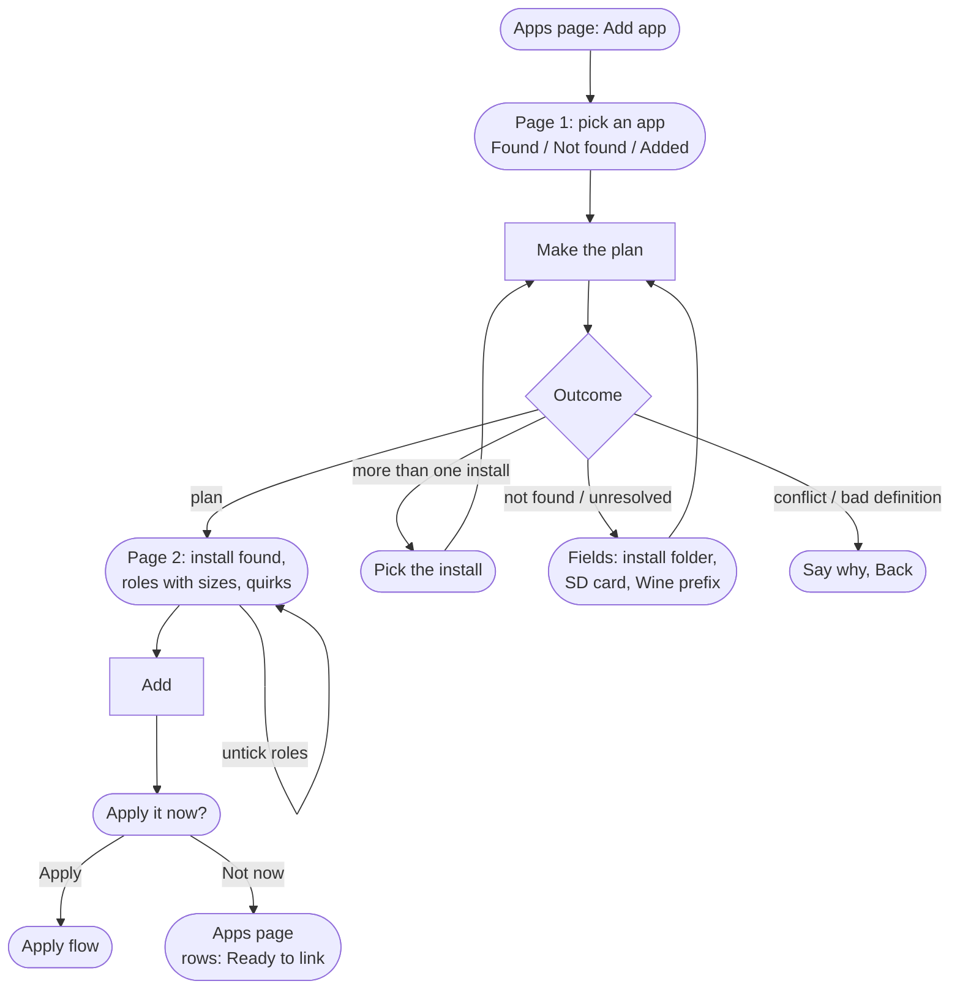
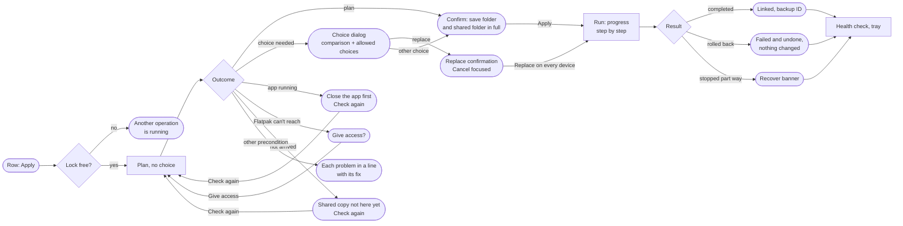
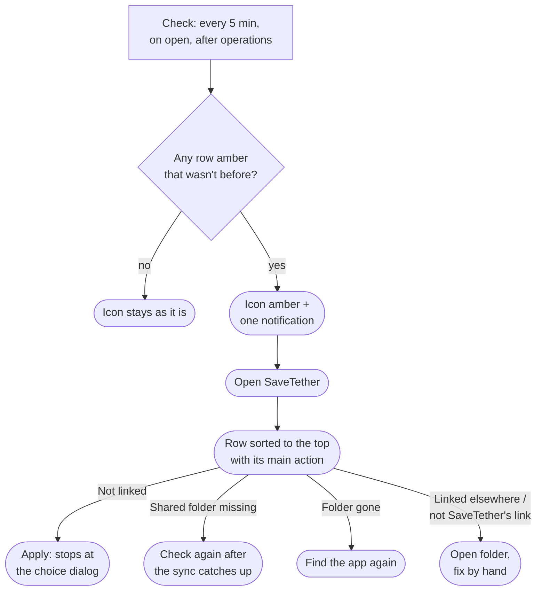
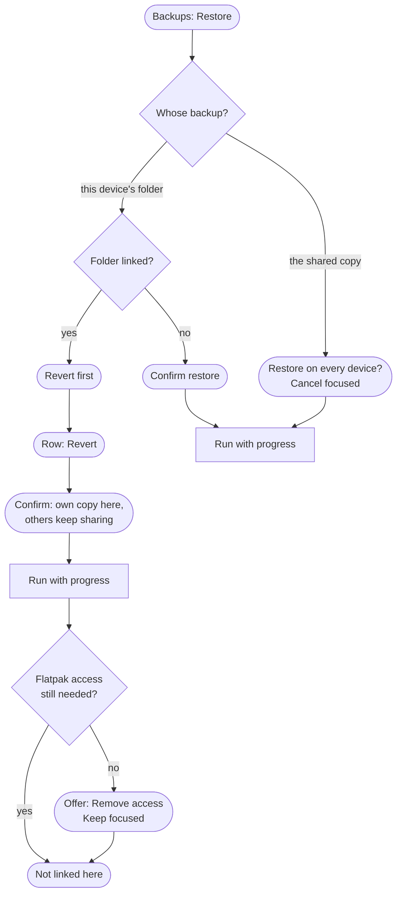

# Desktop app specification (phase 3)

Status: written 2026-11-17; the owner accepted every proposed answer to the open questions the same day (section 15). It specifies the desktop app of design 5.14 to the level of design 5.12. Built so far (2026-11-18): the core changes of section 13 except item 5, and the app shell, meaning sections 2, 3 and 3.1, with a window that shows the header, the banners of rows 1 to 5 and each mapping's state word. The pages, dialogs and actions of sections 4 to 12 are not built yet.

The design (`save-redirection-design.md`) says *what* SaveTether does and *why*. This document says what the window and tray icon show in every state, what each button does, and how every refusal the core can give reaches the person. Section numbers like "5.3" refer to the design.

## 1. Principles

1. **The app holds no logic of its own.** Every check, plan and change goes through the core (`Workspace`), exactly as the CLI does. The app decides only what to show and which choices to offer. If the app and the CLI disagree about what is allowed, the app is wrong.
2. **Only allowed choices are offered.** Where the CLI lists the allowed flags and refuses the others, the window offers only the allowed choices. A choice the core would refuse is never a button.
3. **The app speaks in its own words.** The core's messages are written for the CLI and name its flags (about 70 strings name a command or a flag today). The app writes its own sentence for each refusal *kind* and fills in the facts (paths, names, sizes) from the core's structured fields. The core's message is still shown, under "Details", so nothing the core knows is hidden. Section 13 lists the core change this needs.
4. **One operation at a time.** Within the app, and across processes, through the operation lock (section 9.1).
5. **Safe by default, with the keyboard alone.** Every dialog opens with focus on the choice that changes nothing. Escape always cancels or goes back. Nothing needs a mouse, a hover or a drag (section 12).
6. **Everything in one window.** Dialogs are overlays inside the main window, not separate OS windows. A dialog then cannot open behind the window or on another screen, and keyboard focus never has to move between windows.
7. **Desktop only.** The app runs on the Windows and Linux desktops, which on the Deck means Desktop Mode. It is not built or supported for Game Mode (decided by the owner on 2026-11-17). A Decky plugin with limited functions may cover Game Mode later (5.11, phase 4).

## 2. The process

- **One process, one copy.** `savetether-gui` holds a single-instance lock in the local folder (5.12, "Local files"). A second start sends "show the window" to the first copy and exits. Windows: a named mutex plus a named pipe. Linux: a lock file plus a Unix socket in the same folder. The operation lock (9.1) is separate: the app holds it only while an operation runs.

  *As built:* one mechanism on both systems, `gui.lock` held with no sharing (as the operation lock is) plus a Unix domain socket, which .NET supports on Windows 10 and later, so the code and its tests are the same everywhere. The socket is `gui.sock` in the local folder, or, when that path is too long for a socket, a name made from the local folder's path in `$XDG_RUNTIME_DIR` (Linux) or the temporary folder. A socket left by a killed copy is removed by the next copy through `SafeFs.DeleteSocket`, which refuses anything that is not a socket. If the claim cannot be made at all, the app runs without it and logs why.
- **Start.** With `--minimized` (used by the autostart entry, section 11) the app starts with the tray icon only. Without it the window opens. Either way it runs a health check at once.
- **Closing the window** hides it and leaves the tray icon running. The first time this happens, a notification says: "SaveTether is still running in the tray. Quit it from the tray icon's menu." Where there is no tray host (stock GNOME), closing the window quits. Detecting "no tray host" is not reliable on Linux (plan section 5, trial notes), so the rule is: on Linux, the app checks for an `org.kde.StatusNotifierWatcher` owner on the session bus at start; if there is none, closing the window quits (decision 1).
- **Quit** (tray menu, or Ctrl+Q in the window) is refused while an operation runs: "Wait for the current operation to finish." Operations are journalled transactions; stopping one half way is what `recover` exists for, not something to offer.
- **Log.** The app appends one line per operation, refusal and unexpected error to `gui.log` in the local folder, and keeps the last 1 MB. No paths beyond those already in the local files, no content of save files.

## 3. Overall state and the tray icon

The overall state is computed from one `Status()` report plus the journal, the lock and the setup state. The first row that matches wins.

| # | Condition | Icon | Tray menu first line | Window header |
|---|---|---|---|---|
| 1 | No `bootstrap.json` (device not set up) | amber | Not set up | the setup page (section 6) |
| 2 | A file has a newer schema than this version knows (`StoreProblem.SchemaTooNew`) | amber | Update SaveTether | banner B1 |
| 3 | Journal open (unfinished operation) | amber | An operation did not finish | banner B2 |
| 4 | Sync root unavailable (`SyncRootProblem` set) | amber | Sync folder not available | banner B3 |
| 5 | Device file mismatch | amber | Device name used by another install | banner B4 |
| 6 | Any mapping not OK and not Not applied | amber | *n* apps need attention | rows sorted to the top |
| 7 | Otherwise | green | All linked | "All linked" |

- **Two conditions added while building** (2026-11-18), both amber: *Cannot check this device*, after row 2, when the core refuses to report for another reason (this device's file missing from the sync folder, say; the window shows the core's message); and *Health check failed*, when checks fail unexpectedly three times in a row (section 10). Until the third, the icon keeps its last state.
- **Not applied stays green** (5.14): a mapping set up on another device and not wanted here is normal.
- **The lock does not change the state.** While another process holds the operation lock (a CLI `apply`, the Decky plugin), the folder it is working on may briefly look Replaced (renamed aside, 5.3). So while the lock is held by another process, a check's result is shown in the window but does not change the icon or raise a notification; the next check after the lock is released does.
- **Tray menu**: the first line above (disabled, as a label), then "Open SaveTether", "Check now", a separator, "Quit". Clicking the icon opens the window; the trial found the icon's position cannot be known reliably on Linux, so there is no panel beside the icon (plan section 5).
- **Icons**: two images, green and amber, each with a distinct shape as well as colour (a tick and an exclamation mark), so the state does not depend on telling colours apart.

### 3.1 Checks and notifications

- **When**: at start, every 5 minutes, when the window is shown or the tray menu opens, and after every operation. "Check now" in the window header and the tray menu. A check takes milliseconds (5.5); it runs off the UI thread, and a check already running is not started twice.
- **Notification** when a check finds a mapping in an amber state that it was not in at the previous check, or a new amber condition from rows 1 to 5. One notification per check at most, summarising: "Ryujinx saves: not linked. Eden saves: shared folder missing." At start, an amber state is notified once: this is the login check that 5.5 replaced with the tray icon. Nothing is notified when the state turns green; the icon changes.
- **How**: Windows, a toast through PowerShell's `Windows.UI.Notifications` (no new dependency); Linux, `notify-send` when it is on `PATH`, otherwise none. A notification that cannot be shown is logged and otherwise ignored. Clicking a notification is not required to do anything (decision 2): opening the window from a PowerShell toast needs an app ID registration, which the release archive does not do. The tray icon and its menu are the way in.

## 4. Window layout

Minimum 800 × 560, designed for 1280 × 800 (the Deck's screen) at 100 % scaling, base text 15 px.

- **Header**: device name, sync folder path, the overall state word with its icon, "Check now", and the time of the last check.
- **Banners**: zero or more, below the header, in the order of section 3's table. Each says what is wrong in one sentence and has its actions as buttons.
- **Pages**, as a tab strip under the banners: **Apps** (default), **Backups**, **Settings**. Ctrl+1, Ctrl+2, Ctrl+3 switch pages; the tab strip is also reachable with Tab.
- **Dialogs** are overlays over the page, with the page dimmed and not focusable underneath.
- **Busy**: while an operation runs, every action button in the window is disabled, and the operation's dialog shows its progress (section 9.3).

### 4.1 Banners

| # | When | Sentence | Actions |
|---|---|---|---|
| B1 | A shared or local file has a newer schema | "A newer version of SaveTether has written <file>. Update SaveTether on this device before going on." | Open the releases page (decision 3: a link, so the only network access is the person's own browser), Details |
| B2 | Journal open | "<Operation> of <mapping> did not finish. Nothing else can be done until it is recovered." | **Recover** (section 9.5), Details |
| B3 | Sync root unavailable | "The sync folder <path> is not available: <reason>. If it is on a drive or a network share, connect it." The reason is "it does not exist" or "the SaveTether folder is not in it", from the core's two cases (5.12, "Sync root unavailable") | Check again, Open the folder's parent |
| B4 | Device file mismatch | "Another SaveTether install uses the device name '<name>'. Two machines with one name would apply each other's folders." | **This is that device** (take over, section 6.3), **Use another name** (section 6.2), Details |
| B5 | The autostart entry points to a missing file | "SaveTether is set to start with the session, but the entry points to <path>, which is missing." | **Fix it** (rewrite the entry, section 11), **Turn it off** |
| B6 | The lock is held by another process | "Another SaveTether operation is running (<command>, started <time>). Actions are paused until it finishes." | none; the app re-checks the lock every 3 seconds while the window is visible |

While B1, B2 or B3 is shown, every action on the Apps and Backups pages is disabled, except "Open folder". The core refuses these operations anyway; disabling them avoids a click that can only fail.

## 5. Apps page

Mappings are grouped by app: the part of the mapping ID before the dot, named from the app's definition when there is one ("Ryujinx"), otherwise the ID itself. Inside an app, one row per role (mapping), named from the definition's role name ("Saves") or the part after the dot.

Each row shows: the state word and icon, one sentence, and the folder on this device. Rows needing attention, and the apps holding them, sort to the top; the rest are in name order.

Page actions: **Add app** (section 8), **Apply all** (section 9.4, shown when at least one row is Ready to link).

### 5.1 States

The core's `HealthState` has seven values. Not applied, Replaced and Broken each cover situations that need different words and actions, so the core says which with a `HealthReason` (section 13, item 2), shown below in the Situation column.

| Core state | Situation (reason) | Word | Colour | Sentence | Main action | Other actions |
|---|---|---|---|---|---|---|
| OK | | Linked | green | "Saves here are the shared copy." | none | Open folder, Open shared folder, Backups, Revert |
| Not applied | no folder set on this device (`no-save-folder`) | Not on this device | grey | "Set up on <devices>, not here." | Add (opens Add app at this app) | none |
| Not applied | folder set, not linked (`not-linked-yet`) | Ready to link | grey | "Not linked yet." | **Apply** | Open folder, Stop using here |
| Not applied | the folder in the device file is not an absolute path (`save-folder-not-absolute`) | Folder setting is wrong | amber | "This device's file has '<value>' as the folder." | Add again | Details |
| Replaced | the folder holds files (`folder-holds-files`) | Not linked | amber | "The link was replaced by a real folder. Saves made here are not shared." | **Apply** (stops at the choice, section 9.2) | Open folder, Backups |
| Replaced | the folder is empty (`folder-empty`) | Link missing | amber | "The link is gone and the folder is empty." | **Apply** | Open folder |
| Replaced | nothing at the folder (`folder-missing`) | Folder gone | amber | "Nothing is at <path>. If the app has moved, find it again." | **Find the app again** (Add app, section 8) | Apply |
| Replaced | a file or something else is where the folder was (`not-a-folder`) | Not a folder | amber | "Something other than a folder is at <path>. Move it away by hand, then apply." | Open folder's parent | Details |
| Broken | the shared folder is missing (`shared-folder-missing`) | Shared folder missing | amber | "The link is in place, but the shared folder is missing. It may not have synced yet." | Check again | Open folder, Open shared folder's parent |
| Broken | the sync root cannot be used (`sync-root-unavailable`) | Shared folder missing | amber | Covered by banner B3; the row repeats only "The sync folder is not available." | Check again | Open folder |
| Retargeted | | Linked elsewhere | amber | "The folder now links to <path> instead of the shared folder. Remove that link by hand, then apply." | Open folder | Details |
| Double seed | | Two shared copies | amber | "More than one device made its saves the shared copy: <devices>." | **Use this device's copy** (section 9.2, Double seed) | Backups |
| Foreign link | | Not SaveTether's link | amber | "The folder is a link SaveTether did not make, to <path>. Remove it by hand, then apply." | Open folder | Details |

"Not applied, no folder set" counts as grey but is listed after everything else, under a collapsed "Not on this device (*n*)" heading, so a device that uses three of ten shared apps is not cluttered.

*As built (2026-11-18):* `AppsPage` (presentation project) holds this table, the grouping and the order; the window shows each row's main action as a button and the others under **More**.

Changes from the table above:
- **Linked rows** have no main button, as the table says. Revert is under More. The previous build had made Revert the main action, which the table does not.
- **Opening folders.** Open folder uses `explorer` on Windows and `xdg-open` on Linux.
- **No device has a folder.** When no device has a folder set for the mapping, the row says "No device has a folder set for it." instead of "Set up on <devices>".
- **The collapsed section** stays open across checks, and its rows name their app, since there is no app heading above them.

*As built (2026-11-18), with Add app:* **Find the app again** (Folder gone) and **Add** (Not on this device) open Add app's page 2 for the row's app. Both are offered only when the catalog has a usable definition for the app (`MappingState.HasDefinition`); a mapping made by hand with `map add` has none, so its row keeps no main action there, as Add app could only refuse it.

Not built yet:
- **Backups**, which needs the Backups page.
- **Add again** on "Folder setting is wrong".
- **Opening the other actions by keyboard:** they are a Tab stop (the More button), not the Menu key or Shift+F10 (section 12).

**Stop using here** is `map remove`: refused by the core while applied, so it is only offered when Ready to link. It asks for confirmation: "Forget this device's folder for <role>? Nothing is deleted; the shared copy and other devices are not affected."

The "Folder setting is wrong" row turns the overall state amber, unlike the core's Not applied (decision 4). Keeping it green, as the CLI does, would leave a misconfiguration unnoticed.

## 6. First-run setup

Shown instead of the pages when there is no `bootstrap.json`, and reachable later from banner B4. Three steps, each a page with Back and Next; the result is one `Workspace.Init` call at the end, so nothing is written until the last step.

### 6.1 Sync folder

A path field and a "Choose folder" button. The folder picker is the OS dialog. The field accepts a typed path too, for a folder the picker does not show, such as a network share that is not mounted in the file manager.

On Next the app checks the folder and shows one of:

| Found | Shown | Offered |
|---|---|---|
| `savetether/.savetether/` exists | "This sync folder is already set up for SaveTether, on: <device names>." | Next |
| the folder exists but has no SaveTether folder | "This sync folder is not set up for SaveTether yet." and the two cases below | **This is my first device** (create-root), or Back |
| the folder does not exist | "<path> does not exist. If it is on a drive or a network share, connect it." | Back |

"This is my first device" asks for confirmation: "Only do this on the first device. If SaveTether is set up on another device, wait until the sync tool has delivered the SaveTether folder here instead; setting it up twice creates two separate setups." This is the GUI form of 5.3 invariant 5's protection against an empty mount point.

### 6.2 This device's name

- Existing device files are listed first, each with "Take over" (used after a wipe, 5.4). Below them, a field for a new name, filled with a suggestion from the machine's host name, lowercased, with characters outside `a-z 0-9 - _` dropped.
- The name is checked as typed against `Identifiers.IsValidDeviceName`, with the rule under the field.
- **Take over** needs confirmation (5.6): "Only take over '<name>' if this is that device, set up again. Two machines with one name would apply each other's folders." Buttons: Cancel (focused), Take over.

### 6.3 Backups, and finish

- The backup location: the default, or the one in the device file being taken over, with "Change". A location from the device file that does not exist is shown with the core's note (5.12, `init`): its drive may not be connected.
- **Set up** runs `Init`. A `StoreException` is shown in place with the step it belongs to, and nothing moves on.
- After setup the window shows the Apps page. When the device was taken over and has folders set (a restore after a wipe), it also shows: "This device has <n> apps set up. Apply them all now?" with **Apply all** (section 9.4) and Not now.
- First run only, before step 6.1: the install step of section 11, when the app is not running from the per-user location.

*As built (2026-11-18):* `SetupFlow` in the presentation project, shown by `SetupView`. Three choices were made while building it:
- **The lock.** Set up takes the operation lock. The app's own files mean the local folder exists before setup, so a CLI could run at the same moment.
- **The backup location.** It is passed to `Init` only when the owner changed it. Unchanged, the core decides, as the CLI does without `--backup-root`. So a taken-over device's location that is not there is not created, since its drive may only be disconnected; the page shows the core's note beforehand.
- **Typed paths.** A typed path may start with `~` on Linux.

Not built yet: the install step, the Apply all offer after a take-over (it needs operations, section 9.4), and reaching setup again from banner B4.

## 7. Operation flow, common to every action

Apply, Revert, Restore, Recover, Add app, Stop using here, the Flatpak grant and its revoke, Take over and changing the backup location are operations. Each:

1. Takes the operation lock (9.1). If another process holds it: "Another SaveTether operation is running (<command>). Try again when it has finished." Nothing else happens.
2. Plans (where the core plans): `PlanApply`, `PlanRevert`, `PlanRestore`, `PlanAppAdd`.
3. On a refusal, shows it (section 9) and releases the lock.
4. On a plan, shows the confirmation for that action, with the plan's steps in plain words under "Show steps". The lock is held while the dialog is open, so the plan cannot go stale behind it; a dialog left open for 10 minutes is cancelled and the lock released (decision 5).
5. Runs the plan with progress (9.3), then shows the result (9.3), releases the lock, and runs a health check.

*As built (2026-11-18), for Apply, Revert and Recover.* `OperationSession` (presentation project) holds the lock from the first plan to the result; `ActionFlow` (the app) shows the dialogs. While an operation runs, the app runs no health check, since its own lock is held and a folder may be renamed aside for a moment, and Quit is refused with section 2's sentence.

Choices made while building:
- **Arriving saves.** The choice dialog cannot know beforehand that the shared copy may still be arriving: the core says so only once add-missing or replace-shared is chosen (`RefusalKind.NotArrived` with `AssumeSyncedWouldHelp`). So that choice is followed by a dialog with section 9.2's sentence and "The shared saves really were deleted". Disabling the two choices in advance is not done.
- **Which button has the focus.** In refusal dialogs Cancel has the focus, not Check again: it is the choice that changes nothing.
- **Recovery's result** is worded as recovery succeeding: "Recovered: the unfinished apply was undone." The plain run's "failed and was undone" read as a new failure (found on the Deck).

Built since: the other row actions except Backups, and Apply all (section 5's notes); Add app (section 8's notes), which takes the lock only for Add.

Not built yet:
- Backups and Restore.

## 8. Add app

A guided `app add` (5.2, "Adding an app"; plan P2.5). Two pages and a confirmation.

**Page 1, choose an app.** The catalog's apps (shared definitions, then built-in, as `app list` shows them), in name order, with a search field that filters as typed. Next to each, filled in the background: "Found", "Not found" or "Added" (already has a folder on this device). Opening the page does not wait for detection.

**Page 2, the plan.** `PlanAppAdd` with what is known so far; then, by outcome:

| Outcome | Shown | Offered |
|---|---|---|
| Plan | The install used and what showed it is there; each role with its class, folder, size and file count, "already a link" or "not there yet" where so; the definition's quirks; each role's note | Role checkboxes (the definition's defaults ticked; `cache` and `media` classes unticked and labelled why), **Add** |
| `install-choice-needed` | "More than one install of <app> was found." and the candidates, each with what was found | Pick one, then the plan |
| `not-installed` | "<App> was not found on this device." with each install looked for and why it was not found | The fields below, for installs whose `ResolveProblem` is `needs-value`; Back |
| `unresolved` | "<Role>'s folder could not be worked out: <reason>." | The field that would resolve it, if any; Back |
| `unknown-install`, `unknown-role` | Cannot happen from the window, which only offers what the definition lists. Shown as an unexpected error (section 10) | |
| `invalid-definition` | "The definition for <app> has mistakes, so it cannot be used." with the core's message | Back |
| `conflict` | "<Role> is already set up differently: <facts>." Covers another target recorded, a role applied at another folder (revert it first), and a folder another mapping uses | Back |

**Fields** only for what cannot be found by looking (5.14): install folder, SD card, Wine prefix. Each is a path field with "Choose folder". After a field changes, the plan is made again.

**Add** runs `AddApp`. It changes no save data, so the confirmation is the plan page itself. Afterwards: "<App> added. Apply it now?" with **Apply** (section 9.2, for each role added) and Not now.

**Re-running for a moved app.** "Find the app again" on a Folder gone row opens page 2 for that app directly. The core's rule for a folder that is applied at the old place (revert first, unless the link moved with the folder) arrives as `conflict`.

**Add a folder by hand** (decision 6): a link at the bottom of page 1, for apps with no definition. A form for `map add`: mapping ID, target, save folder, process names, entry depth. It is the only way to add an unlisted app without the CLI. It comes late in phase 3, after the guided flow.

*As built (2026-11-18).* `AddAppFlow` (presentation project) holds the pages' logic and words; `AddAppScreen` (the app) shows them in place of the Apps page, which a check in the background does not replace.

Choices made while building:
- **The lock is taken for Add only.** Planning reads, and page 2 is made again at every field, install or role change, so holding the lock across the page (section 7, step 4) would pause health checks and every CLI command while the owner reads. Instead Add takes the lock, plans once more with the same request, and writes only if that plan matches the one shown (install, values, and each role's mapping, target, folder, new or not, depth). If it differs, page 2 shows the new outcome with "Something changed since this page was made. Check it again, then add." The point of section 7, a plan that cannot go stale behind the confirmation, is kept.
- **Roles.** Every role the chosen install has is listed; the definition's defaults are ticked. Ticking or unticking makes the plan again with exactly the ticked roles, so sizes are shown only for planned roles. A role that is off by default says why, as "Off by default: ...", ticked or not. Ticking a role whose folder cannot be worked out keeps the previous plan and says why. With none ticked, Add is off.
- **Fields** are found from the definition: an install that uses `{install_dir}` or `{sd_card}` in its detect rule, base or role paths gets that field, and a winpath on Linux gets the Wine prefix field. For `not-installed` they are offered for the installs that need a value, or for every install when the core says the app has moved (`GiveNewLocation`), prefilled with the remembered value. For `unresolved`, when the core says a location would help. A changed field takes effect with **Look again**, not at each keystroke. An install that needs a value is worded "can only be looked for once you give its location below", not with the core's token (found on the Deck).
- **Apply it now?** runs the ordinary Apply flow (section 9.2) for each role added, one after another, each its own operation.
- **Errors.** A refusal from the core while planning (`StoreException`, an unreadable file) is shown on the page with Back to apps; anything else is section 10's unexpected error, logged and shown on the page.

Not built yet:
- **Another install when one is found.** When exactly one install is detected, the core plans it, and the window offers no way to use another install of the same app instead (the CLI has `--install`).
- **Add a folder by hand.**

## 9. Apply, revert, restore, recover

### 9.1 Operation lock

Plan section 5 lists the lock as its own item; this is the behaviour both front ends rely on.

- File `operation.lock` in the local folder, opened with no sharing (`FileShare.None`) for the length of the operation. The OS releases it when the process ends, however it ends, so a killed process never leaves a lock that blocks. On Linux .NET takes an exclusive advisory `flock` for `FileShare.None`, which is enough because every party is SaveTether. Any other share mode takes a *shared* `flock`, which would let two processes in, so the mode must stay `None`. Proved by the lock's tests against a second process: PowerShell on Windows, `flock(1)` on Linux.
- The lock file is never deleted: deleting it while it is held would let another process lock a new file, and two operations would run.
- Who holds the lock goes in a separate file, `operation-holder.json` (schema, process ID, front end `cli` or `gui`, command, start time), because a file opened with no sharing cannot be read by another process. It is written just after the lock is taken and left in place afterwards, so a refusal names the holder only while that process is still running; otherwise the refusal does not name one.
- The CLI takes it for every command that writes: `init`, `map add`, `map remove`, `app add`, `apply` (including the Flatpak grant and revoke), `revert`, `backup restore`, `recover`. Not for `status`, `backup list`, `app list` or a dry run. It is taken before the journal is checked, since another process's running operation has its journal open. `init` on a device never set up takes no lock: there is no local folder yet, and taking the lock would create one, which a refused `init` must not leave behind. Two first-time `init`s at the same instant are not guarded against.
- CLI refusal: exit 1, "Another SaveTether operation is running (<front end> <command>, process <id>, started <time>). Nothing was changed. Try again when it has finished." `--json`: `"problem": "operation-running"`. Every store refusal now carries its kind in `problem`, so scripts can tell them apart.

### 9.2 Apply

**Apply** on a row runs `PlanApply` with no choice. By outcome:

**A plan.** A confirmation: "Link <role> on this device to the shared folder?" with the save folder and the shared folder in full (5.3 requires the plan to print both), "A backup is taken first" when the folder has data, and the steps under "Show steps". Buttons: Cancel (focused), Apply.

When the plan has `NeedsFirstSeedConfirmation`, the confirmation adds: "If <role> was already set up on another device, cancel and wait until it has synced here. Otherwise both devices will make their own saves the shared copy." (5.3, the one race.)

**A refusal**, by `RefusalKind`:

| Kind | Shown | Offered |
|---|---|---|
| `choice-needed` | The choice dialog, below | |
| `choice-not-allowed` | Cannot happen: the dialog offers only `AllowedChoices`. Shown as an unexpected error | |
| `confirmation-needed` | The replace confirmation, below | |
| `not-arrived` | "A device has shared these saves, but the shared folder here is still empty. The sync tool has probably not delivered it yet." | **Check again** (focused), and under "More": "The shared saves really were deleted", which re-plans with `AssumeSynced` after a confirmation |
| `foreign-link` | The Foreign link sentence from 5.1 | Open folder |
| `broken-link` | The Broken sentence from 5.1 | Check again |
| `precondition` | Every failure, one line each, from the table below | The actions in the table |

**Precondition failures**, by `PrecheckKind`. Several can come together (5.3, "Order of checks"); each is listed.

| Kind | Sentence | Offered |
|---|---|---|
| `sync-root-not-initialized` | Banner B3 covers it | |
| `unfinished-operation` | Banner B2 covers it | |
| `app-running` | "Close <app> first. SaveTether looked for: <process names>." | **Check again** (focused), and under "More": "<App> is closed", which re-plans with `AssumeClosed` after a confirmation: "SaveTether thinks <app> is running. Linking while it runs can lose the saves it writes on exit. Go ahead only if it is closed." |
| `sandbox-cannot-reach` | "<App> is a Flatpak and cannot write to the shared folder. SaveTether can give it access to the SaveTether folder in the sync root, and nothing else." | **Give access** (the grant, then re-plan), Cancel. Offered only when the core says the grant is the only thing in the way, as the CLI does (5.3, Flatpak precondition); otherwise the sentence alone, with Details |
| `source-parent-missing` | "The folder that should hold the save folder does not exist: <path>. The app may have moved, or not been started yet." | Find the app again |
| `backup-location-unusable` | "Backups cannot be written to <path>: <fact>." | Open Settings |
| `not-enough-space` | "Not enough free space on <volume>: <need> needed, <free> free." | none |
| `target-not-local` | "On Windows the sync folder must be on a local drive, because a folder link cannot point to a network drive." | none |
| `source-inside-sync-root`, `paths-overlap`, `target-outside-data-root`, `source-unusable`, `target-unusable` | "<role> cannot be linked as it is set up: <fact>." | Details |
| `not-applied`, `backup-unusable`, `restore-destination-unusable` | Revert and restore only; see 9.6 and 9.7 | |

**The choice dialog** (`choice-needed`). Title: "<Role> on this device already has saves." Then the comparison and the allowed choices.

- **Comparison** (5.4), grouped by entry (5.13's entry depth): "Only on this device", "Only in the shared copy", "On both, different", and a collapsed "On both, the same (*n*)". Each entry expands to its files with size and time. Above the groups: "Newest here: <time>. Newest in the shared copy: <time>."
- **Choices**, one per `AllowedChoices` value, as a list where nothing is selected at first. Continue is disabled until one is.

| Choice | Label | Sentence |
|---|---|---|
| `copy` | Share this device's saves | "These saves become the shared copy for every device." |
| `no-copy` | Use the shared saves (when the shared folder has data); Start empty (when it is empty) | "This device's saves are kept in a backup only. <App> will see the shared saves." / "This device's saves are kept in a backup only. <App> will see no saves until another device shares some." |
| `add-missing` | Use the shared saves, and add games only this device has | "Copies entries the shared copy does not have. Nothing in the shared copy is changed or deleted." |
| `replace-shared` | Replace the shared saves with this device's | "Every device's copy is replaced. The shared saves are backed up on this device first." |

- Every option ends with: "This device's saves are backed up first, whichever you choose."
- When `AssumeSyncedWouldHelp`, `add-missing` and `replace-shared` are shown disabled with: "The shared copy may still be arriving: it lacks files a device shared. Wait for the sync tool, or confirm it has finished." and a checkbox "It has finished syncing", which re-plans with `AssumeSynced`.
- `replace-shared` leads to the replace confirmation.

**The replace confirmation.** Its own dialog, never combined with the choice: "Replace the shared saves for <role> on every device?" then: "The shared copy is backed up on this device first. Then it is deleted and replaced with this device's saves. The deletion reaches every device through the sync tool." Buttons: Cancel (focused), **Replace on every device**. Nothing is typed (decision 7), although the CLI asks for a typed "yes": the separate dialog with Cancel focused already makes it deliberate, and on the Deck's Desktop Mode typing usually means the on-screen keyboard.

**Double seed.** "Use this device's copy" runs `PlanApply` with `replace-shared`. On a device where the folder is already the link (classification row 1) the confirmation instead says: "Make this device's copy the one every device keeps? No files change; the other devices' claims are marked as replaced." Where the sync tool kept the other device's files and this device's should win, the route is revert, restore and replace (5.3); the dialog says so and links to Backups.

### 9.3 Progress and results

- **Progress**: the plan's steps as a list, each ticked as the executor finishes it. Needs a progress callback from the executor (section 13, item 3).
- **Result**, by `ExecutionStatus`:

| Status | Shown |
|---|---|
| `Completed` | "<Role> is linked." (or reverted, restored), with the backup taken, and the executor's messages |
| `Refused` | As a refusal (9.2) |
| `RolledBack` | "<Operation> failed and was undone. Nothing has changed: <error>." with the executor's messages |
| `RecoveryNeeded` | Banner B2 appears; the dialog says "<Operation> stopped part way. Recover it before doing anything else." with **Recover** |

### 9.4 Apply all

For every row in the Ready to link, Not linked or Link missing state, one `PlanApply` with no choice, in name order, each its own operation. A mapping that needs a choice or is refused is skipped, and stays on the page with its reason. Rows that needed no choice are applied after one confirmation listing them all. Afterwards: "<n> linked. <m> need you:" and the list, each opening its own Apply.

This differs from the CLI's `apply --all`, which stops at the first mapping needing a choice. The window can show all of them at once, so it carries on.

*As built (2026-11-18):* all rows are planned in one operation session; the confirmation names those it will link and those that need you first; a run that stops part way ends Apply all, since nothing else may run until it is recovered. The summary names the rows still needing you; each is opened from its own Apply button.

### 9.5 Recover

Banner B2's **Recover** runs `Workspace.Recover()` after a confirmation that shows what is unfinished (the journal's operation and mapping) and that recovery either undoes or completes it (5.3, journal table). The result is shown as in 9.3. A shared-folder restore that recovery will not carry through reports the backup ID; the result shows it with "Open Backups".

### 9.6 Revert

**Revert** on a Linked row, after a confirmation: "Give this device its own copy of <role>? The shared saves are copied here and the link is removed. Other devices keep sharing." A refusal of kind `not-applied` (the folder is no longer this mapping's link) is shown with the row's current state.

After a revert, when the core says a Flatpak grant is no longer needed (`SandboxGrantNoLongerNeeded`), the result offers **Remove access** and Keep. Keep is focused, since removing it is only tidying up.

### 9.7 Backups page and restore

- A list grouped by mapping: time, reason (`pre-apply` "before linking", `pre-revert` "before reverting", `pre-restore` "before restoring", `baseline` "first backup", `snapshot` "snapshot"), whether it is of this device's folder or of the shared copy, size and file count. A filter by app. "Open folder" opens the backup's data folder: a backup is a plain tree (5.12) and can always be copied back by hand.
- **Restore**: `PlanRestore`. A refusal of kind `restore-destination-unusable` because the folder is a link: "<Role> is linked, so restoring would write into the shared copy. Revert first." with **Revert**. `backup-unusable`: "This backup is incomplete or damaged, so it cannot be restored." The first backup of a mapping is marked "Kept" (retention never removes it, 5.12).
- A backup of the shared copy needs a confirmation like the replace confirmation: "Restore the shared saves for <role> on every device?"

## 10. Errors outside the tables

- **`StoreException`**: shown in the dialog or page that caused it. Its `StoreProblem` picks the title (`NotFound` "Not found", `Invalid` "Not valid", `Conflict` "Already set up differently", `MappingsApplied` "Revert these first", `NotInitialized` banner B3, `SchemaTooNew` banner B1), and the message is the core's, which must therefore be free of CLI wording (section 13, item 1).
- **Anything else** (an `IOException` the core did not expect, a bug): "Something went wrong: <exception message>." with "Copy details" (type, message, stack trace) and a pointer to `gui.log`. The app keeps running and runs a health check, since the journal decides whether anything is unfinished. An exception from a background check is logged and the icon keeps its last state; three in a row turn it amber with "Health check failed".

## 11. Settings, installing, starting with the session

**Settings page.**

- **Start with the session**: a switch. On writes the entry, off removes it. Linux: `~/.config/autostart/savetether.desktop` (`$XDG_CONFIG_HOME` honoured), `Exec=<path> --minimized`. Windows: `HKCU\Software\Microsoft\Windows\CurrentVersion\Run`, value `SaveTether`, `"<path>" --minimized`. With the switch on, the app rewrites the entry with its current path at every start (5.14, "Distribution").
- **Backups**: the location, with **Change**, which runs `Init` again with the new backup root after a confirmation that existing backups stay where they are and are no longer listed. Moving them is not offered, since the core has no operation for it (decision 8).
- **This device**: name and sync folder, read only. Changing either is "Set up again", which shows the setup pages with the current values filled in. A new sync folder is refused while any mapping is applied here, as `map remove` is (decision 9): those links point into the old sync folder. The core's `Init` checks this (section 13, item 7); the refusal's next steps are one Revert per mapping, shown as a Revert button for each.
- **About**: version, the local folder (with Open), the licence.

**Installing.** The release archive is unpacked anywhere. On first run, when the app is not in the per-user location (`~/.local/bin` on Linux, `%LOCALAPPDATA%\Programs\SaveTether` on Windows), the setup starts with: "Install SaveTether for this user?" It copies both binaries (and the app's native libraries) there, starts the copy and quits; the unpacked files are left for the person to delete. Not now carries on from where it is. On Windows, an option "Make the `savetether` command available in terminals" adds the folder to the user's `PATH` (decision 10): a persistent change to the user's environment, so it is opt-in and unticked.

**Autostart pointing to a missing binary.** The CLI's `status` reads the entry and warns when its path is missing (`autostart_missing: <path>` in `--json`); the app shows banner B5. Neither changes the entry without being asked.

## 12. Keyboard and focus

The app works with the keyboard alone, for accessibility and for the Deck in Desktop Mode, where a controller's Steam Input desktop layout usually stands in for a mouse.

- Everything is reachable with Tab, Shift+Tab, the arrow keys, Enter and Escape, and focus is always visible (a 2 px outline in the accent colour).
- Lists move with the arrow keys; Enter opens a row's main action, and the Menu key or Shift+F10 opens its other actions as a list, never a hover menu.
- Every dialog opens with focus on its safe button. Escape is Cancel or Back everywhere. Enter never confirms a destructive choice from a text field.
- No tooltip carries information that is not also on screen.
- Text fields only where a value cannot be picked (device name, a path the picker cannot reach, search). Every path field has "Choose folder".
- Screen readers: every control has an accessible name (Avalonia's `AutomationProperties.Name`). Not tested beyond that in phase 3.

## 13. Changes needed in the core and the CLI

These come before or with the app, each its own small PR.

1. **Messages without CLI wording.** Core messages state what is wrong and the facts; the flag or command to use is added by the CLI's formatter, as the app adds its button. About 70 strings across 10 core files today. This removes the string replace in `CliApp` that strips " Add --confirm-replace to go ahead." from a core message.

   *Built 2026-11-17.* A refusal kind alone was not enough to choose the hint (a store error's `Conflict` covers several situations), so each message is a `Note`: its text, and the `NextStep`s that can follow it (an action such as Recover, or Revert with the mapping's ID). The CLI words each step in `Hints`; the app will word the same steps as buttons. `--json` keeps its shape: notes are written as one string, text then hint. The journal keeps plan notes as plain strings, so its format is unchanged. Every command and flag the CLI named is still named, but some sentences read differently, because the hint now follows the facts instead of sitting inside them. A test fails if a core source file names a CLI command or flag.
2. **Health reason.** `MappingHealth` gains a reason for the cases one state covers: Replaced (has files, empty, missing) and Not applied (no folder set, folder set, folder not absolute). Additive in `status --json`.

   *Built 2026-11-17* as `HealthReason`, `reason` in `status --json`, present only for Not applied, Replaced and Broken. Two situations were added while building it: Replaced by something that is not a folder (`not-a-folder`), and Broken because the whole sync root cannot be used (`sync-root-unavailable`) rather than one shared folder missing (`shared-folder-missing`). The Replaced details now give Apply as a next step, instead of naming apply in their text.
3. **Progress.** `Workspace.Run` and `Recover` take an optional `IProgress<PlanStep>`, reported after each step is journalled done. The CLI passes none.

   *Built 2026-11-17* as `IProgress<StepProgress>`, where `StepProgress` carries the step, its index, the step count, and Started or Done, so the window can show the current step as well as ticking finished ones. Each report follows the journal's record of the same thing. A recovery that carries an operation through first reports the steps already done, then the rest as they run; a recovery that undoes reports nothing, since undoing does not run the plan's steps. The callback runs on the executor's thread and must not throw: a throw is treated like a crash, leaving the operation to `recover`. The app passes a `Progress<T>`, which posts to the UI thread and does not throw.
4. **Operation lock** (9.1), in the core, used by the CLI and the app.

   *Built 2026-11-17* as `OperationLock` in the core's storage layer, used by the CLI. Section 9.1 describes what was built, including the holder file, the `init` exception and the new `problem` field in `--json`. The app will take the same lock.
5. **Autostart check** in `status` (section 11), once the app writes entries.
6. **Facts as fields.** Where an app sentence above needs a fact the core only has inside a message (not-enough-space's sizes, app-running's process names, a conflict's other folder), the refusal carries it as a field. Found while writing the app's texts; additive.

   *Built 2026-11-18.* A `PrecheckFailure` of kind `app-running` has `Processes` (`running`, `looked_for`), and one of kind `not-enough-space` has `Space` (`path`, `needed_bytes`, `free_bytes`). `path` is the folder the message names, not the volume, so the app finds the volume from it; sizes are in bytes, for the app to format. A conflict carries `ConflictFacts`: on `StoreException.Conflict` from `map add`, `map remove` and writing a mapping, and on `AppAddOutcome.Conflict` from `app add`. Its `kind` says which of four it is: `target-differs` (this mapping has another shared folder, given as `target`), `applied-elsewhere` (this mapping is linked at `folder`), `folder-in-use` (another mapping, `mapping_id`, has a save folder at, inside or around this one, given as `folder`) and `target-in-use` (another mapping uses this shared folder, or one that differs only by letter case). In `--json` they are `processes` and `space` on each failure, `conflict` beside `problem` for a store refusal, and `conflict` inside `app` for `app add`. Each appears only when set, so the output is otherwise unchanged. The messages are unchanged.
7. **Sync folder change guarded.** `init` with a sync root other than the one in `bootstrap.json` is refused while any mapping is applied on this device: its link points into the old sync folder, and the device would lose track of it. The refusal names the mappings to revert first. Applies to the CLI and the app alike (decision 9).

   *Built 2026-11-18* in `Workspace.Init`, before anything is written, so a refused `init` leaves the device as it was. The mappings come from this device's `state.json`, which is local and so readable with the old sync folder unmounted, and from its device file in the old sync folder when that is readable, in case the local record was lost. A mapping blocks when its save folder is a link into the old sync folder and the shared folder it points to exists. The refusal is a new `StoreProblem`, `MappingsApplied` (`"problem": "mappings-applied"` in `--json`), with one Revert step per mapping. A link whose shared folder cannot be reached does not block, by the owner's decision on 2026-11-18. It holds no saves, and `revert` would refuse it because it copies the saves back from that folder, so blocking would leave no way out but deleting links by hand. `init` goes ahead instead and returns a note for each such link, which it leaves in place. The same sync folder, given again, is not a change.

The JSON contract freeze (plan section 5) should come after items 1, 2 and 6, since they add fields to the output. *Done 2026-11-18, after all three: `docs/cli-json.md`.*

## 14. Code layout and testing

- **Projects**: `SaveTether.Gui` (Avalonia: views, the tray icon, the single-instance and notification code), and `SaveTether.Gui.Presentation` (view models, the app's texts, the state tables of sections 3 and 5.1, the flows of sections 6 to 9) with no Avalonia reference. The presentation project depends on the core only; the GUI project on both. The CLI stays free of the UI toolkit, as approved. *As built:* the single-instance claim and `gui.log` are in the presentation project, since they need no UI toolkit and can then be tested. The GUI project keeps the tray, the window, notifications and the tray-host check. Its views are built in code, with no XAML and no bindings, which suits Native AOT.
- **No build telemetry.** Avalonia's packages bring `Avalonia.BuildServices`, whose `AvaloniaStats` target reports each build to Avalonia. `Directory.Build.targets` replaces it with an empty target; a detailed build log shows the override and no `AvaloniaStatsTask`.
- **Bindings** are compiled bindings (Native AOT, plan section 5).
- **Tests** for the presentation project go in the existing test project, against real temporary folders as everywhere else (5.8):
  - Section 3's table, row by row, and its order.
  - Section 5.1's table: every `HealthState` and reason maps to a word, a colour and a main action.
  - **Exhaustiveness**: every value of `RefusalKind`, `PrecheckKind`, `AppAddProblem`, `StoreProblem`, `ResolveProblem` and `ExecutionStatus` has an app text; a new enum value without one fails a test.
  - The choice dialog offers exactly `AllowedChoices`, for each classification and with and without `AssumeSyncedWouldHelp`.
  - Notifications fire once per change, not per check, and not while another process holds the lock.
  - Each flow of sections 6 to 9 driven through its view model against fixture devices, including each refusal.
  - Autostart entries compared with expected text.
- **Not testable in CI**: the tray icon, notifications, the folder picker. These are the phase 3 lines of the hardware checklist (plan section 8).

## 15. Decisions

Proposed in the draft and accepted by the owner on 2026-11-17, all eleven as proposed.

| # | Question | Decided |
|---|---|---|
| 1 | On Linux with no tray host, should closing the window quit? (2) | Yes, detected by a StatusNotifierWatcher on the session bus |
| 2 | Clicking a notification on Windows opens nothing (3.1) | Accept for phase 3 |
| 3 | Banner B1 links to the GitHub releases page (4.1) | Yes; it opens the person's browser, the app makes no request |
| 4 | "Folder setting is wrong" turns the icon amber, unlike the CLI's Not applied (5.1) | Yes |
| 5 | A confirmation dialog left open cancels after 10 minutes, releasing the lock (7) | Yes |
| 6 | "Add a folder by hand" in the window (8) | Yes, late in phase 3 |
| 7 | Replace confirmation without typing (9.2) | No typing |
| 8 | Changing the backup location does not move existing backups (11) | Accept, and say so |
| 9 | Changing the sync folder is refused while any mapping is applied (11) | Yes |
| 10 | Opt-in "add to PATH" on Windows (11) | Offer it, unticked |
| 11 | Two projects, view models without Avalonia (14) | Yes |

## Appendix A. Flows of the common actions

Drawn from the sections above, as a summary; where a diagram and the text disagree, the text is right. Rounded boxes are what the person sees or does, rectangles are what runs, diamonds are what the core decides. Every flow ends with a health check, which updates the tray icon (section 3.1).

### A.1 First-run setup (section 6)

Nothing is written until "Set up". "This is my first device" is the only path that creates the SaveTether folder in the sync folder.

### A.2 Add an app (section 8)

The window asks only for what it cannot find by looking. Adding changes no save data, so the plan page is the confirmation.

### A.3 Apply (sections 7, 9.2, 9.3)

The window offers only the choices the core allows. The operation lock is held from planning until the result is shown.

### A.4 Fixing a problem the tray found (sections 3.1, 5.1)

### A.5 Revert and restore (sections 9.6, 9.7)

