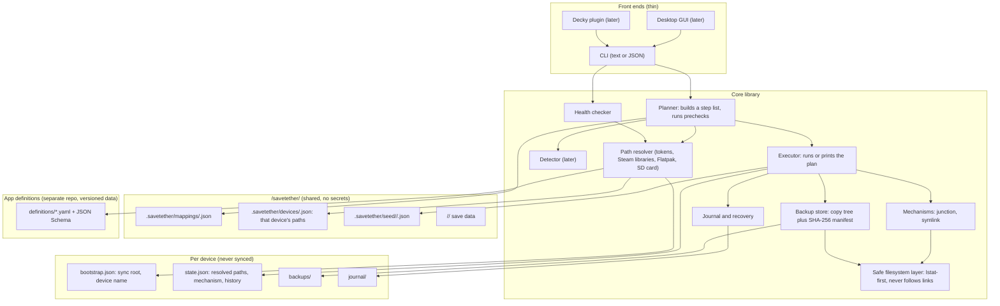
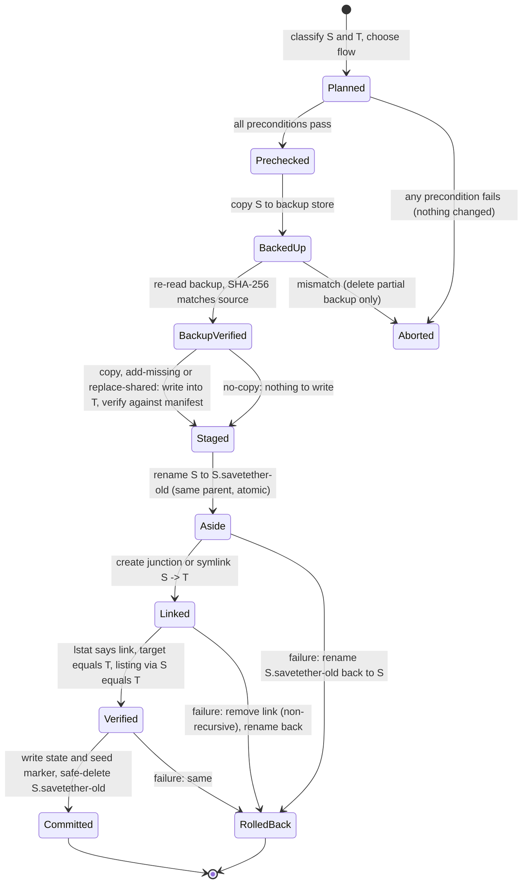

# SaveTether: cross-device save-folder redirection manager — design

Status: design proposal, nothing implemented. Written 2026-11-12 from the owner's design brief and revised the same day with the owner's answers (section 1). Open decisions resolved the same day (section 7), after an inventory of the Windows device (appendix B).

This document is self-contained. The facts from the brief that the design depends on (devices, current script mappings, known weaknesses) are reproduced in appendix A, so nothing else needs to travel with it to a new repository. Section 7 lists what is decided, what is still open, and where to start. "You" means the owner; "I" means the author of the design.

Labels used throughout: **[V]** verified by a source I checked today, **[K]** from my own knowledge and not re-checked, **[I]** inference. Section 6 says what would confirm each inference.

## 0. Bottom line

1. **The premise is mostly right.** Links from the app's save folder *into* one Syncthing folder are a sound mechanism. The scripts are the problem, not the links. On Windows, use **directory junctions** instead of `mklink /D`: no admin, no Developer Mode.
2. **The scope is not right for a first version.** You expect 10 to 20 apps. Weaknesses 1, 2, 3, 5, 7 and 8 are fixed by a single safe CLI with a mapping file. The GUI, autodetection, Decky plugin and community definitions are a product that is perhaps ten times that effort. Build the CLI, live on it, then decide whether the product is worth it.
3. **No existing tool does this job**, but Ludusavi is a real alternative for the Steam/Proton games if you accept copy-on-launch instead of live sync (design C).
4. **Recommended:** design A, a link manager (junction on Windows, symlink on Linux; config redirects were considered and deferred, see 5.13), as a CLI core that emits JSON, with UIs added later. Stack: C#/.NET Native AOT, with Rust the runner-up. Reasoning in section 3.2.
5. **Do this before any code:** the plaintext share credential in the Syncthing folder has already been copied to every device and to Unraid (and into any Syncthing file versions and backups). Moving the file is not enough. Rotate the credential.

## 1. Requirements and assumptions

### Requirements, restated

| # | Requirement | Source |
|---|---|---|
| R1 | No change to an app folder without a verified, timestamped backup outside the sync folder, restorable from the tool | weakness 1 |
| R2 | Every operation is idempotent, journaled and reversible | weakness 2 |
| R3 | When both the device and the sync folder hold data, the tool never picks a winner silently | weakness 3 |
| R4 | No device depends on another device's paths. Shared files read by every device (the mapping list) contain no machine paths; a device's own paths live only in that device's own file | weakness 4 |
| R5 | No admin on Windows, no root on SteamOS | weakness 5 |
| R6 | Only saves, plus what is needed to resume, are synced. NAND system folders are allowed | weakness 6 |
| R7 | A replaced, broken or re-pointed link is detected and reported | weakness 7 |
| R8 | No credentials in the sync folder or any shared file | weakness 8 |
| R9 | Windows x64, Linux x64, Linux ARM64, on an immutable OS | brief |
| R10 | Usable on the Deck with little Desktop Mode work | brief |

### Assumptions

- One person, one device in use at a time. Simultaneous play on two devices is out of scope beyond surfacing the conflict files.
- **The tool is not coupled to any sync product.** Something else moves `<sync root>/savetether/` between devices: Syncthing today, but it could be any tool that copies ordinary files and folders. SaveTether contains no Syncthing code and reads no Syncthing files or APIs. Everything it needs to know about sync state comes from files it writes itself in `savetether/.savetether/`. Integrations with a specific sync tool (idle check, its conflict files, its ignore patterns) are a possible later addition (5.10), never a requirement.
- What the tool needs from the sync tool: it syncs the contents of `savetether/` as ordinary files, it eventually delivers every file, and it does not need links inside `savetether/` (there are none; the links are in the apps' folders, pointing in).
- The device you stop on finishes syncing before you start on the next one. Playing offline is fine; the save reaches the others when the connection returns.
- The sync root is on internal, always-mounted storage on both current devices. The tool still checks, because that may not hold on a future device.
- All current mappings are directories. File-level mappings are deferred (see 2.1).
- **The tool owns one folder in the sync root: `<sync root>/savetether/`.** Every target has the shape `<sync root>/savetether/<app>/<save folder>`, and the tool's shared metadata lives in `<sync root>/savetether/.savetether/`. Everything else in the sync root (the old script-era app folders, `Scripts/`, `Backup/`) is ignored: never scanned, read, backed up or touched.
- **No migration.** The tool creates redirections from scratch. It does not adopt or convert links made by the old scripts. The owner moves old save data into the new structure by hand when ready (section 5.7).

### Owner's answers (2026-11-12) and what they change

| # | Question | Answer | Effect on the design |
|---|---|---|---|
| 1 | Is file versioning on at the sync host? | That is the user's choice. Redirection is the main feature; backups are an option | The design no longer relies on host versioning. The tool's own local backup store is the only safety net it can count on. Optional scheduled local snapshots of the shared targets are added to phase 2 |
| 2 | Does Steam Cloud cover FF IX? | Yes. Games with platform cloud saves are out of scope. Targets are standalone apps and games without cloud support | The tool warns before managing a game that has platform cloud saves. FF IX stays only as a format example |
| 3 | How many apps? | 10 to 20: about half emulators, the rest old Flash games and visual novels, on Windows and via Lutris on the Deck | Phases 1 and 2 are clearly worth it for personal use. Phases 3 and 4 are justified by the open-source aim, not by personal need. Lutris and non-Steam prefixes become first-class (5.2) |
| 4 | Save states? | Yes: saves and states. Screenshots optional, space permitting | State roles default to on. Media roles stay off, and the tool shows each role's size before enabling |
| 5 | Is Decky acceptable? | Yes, but the panel is compact | The Deck UI is a Decky plugin (5.11). The desktop GUI is deferred |
| 6 | Eden's path on the Deck? | Not installed at the moment; it is a yuzu derivative | Both candidate paths stay in the definition, marked untested |
| 7 | Suspend and switch? | No. Save, shut down, resume elsewhere. Redirection is the firm preference; reacting to app start and exit is not wanted | The copy-around-launch mechanism is dropped from the plan, not just deferred. Mechanisms are `link` and `config` only |

## 2. Solution designs

### 2.1 Mechanisms (applies to all designs)

Direction matters more than link type. **[V]** Syncthing never follows symlinks, and on Windows does not sync them at all; other sync tools treat links inconsistently **[K]**. So a link placed *inside* the sync folder pointing out is useless. The right way round, and the only one the tool uses: real data lives in the sync folder, and the app's folder is the link. Any sync tool then sees ordinary files, and its writes are invisible to the app.

| Mechanism | Privilege | Works for | Sync tool | App behaviour | Verdict |
|---|---|---|---|---|---|
| Symlink (Linux) | none | dirs and files, any filesystem | fine (data is real in the sync folder) | transparent. Wine and Proton resolve host symlinks below the prefix normally **[K]** | default on Linux |
| Directory symlink (Windows) | admin, or Developer Mode | dirs and files | fine | transparent | avoid; junctions do the same job for directories |
| Junction (Windows) | none | directories on local volumes, cross-drive allowed, absolute target only | fine | transparent to almost everything | default on Windows |
| Config redirect | none | apps with a save-path setting (RetroArch, Dolphin, PCSX2, DuckStation) | fine | the most robust: nothing to be replaced on disk | deferred on 2026-11-12 (5.13): links cover the same apps, and this means editing files the app owns |
| Bind mount | root, and a persistent unit on SteamOS | anything | fine | transparent | rejected: needs root, fragile across SteamOS updates |
| Copy in/out around launch | none | anything, including single files, with file-level filters | best isolation: Syncthing never touches a file the game has open | needs a launch hook per game; nothing syncs if the game never exits cleanly (crash, or Deck suspended mid-game) | rejected by the owner: no reacting to app lifecycle |
| One Syncthing folder per save folder | none | directories | native | no redirection at all | design B |

Behaviours that need handling whatever the choice:

- **Atomic-rename saves** (write temp, rename over). Safe through a directory link, because temp and final file are both inside the target. This is why you link the *directory*, never an individual file.
- **Apps that delete and recreate the save folder.** `rmdir` on a link fails or removes only the link; the app then makes a real folder and saves stop syncing. This is the main drift case (R7). Linking one level higher avoids it for known offenders, and the definition records that. A config redirect would avoid it too; that mechanism is deferred (5.13).
- **Cross-filesystem rename.** If an app builds a save in its cache folder and renames it into the save folder, a link to another volume turns that into a cross-device rename, which fails. Most apps fall back to copy. Record exceptions as quirks.
- **Flatpak sandboxes.** A link inside `~/.var/app/<id>/` that points to `~/Sync/...` dangles *inside the sandbox* unless that Flatpak has filesystem access to the target. Your PPSSPP link works today, so that access exists, probably via EmuDeck's overrides **[I]**. The tool must check this before applying and offer `flatpak override --user --filesystem=<target> <id>`, which needs no root.
- **Proton prefix lifecycle.** Deleting `compatdata/<appid>` removes the link, not the target. A recreated prefix has a real folder again: drift, caught by the health check.
- **File-level links on Windows.** File symlinks need privilege and hard links break on the first atomic rename. If a game keeps one save file among junk, link the directory and filter the junk with ignore patterns instead.
- **Case sensitivity.** Windows filesystems ignore case; the Deck's do not. A game under Wine may write `SaveData` where the Windows build wrote `savedata`, giving two folders on Linux and one on Windows. Targets in the shared mapping list are therefore fixed, exact-case names chosen by the tool, and the health check flags names in a target that differ only by case **[I]**.
- **Footprint.** Link the narrowest directory that holds saves, and leave cache and media roles off. That is the whole footprint control the core has, because filtering files out of a linked folder is the sync tool's job and the core does not talk to one. A later Syncthing integration could generate ignore patterns: **[V]** `.stignore` is per-device and not synced, but it supports `#include`, so each device's `.stignore` could include one synced, generated pattern file.

### 2.2 Design A: link manager (recommended)

**Architecture.** One core library, one CLI that can print JSON, UIs layered on the CLI later. No daemon.

**Mechanisms.** Chosen per role in the app definition: `link` (junction on Windows, symlink on Linux), or `config` (edit a key in the app's config file).

**Data model.**

- *App definition* (shared, read-only data): how to find an app and which folders ("roles") it has, each classed as save, system, state, cache, mod or media.
- *Mapping list* (shared, in `<sync root>/savetether/.savetether/`): which roles of which apps are enabled, and their path relative to `<sync root>/savetether/`. No machine paths.
- *Device config* (shared, one file per device in `<sync root>/savetether/.savetether/devices/`): that device's source paths, process names, backup location and token overrides. Only the owning device reads it, so a wiped device can be restored from it (5.4).
- *Bootstrap* (local): the sync root path and this device's name. The only thing the tool needs before it can read the shared folder.
- *Device state* (local): resolved paths, mechanism used, backups taken, journal. Rebuildable from disk, except backup history.

**Apply/revert.** A journaled transaction, section 5.3.

**UX.** Windows: CLI first, desktop GUI later. Deck: CLI over SSH or Konsole first; later a Decky plugin that calls the CLI (5.11).

**Effort.** Core transaction engine and safe filesystem layer M. CLI S. Resolver and definitions format M. Detection M. Desktop GUI M to L. Decky plugin M. CI, packaging and signing M.

### 2.3 Design B: Syncthing orchestrator (no redirection)

**Idea.** Do not move or link anything. Make each save folder its own Syncthing folder with a deterministic folder ID (`savetether-ppsspp-savedata`), configured through Syncthing's local REST API. Each device maps that ID to its own path, which is exactly the per-device path mapping you need, and Syncthing already has it.

**Strengths.** There is no destructive step and nothing for an emulator update to replace. If a folder is recreated, its `.stfolder` marker disappears and Syncthing stops that folder with a visible error, which is a free health check. `.stignore` per folder gives precise footprint control.

**Weaknesses.**
- First sync of two populated folders is a file-by-file merge done by Syncthing, with conflict copies. For multi-file saves that can produce a mixed state. The tool would have to stage this (back up, then set the joiner receive-only or empty it first), so the onboarding logic of design A is still needed.
- Unraid must accept every new folder. Auto-accept exists **[K]**, but your backup tree becomes dozens of folders.
- The tool needs the Syncthing API key on each device (read locally at run time, never stored in shared config) and is tied to Syncthing for good.
- `.stfolder` and `.stignore` appear inside game save folders. Usually harmless, not guaranteed.
- Migration means undoing your current layout rather than adopting it.

**Effort.** Syncthing API client M. Onboarding logic M. The rest as design A. No link layer, so the riskiest code in A disappears, replaced by dependence on Syncthing's config API across three installs.

### 2.4 Design C: adopt Ludusavi, wrap game launch

**Idea.** Build nothing for PC games. Ludusavi already has **[V]** a `wrap` command that restores before launch and backs up after exit (usable as a Steam launch option), custom games, path redirects between Windows and Proton locations, and rclone cloud sync. Point its backup folder at the Syncthing folder, or use its rclone support against Unraid. Keep a small safe-link script only for emulators.

**Strengths.** Least code. Ludusavi's backups are real, versioned backups. Saves are never open while Syncthing writes them.

**Weaknesses.**
- Nothing syncs unless the game exits cleanly. A suspended Deck never runs the backup step.
- Emulators are not in its manifest. Every emulator is a hand-made custom entry on every device, and emulators launched through EmuDeck or LaunchBox need their own launch hooks.
- Cross-OS restore relies on redirects that Ludusavi's own users report as game-specific and sometimes unworkable **[V]** (third-party write-up).
- Health, onboarding policy and the emulator half of your list are still unsolved, so you would still write a tool.

**Effort.** Configuration S per game. Emulator link script S to M. Ongoing manual upkeep on every device.

### 2.5 Other existing tools

- **EmuDeck CloudSync.** rclone-based, emulators only, and **[V]** still marked early access for Patreon supporters in the sources I found (none dated 2026). It targets cloud providers; I did not confirm whether a self-hosted target fits your Unraid setup. It does not cover standalone games. EmuDeck also owns the folder layout under `Emulation/`, and a reset or update can recreate folders your links replaced, so the health check should expect it.
- **Syncthing alone.** That is design B done by hand. It works for five folders and stops being pleasant around twenty.
- **Steam Cloud.** Free and already correct for the games that support it. Check each Steam game before managing it.

## 3. Comparison

### 3.1 Designs

| | A: link manager | B: Syncthing orchestrator | C: Ludusavi + wrap |
|---|---|---|---|
| Safety | Good, if the transaction engine is right. Has one inherently risky step (the switch) | Best on disk: no destructive step. First-sync merge is the risk | Good. Copies only |
| Footprint | Narrow links plus generated ignore patterns | Best: per-folder ignores | Best: file-level |
| Syncs while game is suspended | Yes | Yes | No |
| Deck usability | CLI now, Decky plugin later | Same | Launch options per game; Ludusavi GUI in Desktop Mode |
| Maintainability | One engine, data-driven | Depends on Syncthing's API and config on three hosts | Low code, high manual upkeep |
| Works with another sync tool later | Yes | No | Yes |
| Migration from today | None by the tool: fresh `savetether/` tree, owner copies old data in by hand | Undo links first | Undo links first |
| Effort to replace the scripts | M | M to L | S to M, incomplete |
| Steam Frame readiness | Needs an ARM64 build; mechanism unchanged for native Linux apps | Same, plus Syncthing must run there | Depends on Ludusavi ARM64 builds |

### 3.2 Tech stacks

Scores 1 (poor) to 5 (good). Learning cost: 5 means nothing to learn.

| Stack | Portability | Maintainability | Contributor appeal | Deck / Game Mode fit | Your learning cost |
|---|---|---|---|---|---|
| C#/.NET, Native AOT CLI, Avalonia GUI later | 4 | 5 | 3 | 4 | 5 |
| Rust CLI, egui or iced GUI later | 5 | 4 | 4 | 4 | 2 |
| Go CLI, thin UI | 5 | 4 | 4 | 3 | 4 |
| C++ with Qt | 4 | 3 | 2 | 5 | 5 |
| C++ with Dear ImGui | 4 | 3 | 2 | 4 | 5 |
| Python | 2 | 3 | 5 | 2 | 4 |
| Electron | 3 | 2 | 4 | 3 | 3 |

Notes per candidate. All **[K]** unless marked.

- **C#/.NET 10 (LTS).** Symlinks, link targets and `lstat`-style metadata are in the base library on all three targets (`CreateSymbolicLink`, `LinkTarget`). Creating a junction is not; it is about sixty lines of P/Invoke (`DeviceIoControl` with `FSCTL_SET_REPARSE_POINT`). Native AOT gives a single binary of a few MB for a CLI with fast start, but AOT cannot cross-compile between operating systems, so CI needs a native runner per target. GitHub provides Linux ARM64 runners for public repositories. Depends on glibc, which SteamOS has. Avalonia is the strongest non-Qt cross-platform GUI and supports AOT. Testing story is excellent.
- **Rust.** Static musl binaries with no runtime dependency, the easiest ARM64 cross-compile after Go, exhaustive `match` suits the state machine. Junctions need a small crate or raw Win32. GUI crates are younger and change more often. The common YAML crate was archived in 2024, so pick a format with care. Cost: several weeks before you are productive, on a tool where mistakes delete saves.
- **Go.** Best cross-compilation of all, static binaries, learnable in days. Reads junctions natively; creating them needs `x/sys/windows`. Syncthing and rclone are Go. The GUI options are the weakest here (Fyne needs cgo and OpenGL, Wails needs a web view), so Go fits only if the UI is a Decky plugin or a terminal UI.
- **C++/Qt.** The best controller-friendly UI via QML, and native to the Deck's KDE desktop. LGPL is fine with dynamic linking. Build and packaging for three targets is the heaviest of any option, and few drive-by contributors will set up a Qt toolchain. Qt 6 dropped its gamepad module, so you need SDL anyway.
- **Dear ImGui.** Built-in gamepad navigation and a tiny binary. Poor text input and accessibility, and it looks like a debug tool. Reasonable only as a dedicated Game Mode front end.
- **Python: ruled out for the core.** SteamOS ships Python, but its version changes with OS updates and you cannot install packages on the immutable root. Freezing with PyInstaller gives large per-architecture bundles. It remains mandatory for a Decky backend.
- **Electron: ruled out.** Over 100 MB to wrap filesystem calls it does worse than every other option.

**Stack recommendation: C#/.NET.** This is not because you know it; it is because the other differences are small and that one is large. All three leading stacks produce a single binary for all three targets. The realistic contributor base for this project will send app definitions (data files, language-neutral), not engine code, so "contributor appeal" of the core language matters less than it looks. That leaves learning cost, and writing delete-adjacent filesystem code in a language you are learning is a safety cost, not just a time cost.

I would switch to **Rust** if: you want the project to sit close to Ludusavi and share code or maintainers with it, Avalonia misbehaves under gamescope or on ARM64 SteamOS, or a glibc dependency becomes a problem on some future device. I would switch to **Go** if you decide the only UI will ever be a Decky plugin.

**Parts with a fixed language regardless:** a Decky plugin is Python (backend) and TypeScript/React (frontend). Junction creation is Win32 from any language.

### 3.3 Distribution and UI shape

| Channel | Verdict | Why |
|---|---|---|
| Single binary in `~/.local/bin` or `%LOCALAPPDATA%` | **Primary** | Nothing to install, survives SteamOS updates (it is in `/home`), no sandbox |
| AppImage | For the GUI on Linux | Works on the Deck without root; needs FUSE, which SteamOS has |
| Flatpak / Flathub | Not recommended | The tool must write into other apps' `~/.var/app` data, Proton prefixes and SD cards, and inspect host processes. That needs `--filesystem=host` plus a host-spawn permission, which defeats the sandbox and draws Flathub review objections. Flathub also requires offline source builds |
| Decky plugin | Later, as the Game Mode UI | A thin shell over the CLI's JSON output. Store submission needs open source, review, and declared binaries |
| winget / Scoop | Later | Both are a manifest with a URL and hash. Neither requires signing |

Controller use without Decky: a desktop GUI added as a non-Steam shortcut runs in Game Mode, and Steam Input can map the D-pad and buttons to arrow keys, Enter and Escape. So the GUI needs good keyboard focus navigation, not gamepad code.

**UI shape: CLI core, thin UIs.** The CLI is also the test harness and the Decky backend's only dependency.

## 4. Recommendation

Build **design A** in **C#/.NET**, phase 1 as a link-only CLI with mappings entered by hand through `map add`, creating redirections into a fresh `<sync root>/savetether/` tree.

Main trade-offs:

- A keeps one inherently risky step (replacing a folder with a link). B does not. I still prefer A because it keeps one tidy tree on Unraid and does not marry you to Syncthing's API. The risk is contained by the invariants in 5.3.
- Live links mean Syncthing can write into a folder while an emulator has it open. This is true today and has evidently been tolerable. If one app proves fragile, the remedies are a config redirect or leaving that app unmanaged.

What would change my mind:

- Phase 1 testing shows an emulator you care about repeatedly replaces its link. Build config redirects (deferred, 5.13) for those apps, then consider B.
- Nobody else shows interest after a public phase 2 release. For 10 to 20 personal apps the CLI is enough, so phases 3 and 4 would then be effort without a user.
- Flash and visual-novel saves turn out not to live in stable, linkable directories (see section 6). That would cut the non-emulator half of your list.

## 5. Recommended design in detail

### 5.1 Components



Local locations: `%LOCALAPPDATA%\SaveTether` on Windows; `~/.config/savetether` and `~/.local/share/savetether` on Linux. The backup location is configurable because the Deck's internal storage is small, but the tool refuses any location inside the sync root.

### 5.2 Definition format

YAML validated by a JSON Schema, one file per app. YAML needs a third-party parser; YamlDotNet was approved for this on 2026-11-12, subject to proving it works under Native AOT. JSON with comments is the dependency-free fallback.

Tokens: `{home}`, `{appdata}`, `{localappdata}`, `{locallow}`, `{documents}`, `{xdg_config}`, `{xdg_data}`, `{flatpak:<id>}` (to `~/.var/app/<id>`), `{steam_compatdata:<appid>}` (found by reading Steam's `libraryfolders.vdf`, since the prefix lives in whichever library holds the game, which may be the SD card), `{sd_card}`, `{emudeck}` (EmuDeck's configured `Emulation` root), `{install_dir}` (set per device for portable apps).

A `winpath` location is the one cross-OS trick: on Windows it resolves natively, on Linux it resolves inside a Wine prefix. One line covers both. The prefix is named by kind, because your non-emulator apps are mostly not Steam titles:

- `prefix: { steam: <appid> }` for a Steam game under Proton.
- `prefix: { steam_shortcut: <name> }` for a non-Steam game added to Steam. Steam generates the ID, so it is looked up from Steam's shortcuts file by name on each device.
- `prefix: { lutris: <slug> }` for a Lutris game. The prefix path is read from that game's Lutris config **[K]**.
- `prefix: { path: ... }` set in that device's config file, as the fallback.

Games with platform cloud saves are out of scope. Where the tool can tell (the Ludusavi manifest records this per game **[K]**), it warns before managing one.

Schema, abbreviated:

```yaml
schema: 1                # format version
id: string               # stable, lowercase
name: string
kind: emulator | game
installs:                # ways this app can exist on a device; detection picks one
  - id: string
    os: windows | linux
    detect: { dir: path } | { file: path } | { flatpak: id } | { steam: appid }
    base: path           # root that role paths are relative to
roles:
  - id: string
    class: save | system | state | cache | mod | media
    default: bool        # enabled when the app is added
    mechanism: link      # the only mechanism (config redirects are deferred, 5.13)
    path: string | { <install-id>: string }   # relative to base
    target: string       # relative to <sync_root>/savetether/<app-id>/
    entry_depth: int     # how many folder levels down one game's saves sit; default 1 (see 5.13)
    ignore: [pattern]    # files a sync-tool integration may exclude (later; unused by the core)
    notes: string
quirks: [string]
```

**Switch emulator (Eden).** The Deck paths are untested: Eden is not installed on the Deck at present. The definition lists both candidates and detection uses whichever exists, asking if more than one does.

```yaml
schema: 1
id: eden
name: Eden
kind: emulator
installs:
  - id: win-portable
    os: windows
    detect: { dir: "{install_dir}/user/nand" }
    base: "{install_dir}/user"
  - id: emudeck-eden          # unverified path
    os: linux
    detect: { dir: "{emudeck}/storage/eden/nand" }
    base: "{emudeck}/storage/eden"
  - id: emudeck-yuzu-layout   # what the current Deck script uses
    os: linux
    detect: { dir: "{emudeck}/storage/yuzu/nand" }
    base: "{emudeck}/storage/yuzu"
roles:
  - id: saves
    class: save
    default: true
    mechanism: link
    path: "nand/user/save"
    target: "save"
  - id: nand-system
    class: system
    default: true
    mechanism: link
    path: "nand/system"
    target: "system"
    notes: >
      Holds the user profiles. Save paths contain the profile ID, so saves
      do not line up across devices unless profiles are shared.
  - id: mods
    class: mod
    default: false
    mechanism: link
    path: "load"
    target: "load"
```

**PPSSPP.**

```yaml
schema: 1
id: ppsspp
name: PPSSPP
kind: emulator
installs:
  - id: flatpak
    os: linux
    detect: { flatpak: org.ppsspp.PPSSPP }
    base: "{flatpak:org.ppsspp.PPSSPP}/config/ppsspp/PSP"
  - id: win-portable
    os: windows
    detect: { dir: "{install_dir}/memstick/PSP" }
    base: "{install_dir}/memstick/PSP"
roles:
  - { id: savedata, class: save,  default: true,  mechanism: link, path: "SAVEDATA",     target: "PSP/SAVEDATA" }
  - { id: states,   class: state, default: true,  mechanism: link, path: "PPSSPP_STATE", target: "PSP/PPSSPP_STATE" }
  - { id: textures, class: media, default: false, mechanism: link, path: "TEXTURES",     target: "PSP/TEXTURES" }
  - { id: shots,    class: media, default: false, mechanism: link, path: "SCREENSHOT",   target: "PSP/SCREENSHOT" }
  - { id: game,     class: mod,   default: false, mechanism: link, path: "GAME",         target: "PSP/GAME" }
```

**RetroArch.** The `saves` and `states` folder names are RetroArch's defaults as far as is known **[K]**; check them on each device before this definition is used.

```yaml
schema: 1
id: retroarch
name: RetroArch
kind: emulator
installs:
  - id: flatpak
    os: linux
    detect: { flatpak: org.libretro.RetroArch }
    base: "{flatpak:org.libretro.RetroArch}/config/retroarch"
  - id: win-portable
    os: windows
    detect: { file: "{install_dir}/retroarch.cfg" }
    base: "{install_dir}"
roles:
  - id: saves
    class: save
    default: true
    mechanism: link
    path: "saves"
    target: "saves"
  - id: states
    class: state
    default: true
    mechanism: link
    path: "states"
    target: "states"
quirks:
  - "savefile_directory and savestate_directory in retroarch.cfg must be at their defaults, so RetroArch uses the linked folders."
  - "The sort-saves-by-core and by-content settings must match on every device, or the same game saves to different subfolders."
```

**Proton game (Final Fantasy IX).** Format illustration only. FF IX has Steam Cloud, so it is out of scope and the tool would warn.

```yaml
schema: 1
id: final-fantasy-ix
name: FINAL FANTASY IX
kind: game
installs:
  - id: steam
    os: [windows, linux]
    detect: { steam: 377840 }
    base: { winpath: "{locallow}/SquareEnix", prefix: { steam: 377840 } }
roles:
  - id: saves
    class: save
    default: true
    mechanism: link
    path: "FINAL FANTASY IX"
    target: "."
quirks:
  - "Has Steam Cloud: out of scope."
```

**Reusing the Ludusavi manifest.** Yes, there is an open database, and it is meant to be reused.

- **[V]** The manifest is a YAML file in its own repository, compiled from PCGamingWiki plus Steam's API for install-folder names. Its README says the format is intended to be generic enough for any game backup tool to implement, and publishes a schema for tools to code against.
- **[V]** The repository's licence is MIT (GitHub's licence API).
- **[V]** PCGamingWiki's own site says content is "available under Creative Commons Attribution Non-Commercial Share Alike" (pcgamingwiki.com, Copyrights page footer). The version is not stated there.

So the code and format are freely usable, but the data inherits PCGamingWiki's terms: attribution, non-commercial, share-alike. For a free open-source tool that is workable if you follow three rules. Download the manifest on the user's machine at run time, as Ludusavi does, and do not ship it inside releases. Never copy its entries into SaveTether's own definitions, which keeps your definitions free of the share-alike and non-commercial terms. Credit PCGamingWiki and Ludusavi in the UI and README. This is my reading, not legal advice; a short note to Ludusavi's maintainer would settle whether other tools already do this.

What it gives you: save locations for PC games as Windows paths with placeholders, which map onto the `winpath` and prefix resolution above, plus the per-game cloud flag. What it does not give you: emulators (not covered at all), and probably thin coverage of obscure visual novels and Flash games **[I]**. It lists files to *back up*, which can be individual files among other content, so an entry is a starting hint for a link, not a ready-made mapping. Plan on it as an optional detection aid in phase 3, not a foundation.

### 5.3 Apply and revert

**Invariants.** These are the design; everything else is detail.

1. **Never descend a link.** Every delete goes through one routine that `lstat`s each entry and unlinks links without following them. A junction is removed with a non-recursive directory removal. There is no other delete in the codebase.
2. **Never delete save data inside the sync root.** A deletion there propagates to every device. The single exception is an explicit, confirmed "replace shared data with this device's data", and it backs up the shared copy locally first. Revert *copies* out of the sync root; it never moves. The tool's own metadata files in `savetether/.savetether/` are not save data: the tool may rewrite or retire them (for example superseding seed markers), but only through the safe filesystem layer.
3. **No change without a verified backup outside the sync root.**
4. **Originals are renamed aside, not deleted,** until the link is verified.
5. **No sync root marker, no operation.** The sync root must contain `savetether/.savetether/`, created once by `init --create-root` on the first device and delivered to the others by the sync tool. An unmounted drive leaves an empty mount point, which fails this check. Plain `init` never creates the marker, so it cannot be fooled by pointing it at an empty mount point. Using the tool's own marker instead of Syncthing's `.stfolder` keeps the tool independent of the sync product.
6. **No silent winner, no clobbering.** Copying this device's saves into the shared location is always an explicit choice, never a default. If the shared target already holds data, a plain copy is refused; only "add missing" (never overwrites) or a doubly confirmed "replace shared" can write into it.

**Setup choices.** Setup is run on every device. On each one, for each mapping, the owner says what happens to this device's existing saves. A backup is taken first in every case.

| Choice (`apply` flag) | Effect | Allowed when |
|---|---|---|
| `--copy` | This device's saves become the shared copy: copied into T, then S is linked to T. Writes the seed marker | T is empty and has no seed marker |
| `--no-copy` | This device's saves stay in the backup only. S is linked to T as T stands (empty, or holding another device's saves). When T is empty, the output says plainly that the app will now see no saves, and where the backup is | always |
| `--add-missing` | Copies into T only the top-level entries of S that T does not have (for example one PPSSPP game folder), then links. Never overwrites, never deletes. Entries present on both sides are left as T has them and listed, with a note when they differ | T has data |
| `--replace-shared --confirm-replace` | Backs up T locally, replaces T with this device's saves, links. Writes this device's seed marker and marks every other device's marker for the mapping as superseded. The deletion propagates to every device, and the output says so. The only exception to invariant 2 | T has data |
| none | If S is empty or missing, links straight away. If S holds data, stops and lists the allowed choices with the comparison below | always |

Whole top-level entries are the unit for `--add-missing` because most emulators keep one folder or file per game at that level. A game's save is then taken entirely from one device or the other, never mixed file by file.

**Classification.** The planner classifies the local path S and shared target T before any choice is applied. Rows are checked **top to bottom and the first match wins**; tests cover the order as well as each row.

| # | S (local) | T (shared) | Result |
|---|---|---|---|
| 1 | link to T | exists | already applied: verify, record, done (this is also how lost local state is rebuilt) |
| 2 | link elsewhere | any | stop: foreign link, owner removes it by hand (5.7) |
| 3 | any | empty or missing, but an active seed marker exists | stop: the shared copy has not arrived yet. `--assume-synced` skips this row, for the rare case where the shared saves really were all deleted |
| 4 | empty or missing | any | link, no choice needed (T is created if missing). If T is missing files an active seed marker lists, the output notes the shared copy may still be arriving |
| 5 | has data | empty, no active seed marker | first device: `--copy` or `--no-copy` |
| 6 | has data | has data | **guard**: "the shared location already holds saves". Shows the comparison (5.4). `--copy` is refused; `--no-copy`, `--add-missing` or `--replace-shared`. If T is missing files an active seed marker lists, `--add-missing` and `--replace-shared` also need `--assume-synced` |

**Seed marker.** `savetether/.savetether/seed/<mapping>/<device>.json` records which device seeded, when, and the seed's file list (relative path and size). Each device writes its own file, named after itself, so two devices never write the same marker file whatever sync tool is in use.

A marker is a snapshot of the moment of seeding. Emulators later rename and delete save files, so "T is missing files the marker lists" can mean either "not delivered yet" or "changed since". That is why it never blocks a plain link or `--no-copy` (the sync tool keeps filling T either way), and only blocks the two choices that write into T on the strength of a comparison. Only an empty T with an active marker stops every choice (row 3): that is almost never a legitimate later state, and `--assume-synced` is the way past it when it is.

**What counts as "has data".** A folder has data when it holds at least one file or link, at any depth. Empty subfolders do not count: a freshly installed app often creates its folder layout before it has any saves, and that must not turn a restore into a question. In "add missing", a top-level entry counts as already present in T when T has the same name in any letter case, since on Windows the two would be one folder.

**Order of checks.** The structural preconditions are checked first and all failures are reported together; if the sync root marker is missing, only that is reported, since nothing else can be judged. An existing link to T (row 1) is only verified and recorded, so the app-running and backup-location checks do not apply to it. Free space is checked last, against what the chosen plan would actually write.

A marker is **active** unless it has been superseded. `--replace-shared` supersedes all other devices' markers for that mapping by rewriting them with a `superseded_by` field (it does not delete them).

**The one race the tool cannot fully prevent.** If both devices run `--copy` before either has received the other's data, each sees an empty target and no marker. The tool does not talk to the sync tool, so nothing on one device can see the other. Mitigation: when no marker exists, `--copy` prints "if this mapping was already set up on another device, wait until it has synced" and asks for confirmation. If it still happens, nothing is lost: both devices hold backups, and both seed markers arrive, because they are separate files. `status` reports a mapping with more than one active seed marker as **Double seed**, and the owner resolves it with `apply --replace-shared` from the device that should win, which supersedes the other marker (or restores from a backup). On that device S is already a link, so classification row 1 applies and there is nothing to copy or delete: `--replace-shared` there renews this device's marker, supersedes the others, and leaves the shared folder as it stands. If the sync tool kept the other device's files and this device's should win, the route is `revert`, `backup restore` of this device's pre-apply backup, then `apply --replace-shared --confirm-replace`, which is then an ordinary replace. What the sync tool did with same-named files meanwhile (kept one, or made a conflict copy) depends on the sync tool.

**State machine (link mechanism).**



Preconditions: sync root exists and has the tool's marker; T resolves inside `<sync root>/savetether/` and S does not resolve inside the sync root at all; neither path contains the other; S's parent folder exists (so a mistyped path fails instead of creating a link in the wrong place), and the plan prints S and T in full; the app is not running; free space for the backup, and for the copy if S and T are on different volumes; no unfinished journal entry; on Windows, T is on a local volume; on Flatpak apps, the sandbox can reach T (this one check arrives in phase 2 with the Flatpak work; phase 1 leaves it to the owner).

**Journal.** Each step is written as intent before it runs and as done after. On start, an unfinished transaction is rolled back using the table above: before "Aside" there is nothing to undo on S; after it, the rename is reversed. Files already copied into T during a failed copy or add-missing are left in place and reported, because of invariant 2. For replace-shared, the local backup of T taken first is what recovery offers to restore.

The journal is one local file, `journal.json`, that exists only while an operation runs. It holds the whole plan and each step's status (pending, started, done), and every write is flushed to disk. A step marked "started" may have run fully, partly or not at all, so recovery looks at the disk before each move and only undoes what this operation's own steps could have done. Whether an unfinished operation is undone or carried through depends on how far it got:

| Operation | Undone (rolled back) | Carried through (completed) |
|---|---|---|
| apply | until the link is verified | once the link is verified: only the seed marker, state file and aside folder remain |
| revert | while S is still the link: the staged copy is deleted | once the link is gone: the verified copy is renamed into place |
| restore, local folder | until the old folder is renamed aside | after that: the staged copy is renamed into place |
| restore, shared folder | never carried through automatically. It is reported, with the ID of the backup taken first | |

A step that fails during a normal run (as opposed to a crash) is handled the same way at once: rolled back if the operation is still in the first column, otherwise left for `recover` with exit code 3. Two leftovers are reported and never resolved by guessing: an aside folder whose original path exists again (the app was started in between), and a link at S that is not the one this operation made. Before starting, the executor refuses if `S.savetether-old` or `S.savetether-new` already exists.

**Links inside a save folder.** A link found inside S is recorded in the backup manifest and never followed. It is not copied into T (recreating a symlink on Windows needs a privilege the tool must not require, and sync tools treat links inconsistently), and a revert or restore does not copy links back; each case is listed in the output.

**Revert.** Check the app is closed and S is our link. Back up T's current content locally (it is the live save). Copy T to `S.savetether-new` beside S and verify. Remove the link non-recursively. Rename `S.savetether-new` to S. T is left untouched for the other devices.

**Config mechanism (deferred).** Everything above is for links, which are the only mechanism. A second mechanism that edits an app's save-path setting instead of linking its folder was planned and has been deferred; 5.13 gives the reasons and what to do by hand meanwhile.

**Dry run.** The planner outputs a step list. Dry run prints it; a real run executes the same list. There is no second code path to drift.

### 5.4 Onboarding, divergence and conflicts

- **Typical setup.** Windows first: `apply ppsspp.savedata --copy`, so Windows' saves become the shared copy. After Syncthing has delivered them, on the Deck: `apply ppsspp.savedata`. The Deck has saves of its own, so the guard stops and shows the comparison; choose `--no-copy` (Windows wins, Deck's saves kept in the local backup) or `--add-missing` (Deck-only games are added too). Trying `--copy` on the Deck is refused.
- **Restoring a wiped device.** Reinstall the apps, and let the sync tool deliver `savetether/` again (setting up the sync tool itself is outside SaveTether, and is the one step it cannot remove). Then `savetether init --sync-root ~/Sync`, pick this device's name from the list `init` shows, confirm taking it over, and `savetether apply --all`. The fresh app folders are empty and the shared copies hold the saves, so every mapping takes row 4 of the classification and links without a question. A path that changed with the reinstall (a new SD card ID, a different install folder) fails the precondition that S's parent exists; fix that one line in the device file, from any device. Phase 2 tokens such as `{sd_card}` and `{flatpak:<id>}` remove most of those.
- **Comparison.** Shown whenever the guard stops. Grouped by top-level entry, then by file (relative path, size, hash): entries only local, only shared, and present on both with differences, with the newest modification time on each side ("local newest: 10 Nov 21:14; shared newest: 3 Nov 18:02"). Both sides are backed up locally first whichever you pick. There is no file-level merge inside an entry; for multi-file saves it produces incoherent states.
- **Ongoing conflicts.** If two devices change the same file while apart, how that is resolved is the sync tool's business; Syncthing, for example, keeps one and renames the other to `*.sync-conflict-<date>-<time>-<device>`. The core does not recognise any tool's conflict naming. Listing and resolving those files is part of a later sync-tool integration (5.10). The core's recovery path is its local backup store. Because versioning at the sync host is the user's choice, the tool offers its own optional snapshots: a scheduled or on-demand copy of each shared target into the local backup store, with a retention count. It is off by default and costs disk space on the device, which the UI shows.

### 5.5 Health

| State | Meaning |
|---|---|
| OK | link is as recorded, target exists |
| Not applied | mapping enabled in the shared list, not yet applied here |
| Replaced | S is a real folder again. If it holds files, saves are stranded locally; offer to re-run `apply`, which stops at the guard |
| Broken | link is intact, target is missing (sync root not mounted, or target deleted) |
| Retargeted | link or config points somewhere unexpected |
| Double seed | more than one active seed marker exists for the mapping (5.3) |
| Device file mismatch | this device's shared config file carries another install's ID: two machines may be using one device name (5.6) |
| Foreign link | S is a link the tool did not create, for example one left by the old scripts. Apply refuses; the owner removes it by hand |

Cost is one `lstat` and one read-link per mapping, plus a directory walk of small save folders for conflicts: milliseconds. So no daemon. Run it on tool start, on demand, and optionally at login (Task Scheduler on Windows; a systemd *user* timer on SteamOS, which needs no root and lives in `/home`). A later option is a launch guard, `savetether guard <app> -- %command%`, that checks one mapping before the game starts.

### 5.6 Shared versus local

| In `<sync root>/savetether/.savetether/` (shared) | Local only |
|---|---|
| mappings, one file each, with relative targets | bootstrap: sync root path and device name |
| one config file per device: source paths, process names, backup location, token overrides | state: resolved paths, link type, setup choice used |
| seed markers, one file per device per mapping | journal and operation history |
| personal custom app definitions | backups |

**Why device config is shared.** Restoring a wiped device should need almost no typing (5.4), and the Deck's paths can be edited from the Windows keyboard. Each device writes only its own file, so the sync tool never sees two devices edit the same file. Only the owning device reads it, so R4 holds: no device depends on another's paths. The cost is that every device and the sync host can see each device's save-folder paths and name. Nothing shared contains a credential.

**Why state, journal and backups stay local.** They describe this device's disk, not its intended setup; synced, one device would act on another's record. Backups must be outside the sync root (invariant 3), or a deletion that propagates would take them too. State is rebuildable from disk (a link at S that already points at T is recorded again as applied), so losing it costs nothing. Backup history is the one thing a wipe loses, unless that device's `backup_root` is on a disk the wipe does not touch.

**Device identity.** The device name is the key to its config file and its seed markers, so it must be unique and stable. `init` lists the device files it finds and offers them. Taking over an existing name (the normal case after a wipe) needs an explicit confirmation, because two live machines with one name would apply each other's paths. Each device file records a random install ID; `status` warns when the file's install ID is not this install's, which catches two machines claiming one name. The CIFS mount script does not belong in this tool at all. Keep it outside the sync folder, with the credential in a root-only credentials file referenced from `fstab`.

### 5.7 Moving from the scripts (done by hand, not by the tool)

The tool does not migrate. It builds a new `savetether/` tree, and the old script-era folders in the sync root stay as they are until the owner deletes them. For each app, when ready:

1. Close the app on every device.
2. On each device where the app's save folder S is an old script link, remove the link by hand (on Windows `rmdir S`, which removes a symlink or junction without touching its target; on Linux `rm S`, no trailing slash). Put the data back in S by copying it out of the old sync folder. S is now a plain folder again.
3. On the device whose saves should win, `apply <id> --copy`. S's data is backed up and becomes `savetether/<app>/<save folder>`.
4. On the other devices, `apply` after that has synced. If S there still holds data, the guard stops and offers `--no-copy`, `--add-missing` or `--replace-shared` (5.3, 5.4).
5. Retire that app's old script and, once satisfied, delete its old folder from the sync root.

If step 2 is skipped, `apply` finds a foreign link at S and refuses, so a leftover old link cannot be followed or deleted through.

### 5.8 Testing

- **Real filesystems, temporary directories.** Link semantics cannot be mocked usefully. A fixture builder creates trees with real folders, links, junctions, read-only files and long paths.
- **Canary test for invariant 1.** Every delete path is run against a tree containing a link to a canary directory outside it. The canary must survive. This runs on every OS in CI.
- **Round trip.** Apply then revert leaves a byte-identical tree.
- **Fault injection.** Abort after each journal step, run recovery, and assert that every original file's content still exists in at least one of S, T or the backup store.
- **Classification and setup choices.** One test per row of both tables in 5.3, plus tests that the first matching row wins where rows overlap. Includes "active marker, T empty" (stop), "active marker, T missing some listed files" (links; blocks only add-missing and replace-shared), and "superseded marker" (ignored).
- **Device config and restore.** Two devices write their own device and seed files without touching each other's. `init` refuses to take over a device name without confirmation, and `status` flags an install ID mismatch. Deleting `state.json` loses nothing: the next `status` or `apply` re-records the existing links. A simulated wipe is restored with `init` and `apply --all`, with no questions asked. Every refused combination (for example `--copy` into a non-empty T) is tested to change nothing on disk. `--add-missing` is tested never to overwrite or delete an entry in T.
- **CI matrix.** Windows x64, Linux x64, Linux ARM64. GitHub's Windows runners are elevated, so add a test that proves junction creation works without the symlink privilege.
- **Manual checklist on real hardware** before each release: Flatpak app, Proton prefix, SD card path, Game Mode launch.

### 5.9 Open-source setup

- **Licence.** MIT for the code, matching the neighbouring tools (Ludusavi MIT, Decky BSD-3-Clause **[K]**) and the likely dependencies (.NET, Avalonia, YamlDotNet are MIT **[K]**). Apache-2.0 is equally fine if you want the patent grant. GPL-3.0 buys little here and becomes mandatory only if you copy code from a GPL project such as EmuDeck. Definitions as CC0 or MIT, authored independently of PCGamingWiki.
- **Definitions repository.** Separate repo, one YAML file per app, JSON Schema checked in CI, a required "tested on" line per install variant in each pull request, and its own version number. The app downloads a signed or hash-pinned release of it, so definitions update without an app release. Until there is a second contributor, keep it as a folder in the main repo.
- **Builds.** GitHub Actions, the three-target matrix, release artefacts built only from tags, checksums published. Deterministic builds are on by default in .NET; byte-identical reproducibility across machines is a stretch goal, not a launch requirement.
- **Signing.** Unsigned Windows binaries trigger SmartScreen warnings. Options **[K, prices approximate and unverified]**: SignPath Foundation (free for qualifying open-source projects, by application), Microsoft's cloud signing service (around US$10 a month, with country and identity restrictions), or a conventional certificate (a few hundred US dollars a year, hardware-token bound). An EV certificate no longer buys instant reputation. A CLI installed through Scoop or winget sidesteps most of the problem.
- **Channels.** GitHub Releases first. Scoop and winget second (manifest plus hash). Decky store when the plugin exists. Flathub not planned, for the sandbox reasons in 3.3.
- **User data.** No telemetry, no network access except an explicit definitions update. The sample config uses placeholder tokens only.
- **Name.** SaveTether. A web search found no software under that name. GitHub repository names, package registries and trademarks have not been checked.

### 5.10 Phased plan

| Phase | Contents | Exit test |
|---|---|---|
| 0 | Settle the open decisions in section 7 (done 2026-11-12) | decisions recorded |
| 1 | CLI: `init`, `map add/remove`, `status`, `apply` (including `--all`), `revert`, `backup list/restore`, `recover`. Link mechanism only. Journal, backups, the setup choices and guard with the comparison (5.3, 5.4), shared per-device config (5.6), all six invariants, the test suite in 5.8. Absolute paths, entered with `map add`. No definitions, no detection, no config redirects, no adoption of old links. Specified in 5.12 | one real mapping seeded on Windows, joined on the Deck, reverted and re-applied; a wiped device (simulated by deleting the local folder and the links) restored with `init` and `apply --all`; status clean on both |
| 2 | Entry depth (5.13). Definition format and tokens, path resolver including Lutris and non-Steam prefixes, optional snapshots, login-time check | a device restored after its SD card ID or install folder changed, with no hand edits |
| 3 | Decky plugin (5.11). Detection, with the Ludusavi manifest as an optional hint source | apply and revert from Game Mode |
| 4 | Public release: CI matrix, signing, package manifests, definitions repo split, contributor docs | first outside definition merged |
| Later | Desktop GUI for Windows; Steam Frame support; optional sync-tool integrations, each a separate opt-in module the core never depends on (for Syncthing: folder-idle check before apply, listing and resolving conflict files, generated ignore patterns) | |

### 5.11 Decky plugin shape

The Quick Access panel is a narrow column, so it shows only what fits a list:

- One row per mapping: app name, role, a status word (OK, Replaced, Broken, Double seed, Not applied). Rows needing attention sort to the top.
- Selecting a row opens its actions: apply, revert, check now, list backups.
- A header line with the overall state and a "check all" button.

Anything that needs reading goes to a full-screen page, which Decky plugins can register **[K]**: the guard's comparison, conflict resolution, backup restore, and adding an app. Adding an app needs path entry at worst, so the plugin offers only detected choices and leaves hand-typed paths to the CLI or Desktop Mode.

The plugin's Python backend does nothing but run the CLI with JSON output and pass the result through. All logic and all safety checks stay in the core, so the plugin cannot bypass them and a Decky breakage after a SteamOS update costs you the UI, never the links.

### 5.12 Phase 1 specification

Phase 1 has no app definitions and no tokens. Every path is written by hand. This keeps the first release to the part that must be right: the transaction engine.

**Files.** All JSON in phase 1, using the platform's built-in parser, so phase 1 needs no third-party dependency. YAML arrives in phase 2 with the contributor-edited definitions.

Phase 1 is **link mechanism only**. Config redirects were first planned for phase 2 and have since been deferred (5.13).

Every shared file is one file per mapping or per device, so no two devices ever write the same file.

**File format policy.** Every file carries a `schema` number.

- A file with a newer `schema` than the tool knows is refused, and never rewritten, so an older SaveTether cannot drop what a newer one stored. The message says to update SaveTether on that device.
- A file with a known `schema` must have every required field and no unknown ones. Device files are meant to be edited by hand, and a mistyped field name should be an error, not a setting that is silently ignored. Any new field therefore needs a schema bump.
- Files are written to a hidden temporary name in the same folder (`.<name>.<random>.tmp`) and renamed into place, so a reader or a sync tool never sees half a file. Listings skip hidden and temporary names.
- An existing mapping's `target` cannot be changed, and two mappings cannot use the same target or targets differing only by case.

Shared, one file per mapping at `<sync root>/savetether/.savetether/mappings/<id>.json`. No machine paths:

```json
{ "schema": 1, "id": "ppsspp.savedata", "target": "ppsspp/SAVEDATA", "mechanism": "link" }
```

`target` is relative to `<sync root>/savetether/` and has the form `<app>/<save folder>`. The app segment is the part of `id` before the dot. Validation rejects absolute paths, `..`, a leading `.` (reserved for `.savetether/`), and names that differ from an existing target only by case.

Shared, one file per device at `<sync root>/savetether/.savetether/devices/<device>.json`. Read only by that device; editable by hand from any device:

```json
{
  "schema": 1,
  "device_name": "deck",
  "install_id": "9f3c2a7e",
  "backup_root": "/home/deck/.local/share/savetether/backups",
  "paths": {
    "ppsspp.savedata": { "source": "/home/deck/.var/app/org.ppsspp.PPSSPP/config/ppsspp/PSP/SAVEDATA",
                         "process_names": ["PPSSPPSDL", "PPSSPPQt"] }
  }
}
```

The process names above are placeholders to be checked on the device. A mapping with no entry under `paths` on a device is simply "not applied" there.

Local, `bootstrap.json`. Never synced; the only file needed before the shared folder can be read:

```json
{ "schema": 1, "sync_root": "/home/deck/Sync", "device_name": "deck", "install_id": "9f3c2a7e" }
```

Local, `state.json`: per mapping, the resolved source and target, the link type actually used, the setup choice used (copy, no-copy, add-missing or replace-shared), timestamps, and the backup IDs taken. Written only by the executor at commit. Rebuildable: if it is lost, classification row 1 records an existing correct link again.

**Commands.** Every command accepts `--json` (machine output on stdout, one object) and `--dry-run` where it changes anything. Exit codes: 0 success, 1 a precondition refused the operation, 2 an operation failed and was rolled back, 3 recovery is needed, 64 the command line was not understood.

- **Questions.** At a terminal, in text mode, the tool asks for a missing device name, before taking a device name over, before replacing shared data, and before a first `--copy` when no seed marker exists. With `--json`, or without a terminal, it never asks: the first three need their flag (`--device`, `--take-over`, `--confirm-replace`) and are refused without it, and the first `--copy` goes ahead with the warning in its output, because the owner asked for it by name and nothing is lost if both devices do it (5.3).
- **Unfinished operation.** While the journal is open, every command except `status`, `backup list` and `recover` exits 3 without doing anything. `status` still reports, and also exits 3. `recover` exits 0 whether it undid the operation or finished it.
- **Device name owned by another install.** `status` warns (5.6). Every command that would act on the device file refuses until `init --take-over` is run, since it would be applying another machine's paths.
- **Local files** live in `%LOCALAPPDATA%\SaveTether` on Windows and `$XDG_DATA_HOME/savetether` (default `~/.local/share/savetether`) on Linux; `SAVETETHER_HOME` overrides both. Backups default to `backups` inside that folder.
- **`status` only reads.** A lost `state.json` is rebuilt by the next `apply`, not by `status`; a correct link is reported as OK either way.

| Command | Does |
|---|---|
| `init --sync-root <path> [--device <name>] [--create-root] [--take-over] [--backup-root <path>]` | Writes `bootstrap.json`. The backup location is created when it is the default or was named here; one read from an existing device file is not created if missing, since its drive may not be connected. Requires `savetether/.savetether/` to exist; only `--create-root` creates it, once, on the first device. Lists existing device files and offers them; taking over an existing name needs confirmation and writes this install's ID into that file. A new name creates a new device file |
| `map add <id> --source <path> [--target <app>/<save folder>] [--process <name>...] [--entry-depth <n>]` | Creates the mapping file if it does not exist (`--target` is then required), or checks the target matches if it does, and adds this device's source path to its own device file. Changes no save data. `--entry-depth` sets, or later changes, the mapping's entry depth (5.13). `map remove <id>` removes only this device's entry; the shared mapping is left for other devices. Both are refused while the mapping is applied here and the change would orphan the link (revert first) |
| `status [id]` | Health states from 5.5 |
| `apply <id> \| --all [--copy \| --no-copy \| --add-missing \| --replace-shared --confirm-replace] [--assume-synced]` | The transaction in 5.3, with the setup choices there. Without a choice it links only when the local folder is empty, and otherwise stops, listing the allowed choices and the comparison. `--all` runs each mapping this device has a path for, one transaction each, and stops at the first that needs a choice; choices cannot be combined with `--all` |
| `revert <id>` | The revert flow in 5.3 |
| `backup list [id]`, `backup restore <backup-id> [--confirm-replace]` | Restore is itself a transaction and backs up what it overwrites. It puts the backup back in the folder it was taken from. A backup of a local save folder is rebuilt beside the folder and swapped in by rename; it is refused while that folder is a link (revert first), since it would write through the link into the shared copy. A backup of a shared folder clears and refills that folder in place, which spreads to every device, so it needs `--confirm-replace` like `--replace-shared` does. A backup that no longer matches its manifest is refused |
| `recover` | Completes or rolls back an unfinished journal entry. Other commands refuse to run until it has |

**Backup store.** A plain copied directory tree per backup, at `<backup_root>/<mapping-id>/<UTC timestamp>/data/`, with a `manifest.json` beside it listing every file's relative path, size and SHA-256, plus the source path and the reason (pre-apply, pre-revert, baseline, snapshot, pre-restore). A plain tree, not an archive, so a backup can be restored by hand if the tool is broken. Verification re-reads the copy and compares hashes. Retention: keep the newest N per mapping (default 5), and never automatically delete the first backup taken for a mapping, since it is the only copy of the pre-tool state. Links found inside a source are recorded in the manifest (path, kind and target) and never followed. They are not copied into the data folder, because recreating a symlink on Windows needs a privilege the tool must not require; a restore of a local folder recreates them from the manifest, and reports any it could not make (a symbolic link on Windows without the privilege). A restore into a shared folder never creates links and lists them instead. An unfinished backup is built in a `<timestamp>.partial` folder and renamed only after it verifies, so a listed backup is always a complete one.

**App-running check.** Compare running process names against the mapping's `process_names`. On Linux this reads `/proc`; a Flatpak app's processes are visible there from an unsandboxed tool. It is a heuristic, so a miss is possible: the precheck output says which names it looked for, and `--assume-closed` overrides a false positive after an explicit confirmation.

**Replacing shared data.** `apply --replace-shared` is the one case covered by the exception in invariant 2. It requires `--confirm-replace` as well, backs up the shared target locally first, and reports that the deletion will propagate to every device.

**Link type.** Linux: symlink. Windows: junction. `apply` never needs elevation; if a junction cannot be created (target on a network volume), the precheck refuses and says why.

**Suggested code layout.** A core library with no console or UI code; a CLI project that only parses arguments, calls the core and formats output; a test project that runs against real temporary directories. The safe filesystem layer is the only place allowed to delete, rename or create links, which makes invariant 1 checkable by a code search.

### 5.13 Phase 2 specification: entry depth, and config redirects deferred

Status: confirmed by the owner on 2026-11-12. Entry depth is built (plan P2.2).

**Entry depth.** Found in the M7 trial. `--add-missing` and the comparison work on the top-level entries of a save folder, on the assumption that each is one game (5.3). Cemu's save folder has `00050000`, `00050010` and `system` at the top and the games one level down, so both devices always have "the same entries" and nothing is ever added.

A mapping gains `entry_depth`, default 1. With `entry_depth: 2` the unit is a path two levels down, for example `00050000/101c9500`. A file or an empty folder that sits above that depth is its own entry. `--add-missing` then copies whole entries that T lacks, creating their parent folders, and still never writes into an entry T already has. The comparison groups by the same entries.

The value lives in the shared mapping file, because every device must agree on what one entry is. It is set with `map add --entry-depth <n>` or by an app definition. Unlike `target` it can be changed later: no link points at it and no data moves, it only changes how the next comparison and `--add-missing` group the files.

This is a new field, so a mapping that uses it is written as `schema: 2`, and a phase 1 tool refuses that file with the "update SaveTether" message instead of misreading it (5.12, file format policy). A mapping at depth 1 is still written exactly as before, as `schema: 1` with no `entry_depth`, so mappings that do not need the field stay readable by an older tool. Even so, update every device before setting a depth above 1 on any mapping: an older tool cannot list the mappings at all while one of them is in a format it does not know, so its `status` and `map add` stop working and its `apply --all` stops at that mapping, though `apply <id>` for another mapping still works.

**Config redirects: deferred.** Decided 2026-11-12. Some apps have a setting that says where saves go, and the original design planned a second mechanism that edits that setting instead of linking the folder. It is not being built in phase 2. Links are the only mechanism.

Why:

- Links already cover these apps. Every app with a save-path setting also has a save folder, and a folder can be linked. The M7 trial linked Cemu's save folder although Cemu has such a setting.
- It was the most expensive and riskiest part of phase 2: four config-file editors, a second kind of transaction with its own recovery and revert rules, and edits to files the app owns, where a mistake breaks the app's settings.
- Its one real advantage, surviving an app that deletes and recreates its save folder, has not been needed yet. That case is not silent: `status` reports it as Replaced.

What this means in practice:

- An app whose save-path setting was changed by hand (appendix B lists them) is prepared by hand before it is linked: close it, set the setting back to its default folder, and copy the saves into that folder. Then `map add` and `apply` as for any other app. This is the same kind of step as removing an old script link (5.7).
- Nothing stops the owner pointing an app's setting at a folder under `savetether/` by hand. SaveTether then does not manage, check or back up that app.

When to revisit: an app that matters keeps showing as Replaced after being linked, or cannot be linked at all. If it is revisited, three points were worked out and should be kept:

- One role edits one key whose whole value is the shared folder, so "the old folder" is never ambiguous.
- The app must be closed, with a process name required and not optional, because some apps rewrite their config on exit and would undo the edit.
- Revert must not blindly restore the old setting. The old folder still holds the saves from the day of applying, so when it differs from the shared folder the owner has to choose which the app should see.

## 6. Open questions and unknowns

### Verified today

- Syncthing never follows symlinks and does not sync them on Windows; junctions are treated as directories only if enabled per folder. (Syncthing FAQ)
- `.stignore` supports `#include`. (Syncthing docs; the page I found was an old version, so re-check syntax in the current manual.)
- Ludusavi has `wrap`, custom games, redirects and rclone cloud sync; its manifest is compiled mainly from PCGamingWiki.
- EmuDeck CloudSync is rclone-based and described as early access for supporters. No 2026-dated confirmation.
- The Ludusavi manifest repository is MIT-licensed and its README invites other backup tools to implement the format.
- PCGamingWiki's site states its content is under Creative Commons Attribution Non-Commercial Share Alike.
- **Steam Frame:** ARM64 (Snapdragon 8 Gen 3), runs SteamOS, uses FEX to translate x86-64 and Proton for Windows software, with a separate container layer (Lepton) for Android apps. Secondary sources say it went on sale in September 2026. These are enthusiast and tracker sites with some conflicting dates, and I found no Valve announcement, so treat the launch date as likely rather than certain. Architecture and OS are well corroborated.

### Inferences, and what would confirm them

| Inference | How to confirm |
|---|---|
| A static Linux ARM64 build of the tool runs natively on the Steam Frame; an x64 build would also run under FEX | run both on a Frame |
| Emulators on the Frame may be Android apps inside Lepton, whose storage paths this design does not model | install one and find its save path; this could need a new token, or may not be linkable at all |
| Decky Loader works on ARM64 SteamOS | Decky's release notes or a Frame owner |
| Flatpak `--filesystem=home` exposes other apps' `~/.var/app` data | `flatpak run --command=ls` test on the Deck; only matters if Flatpak packaging is revisited |
| Your PPSSPP Flatpak already has filesystem access to `~/Sync` | `flatpak info --show-permissions org.ppsspp.PPSSPP` |
| Eden under EmuDeck uses `storage/eden` or still `storage/yuzu` | `ls` on the Deck |
| Yuzu-family save paths embed a profile ID stored under `nand/system`, which is why that folder must be synced | inspect `nand/user/save` on both devices |
| .NET's recursive directory delete does not descend junctions | irrelevant by design (invariant 1 bans it), but the canary test proves the tool's own routine |
| Avalonia runs acceptably under gamescope in Game Mode with Steam Input keyboard mapping | a hello-world AppImage on the Deck before committing to a GUI |
| Run-time download of the Ludusavi manifest by a free tool is within PCGamingWiki's terms | ask Ludusavi's maintainer; read the licence deed for the version PCGamingWiki uses |
| Signing prices and eligibility | each provider's current pricing page |
| Flash games store saves under a `#SharedObjects` folder whose first subfolder has a random name per install, so the same game has a different path on each device. The resolver would need a wildcard step, and Ruffle or a standalone projector may store them elsewhere again | look at where two of your Flash games save on both devices |
| Visual novels mostly save beside the executable or under AppData inside the prefix, in a directory of their own | check the two you already link; then two more |
| Lutris records each game's prefix path in a per-game config file the tool can read | inspect `~/.config/lutris/games/` on the Deck |
| Decky plugins can register full-screen pages | Decky plugin template and docs |

### Unknown

- Whether live Syncthing writes into a folder an emulator has open have ever corrupted a save for you. If they have, that app needs a config redirect or should be left unmanaged.
- How EmuDeck updates and resets treat folders that have been replaced by links.

## 7. Decisions and starting point

### Decided

| Decision | Choice |
|---|---|
| Name | SaveTether |
| Design | A: link manager, CLI core, thin UIs |
| Mechanisms | `link` (junction on Windows, symlink on Linux) and `config`. No copy-around-launch, no bind mounts |
| Scope | Apps and games without platform cloud saves: emulators, visual novels, Flash games, including Lutris on the Deck |
| Sync tool | The user's choice. The core has no sync-tool code; Syncthing integration is a possible later opt-in module. Decided 2026-11-12 |
| Backups | Tool's own local store is the safety net. Host versioning is the user's business. Optional local snapshots |
| Defaults | Saves and save states on. Screenshots and other media off |
| Deck UI | Decky plugin over the CLI. Windows desktop GUI deferred |
| Order of work | Phase 1 CLI first, before any definitions or detection |
| Layout | The tool owns `<sync root>/savetether/` only: targets at `savetether/<app>/<save folder>`, metadata at `savetether/.savetether/`. The rest of the sync root is ignored. Decided 2026-11-12 |
| Migration | None. No `scan` or `adopt`; old script links and data are moved by hand (5.7). Decided 2026-11-12 |
| Language | C#/.NET 10 (LTS), Native AOT CLI. Decided 2026-11-12. SDK 10.0.402 is installed on the Windows device |
| Licence | MIT. Decided 2026-11-12 |
| Switch (yuzu family) targets | One app folder per emulator (`savetether/yuzu/`, `savetether/eden/`, `savetether/citron/`, ...), not one shared Switch folder. Decided 2026-11-12 |
| Config mechanism | Deferred on 2026-11-12, after phase 1 (5.13). Links are the only mechanism. Apps whose save-path setting was changed by hand are set back to their default folder by hand and then linked |
| Definition file format | YAML with YamlDotNet, from phase 2. Phase 1 files are JSON with the built-in parser. Falls back to JSON with comments if YamlDotNet cannot run under Native AOT. Decided 2026-11-12 |
| Test framework | xUnit (test project only). Decided 2026-11-12 |
| CLI argument parsing | Hand-written, no dependency. Decided 2026-11-12 |
| Branch flow | Feature branches with PRs straight to `main`; a `development` branch is added in phase 4. Decided 2026-11-12 |
| Implementation order | See the [implementation and test plan](../plans/implementation-plan.md) |
| Device config location | Shared, one file per device in `savetether/.savetether/devices/`. A local bootstrap file holds only the sync root and device name. State, journal and backups stay local (5.6). Decided 2026-11-12 |

### Deferred, with the default the tool uses meanwhile

These do not block phase 1. Each is taken up at the phase named.

| Item | Default until then | Revisit |
|---|---|---|
| Backup location on the Deck | Internal storage, `~/.local/share/savetether/backups`, configurable through `backup_root`. The precheck refuses a backup root that is not present, the same way it checks the sync root | If internal space runs short. An SD card works but is removable |
| Name availability | Not checked beyond the earlier web search | Before the phase 4 public release |
| Contacting Ludusavi's maintainer | No use of the manifest | Before phase 3 |

**Switch profile note.** Yuzu-family save paths embed the profile ID held in `nand/system` **[I, section 6]**. If two devices have different profiles, the same game saves under different folders. Map the emulator's `system` folder as well as `save`, or make sure both devices use the same profile, before relying on Switch saves syncing.

### Before writing code

None of these block phase 1 code; they matter before the first real `apply`.

1. Check the unconfirmed items in section 6 that affect phase 1: the PPSSPP Flatpak's filesystem access to `~/Sync/savetether`, and the process names for the app-running check.
2. Owner housekeeping, outside the tool: the old `Scripts/` folder is still inside the Syncthing folder, so whatever it holds reaches every device and Unraid. It contains `steam_deck/fstab`, `fstab.backup` and `update_fstab.sh` (contents not read). If the share credential is in them, rotate it (appendix A, weakness 8).

### First implementation steps

1. The safe filesystem layer with the canary test (5.8), on all three CI targets, before anything calls it.
2. The backup store with verification.
3. Classification and the planner, with dry-run output.
4. The executor, journal and recovery, with the fault-injection tests.
5. `init`, `map add` and `status`, with the shared device files.
6. `apply` and `revert` on a throwaway mapping, then on a real one.

## Appendix A. Context from the original brief

### Devices

- **Windows 11 desktop** (x64). Emulators mostly under `E:\LaunchBox\Emulators\...`; some games on `G:\`. Sync folder: `E:\CloudSaveEmulation`.
- **Steam Deck**, SteamOS (x64, Arch-based, immutable root, user `deck`). Emulators mostly Flatpaks or EmuDeck-managed. Some data on a microSD card at `/run/media/deck/<uuid>/`. Windows games run through Proton, with saves under `~/.local/share/Steam/steamapps/compatdata/<appid>/pfx/drive_c/users/steamuser/...`. Sync folder: `/home/deck/Sync`.
- **Steam Frame**, possible later device. See section 6 for what is known.
- **Unraid server.** Receives the same Syncthing folder and keeps backups.

### Current script mappings

Each app has its own `.bat` (Windows) or `.sh` (Deck) script that deletes or moves the save folder and replaces it with a directory symlink into the sync folder. On the Deck, `run_all_enabled.sh` runs every script in an `enabled/` folder.

| App | Device | Original location (becomes a link) | Target in the sync folder |
|---|---|---|---|
| yuzu / yuzu-EA / Citron / Eden (Switch) | Windows | `<emu>\user\nand\user\save`, `<emu>\user\nand\system`, `<emu>\user\load` | `CloudSaveEmulation\<emu>\save`, `system`, `load` |
| Eden (Switch) | Deck | `<sdcard>/Emulation/storage/yuzu/nand/user/save`, `nand/system`, `load` | `~/Sync/yuzu/save`, `system`, `load` |
| PPSSPP | Deck (Flatpak) | `~/.var/app/org.ppsspp.PPSSPP/config/ppsspp/PSP/{SAVEDATA,PPSSPP_STATE,GAME,TEXTURES,SCREENSHOT}` | `~/Sync/PPSSPP/PSP/...` |
| RetroArch | Deck (Flatpak) | No link. The script edits `savefile_directory` and `savestate_directory` in `retroarch.cfg` | `~/Sync/Retroarch/saves`, `states` |
| Final Fantasy IX (Steam) | Windows | `%USERPROFILE%\AppData\LocalLow\SquareEnix\FINAL FANTASY IX` | `CloudSaveEmulation\FINAL FANTASY IX` |
| Final Fantasy IX (Steam) | Deck (Proton) | `compatdata/377840/pfx/.../AppData/LocalLow/SquareEnix/FINAL FANTASY IX` | `~/Sync/FINAL FANTASY IX` |
| FFXI (HorizonXI private server) | Windows | `G:\Windows Games\HorizonXI\...\FINAL FANTASY XI\USER` (macros) | `CloudSaveEmulation\FINAL FANTASY XI\USER` |
| Visual novels (DohnaDohna, Rondo2) | Both | Game-specific `SaveData` folders, on the SD card on the Deck | `Sync/VisualNovels/<game>/SaveData` |

Notes for migration. The Windows targets sit under a per-emulator folder (`<emu>\save`) while the Deck's sit under `yuzu/`, so the two devices do not currently share one target for Switch saves; reconcile that when writing the mapping list. Final Fantasy IX has Steam Cloud and is now out of scope: revert it rather than adopt it. The Eden Deck script still uses yuzu paths and links folders the Windows script has commented out.

### Known weaknesses of the scripts (the requirements in section 1 come from these)

1. **Inconsistent backups.** Some scripts copy the data before deleting it. Others (FF IX on Windows, PPSSPP on the Deck) `rm -rf` the original with no backup.
2. **Not idempotent.** A second run can back up the link instead of the data, or delete and recreate a link blindly. Nothing records what was done or how to undo it.
3. **No first-run policy across devices.** When a second device links, its local saves are discarded or backed up silently. Nothing decides which device is authoritative or warns when both have diverged.
4. **Hard-coded, machine-specific paths:** drive letters, SD card UUIDs, Steam app IDs, Flatpak IDs. The scripts have drifted apart.
5. **Windows needs admin rights** for `mklink /D`.
6. **Too much data synced:** shader caches, textures, screenshots, DLC and `load` mods. Emulator NAND folders are an accepted exception where saves or profiles depend on them.
7. **No health check.** If an emulator update, Proton prefix rebuild or reinstall replaces a link with a real folder, saves silently stop syncing.
8. **Secrets in the synced folder.** A script there holds a plaintext network-share credential (it adds a CIFS mount to `fstab`).

## Appendix B. Windows device inventory (2026-11-12)

Background only. The tool does not migrate (section 1), so nothing here is input to phase 1. It records where the old scripts left links, which matters for the hand migration in 5.7: each S listed below must have its link removed before `apply` will accept it.

Read-only scan of `E:\LaunchBox`, `G:\Windows Games`, `%APPDATA%`, `%LOCALAPPDATA%`, `LocalLow` and `Documents` (depth 7) for links into `E:\CloudSaveEmulation`, plus a search of emulator config files for that path. Nothing was changed. The sync folder holds about 17 GB across 25 top-level folders, far more than appendix A lists.

### Links (all are `mklink /D` symlinks; there are no junctions yet)

| Link | Target in the sync folder | Note |
|---|---|---|
| `E:\LaunchBox\Emulators\yuzu\user\nand\user\save` | `yuzu\save` | |
| `E:\LaunchBox\Emulators\yuzu\user\nand\system` | `yuzu\system` | |
| `E:\LaunchBox\Emulators\yuzu\user\load` | `yuzu\load` | mods; default off under the footprint rule |
| `E:\LaunchBox\Emulators\yuzu-ea\user\load` | `yuzu\load` | as above. Two links share one target; only `load`, not saves, is linked for yuzu-EA |
| `E:\LaunchBox\Emulators\eden\user\nand\user\save` | `eden\save` | `nand\system` is not linked, see the Switch profile note (section 7) |
| `E:\LaunchBox\Emulators\xenia_manager\Emulators\Xenia Canary\content` | `xenia\content` | `content` also holds DLC and title updates; check its footprint |
| `G:\Windows Games\HorizonXI\Game\SquareEnix\FINAL FANTASY XI\USER` | `FINAL FANTASY XI\USER` | |
| `G:\Windows Games\HorizonXI\Game\screenshots` | `FINAL FANTASY XI\screenshots` | media; `FINAL FANTASY XI` is 3.9 GB |
| `%USERPROFILE%\AppData\LocalLow\SquareEnix\FINAL FANTASY IX` | `FINAL FANTASY IX` | Steam Cloud, out of scope; remove the link by hand |
| `%USERPROFILE%\Documents\SQUARE ENIX\FINAL FANTASY VII Steam` | `FINAL FANTASY VII Steam` | not in appendix A. Probably has Steam Cloud **[K, unchecked]**; if so, out of scope |

Not found by the scan: the visual novels (DohnaDohna, Rondo2) and Citron. Their links may live outside the scanned roots, or their scripts were never run on this device.

### Config redirects set by hand

Emulator config files that contain the sync folder path. The tool does not edit these (5.13): each setting is put back to the app's default folder by hand before that app is linked. The Cemu entry was already out of date on 2026-11-12, when its `mlc_path` was found empty.

- RetroArch: `retroarch.cfg` (also `retroarch - Copy.cfg`, `retroarch.cfg.cheevos.cfg`, and one core override)
- Cemu and Cemu BetterVR: `settings.xml`
- DuckStation: `settings.ini`
- Dolphin: `User\Config\Dolphin.ini`
- PCSX2: `inis\PCSX2.ini`
- shadPS4 Qt launcher: `user\config.toml`
- xemu: `xemu.toml`
- Citra: `user\config\qt-config.ini`

App folders with neither a link nor a config hit on this device: `melonDS`, `PPSSPP`, `Ryujinx`, `Citron`, `Steam`, `SteamRomManager`, `ludusavi`. They may be Deck-only, or set some other way. `Scripts/` and `Backup/` are not app folders and are out of scope (section 1).

## Sources

- [Syncthing FAQ](https://docs.syncthing.net/users/faq.html)
- [Syncthing ignore patterns (old version page)](https://docs.syncthing.net/v0.11.7/users/ignoring)
- [Syncthing forum: why FollowSymlinks was removed](https://forum.syncthing.net/t/why-was-followsymlinks-removed/2314)
- [Ludusavi repository](https://github.com/mtkennerly/ludusavi) and [releases](https://www.github.com/mtkennerly/ludusavi/releases)
- [Game save sync without cloud (third-party Ludusavi write-up)](https://sumguy.com/game-save-sync-without-cloud/)
- [PCGamingWiki on Wikipedia (licence summary)](https://Www.wikipedia.org/wiki/PCGamingWiki)
- [PCGamingWiki: Copyrights](https://www.pcgamingwiki.com/wiki/PCGamingWiki:Copyrights)
- [Ludusavi manifest repository](https://github.com/mtkennerly/ludusavi-manifest)
- [EmuDeck CloudSync](https://emudeck.github.io/cloudsync) and [EmuDeck manual: cloud saves](https://manual.emudeck.com/using-app/10_cloud_saves)
- [Steam Frame specs (vr.org)](https://vr.org/steam-frame-specs) and [overview](https://vr.org/steam-frame)
- [Steam Frame update tracker (outputlag)](https://outputlag.com/hardware/steam-frame/)
- [TechSpot: Valve releases Lepton and FEX](https://www.techspot.com/news/113337-valve-publicly-releases-lepton-fex-compatibility-tools-power.html)
- [TechTimes: Steam Frame software status](https://www.techtimes.com/articles/323899/20260811/valves-steam-frame-software-crosses-production-stage-65-games-now-certified.htm)
