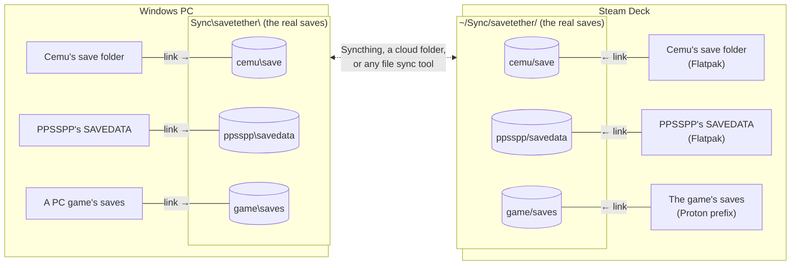
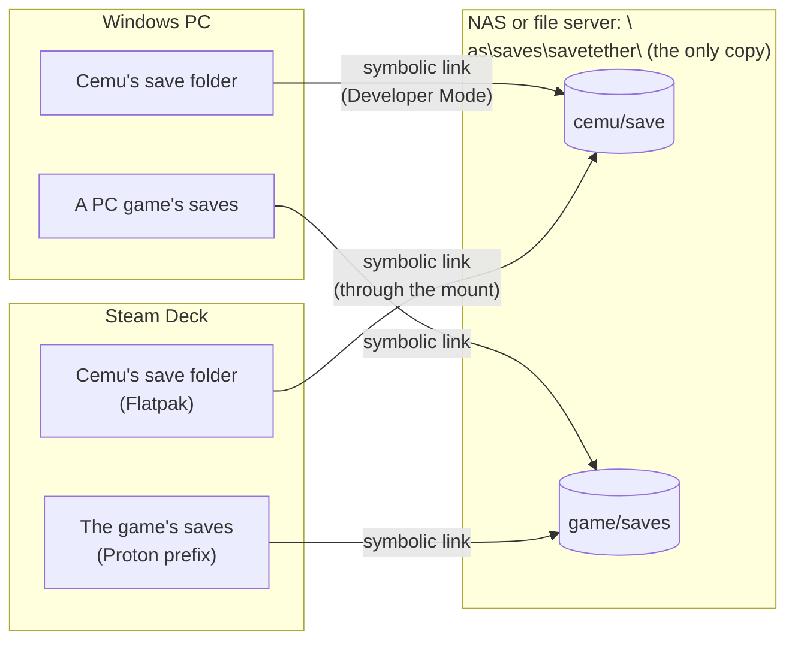

# Ways to share the folder

SaveTether moves save folders into one folder, the **sync root**, and leaves links in their place. It does not move that folder between machines; something else does. This page lists the ways that can be done, what each needs, and what has been tested.

Whatever the method, two things hold:

- **One machine plays at a time.** Let the copy reach the next machine before starting there. Nothing locks the saves across machines.
- **The links stay on each machine; only ordinary files are shared.** SaveTether puts no links inside the sync root, so any tool that copies files and folders will do. Deletions are shared too, which is why moving an app's folder with a tool that follows links can empty the shared copy everywhere (see [moving an app's folder](cli.md#workflows)).

| Method | Windows | Linux, Steam Deck | Offline play | Tested |
|---|---|---|---|---|
| [A sync tool on each machine](#a-sync-tool-on-each-machine) | Yes | Yes | Yes | Yes, with Syncthing |
| [A cloud storage folder](#a-cloud-storage-folder) | Yes | Where a client exists | Yes, if files are kept on the device | No |
| [A network share](#a-network-share) | Yes, with Developer Mode or an administrator terminal | Yes | No | Partly, Windows against a Samba share |
| [One machine, no sharing](#one-machine-no-sharing) | Yes | Yes | Yes | Yes |
| [A removable drive](#a-removable-drive) | Not advised | Not advised | n/a | No |

## A sync tool on each machine

Each machine keeps its own copy of the sync root on a local drive, and a sync tool such as [Syncthing](https://syncthing.net/) keeps the copies in step. This is what SaveTether was built and tested with: a Windows PC and a Steam Deck sharing through Syncthing, with a Linux box that receives only.

- Every machine can play offline; changes travel when the machines next see each other.
- The sync tool needs to deliver every file eventually. SaveTether checks before linking that the shared copy has arrived, and stops if it looks partial.
- Other tools that keep a folder in step between machines, such as Resilio Sync, work the same way, but have not been tried.

## A cloud storage folder

A folder managed by a cloud storage client (OneDrive, Dropbox, Nextcloud, Google Drive for desktop) is also a local copy kept in step, so it works the same way. It has not been tested.

- **Keep the files on the device.** Clients that keep files "online only" until opened (OneDrive's Files On-Demand, Dropbox's online-only files, Google Drive's streaming mode) would make a game wait for a download on every save, and make SaveTether's backups and comparisons download everything. Mark the sync root to be kept on the device: in OneDrive, "Always keep on this device".
- When two machines change a file before syncing, these clients keep both as a renamed "conflicted copy". SaveTether does not merge those; pick one by hand.
- On Linux, and the Steam Deck in particular, not every service has an official client.

## A network share

The sync root is a folder on a NAS or file server (SMB or NFS), and every machine works on it directly. Nothing is copied, so nothing can be out of step, but nothing works while the share is unreachable.

Compare the [sync tool picture](#a-sync-tool-on-each-machine): there each machine keeps its own copy and plays offline; here every link crosses the network to one copy.

**Not recommended.** If the share is disconnected, applications that write data there can fail or misbehave. A folder on each device, kept in step by a sync tool, is safer. SaveTether says so when a share is chosen (setup step 1, `init`), and goes on.

Whatever the system:

- **There is no offline play.** While the share is unreachable every link is broken: `status` reports `Broken` ("the sync root is not available"), the app's tray icon turns amber, and the apps cannot load or save. SaveTether touches no data while it is so; it works again when the share is back.
- **Two machines write one live copy.** There is no sync tool between them, so nothing keeps a copy per machine and nothing makes "conflicted copies": playing the same game on two machines at once can corrupt its saves. One machine plays at a time, as above.
- Emulators and games that hold a save file open across a network have not been tested.

**On Linux, including the Steam Deck,** a symbolic link can point into a mounted share. It has not been tested on hardware.

- Mount the share at the same path every time (an `fstab` entry or a systemd mount), before the apps start.
- A Flatpak app needs access to the mount path. `apply` offers to grant it, for that folder only.
- SaveTether does not detect a mount as a share, so it does not show the "not recommended" note there.

**On Windows,** the sync root can be a `\\server\share\...` path or a mapped drive letter (`Z:\`). A mapped letter is stored as the `\\server\share` path it points to, because a letter belongs to one sign-in and is not seen by a terminal opened as administrator; setup shows "Using `\\server\share` (the drive Z: points to)".

Windows links local folders with junctions, which cannot point to a share. For a share SaveTether makes symbolic links instead, and Windows lets a program make those only in one of two cases:

- **Developer Mode** is on: Settings, System, For developers. Once, and no prompts after. This is the simple way.
- Or the step that makes a link runs from a **terminal opened as administrator**: `savetether apply`, and `app add` or a recovery that makes a link again. Only making a link needs it; playing, Revert, backups and health checks do not, and the links stay.

SaveTether never asks for administrator rights itself and does not turn Developer Mode on. Setup checks that the share answers (within 5 seconds) and makes a test link; if it cannot, it refuses and names both ways, and **Check again** in the app tries again once one is done. `apply` checks again (`symlink-not-allowed` in `--json`). A policy can also stop Windows from following links to a share (`fsutil behavior query SymlinkEvaluation` shows "Local to remote"); SaveTether then refuses with that reason.

Only the sync root may be on a share. A save folder or the backup location on a network drive is still refused.

## One machine, no sharing

Nothing requires a second machine. With one, SaveTether gathers save folders that are spread across an app's install, a Wine prefix or a Flatpak sandbox into one place, where a backup tool can cover them in one rule. Set up with `init --create-root` and apply as usual. Adding a second machine later is the usual `init` there.

## A removable drive

Putting the sync root on a USB drive and carrying it between machines is not advised. Each machine's links point to the drive's path, so while it is unplugged every link is broken and the apps cannot load or save, and a drive letter or mount point that changes breaks them too. `status` reports it, but nothing can make the links work without the drive.

A removable drive is a better fit as the place a sync tool copies to, or as a backup location for the sync root.
